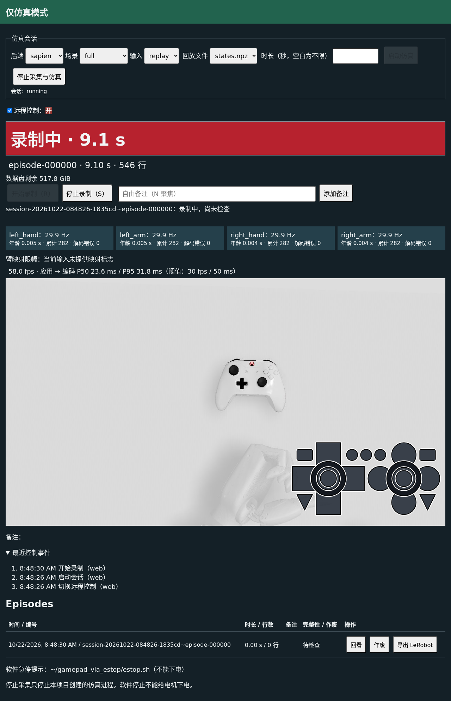
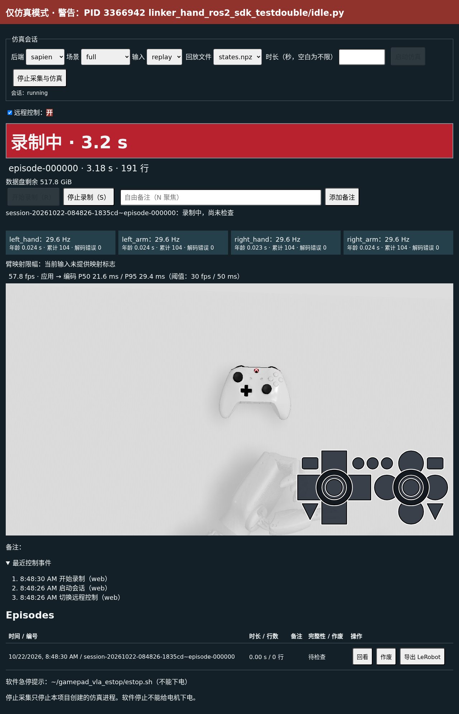

# 采集网页 v1、REST 控制与任务 N 验收

**N1 通过；裁决 4 后从新目录完整重跑的 N2 通过。未 commit。** 本报告的最终现场数据来自 `n-r4-n2-full-1`，此前失败、中断及诊断运行不计入验收。服务已退出，没有留下常驻进程。

## 审阅者裁决

- **裁决 1：REST 控制。** 常驻 `collection_server.py` 持有共享会话控制器；网页是 `/api/v1/*` 的客户端，CLI 仍兼容。只绑定回环地址。实现幂等停止、重复开始 409、ROS 健康前置检查与 force 元数据、JSON/客户端头/同源检查、审计和发起方记录。追加 SSE、最近十条控制事件；远程写默认关闭，每次重启复位，仅网页会话或现场显式启动参数可开启。文档以 Codex 为读者，由 AGENTS 链接，包含语音规则和三个全新只读情景问答。
- **裁决 2：独立数据环境。** 允许在安装根 `envs/data-tools-py310/` 安装仓库已有 data 依赖，版本与计算节点一致；不改 SAPIEN、系统 Python、conda base 或共享环境。导出解释器由 `.local/` 站点配置指定。
- **裁决 3：修复检测误报和查明性能回退。** 按 argv 程序身份、路径组成部分/ROS 包名前缀判断，排除 shell、搜索工具和终端沙箱；检测周期 1 s。真实形态 Python 替身阳性、shell 文本阴性先本地后上站。驱动无论成功失败均回收自有进程。干净状态先复测，仍慢则剖析修复，不降低分辨率或帧率、不改物理，随后全部重跑。
- **裁决 4：完整性绑定编号。** 页面与 status 明确所属 episode_id 和 pending/running/passed/failed；新段不沿用旧通过。停止后保存中→检查中→通过/失败。CLI 和驱动按 stop 返回的编号等待，None、旧编号和非终态继续等待，超时失败。连续两段回归后，全部 N2 从零重跑；此前 300 s 仅作参考。

其余范围、M1 隔离约束、不 commit 及每步最多三次修正继续有效。未实现动作提示、动作清单、关节条形图、接触/穿透告警、握持/误触监控或多视角。原失败报告及早期修正明细保留于 [previous-attempt.md](previous-attempt.md)，它不代表当前验收状态。

## 已核实现状与保护边界

HEAD 仍为 `bab0ccd`，交付是未提交工作树。已阅读项目约定、采集/M2 手册、M1 与 L 报告及指定采集源码。原网页只有单画面、实际手柄 overlay、开始/停止/备注和文字指令对比，启动依赖命令行。现将核心流程抽成 `CollectionController`，CLI 与服务共用；前端为原生 HTML/JS，后端 aiohttp，无 npm 构建链。

[M1 历史报告](../2026-10-22-station-install/README.md)已通过四路各 100 Hz 无损、原值一致，发布→应用 P50/P95 为 **3.5435/6.9580 ms**；SAPIEN 300 s **58.06 fps**，应用→编码 **23.7510/33.2875 ms**，当时 schema v3。这些是历史测量，本报告不改写 L1、L2、M1 结论。

新增渲染副本使用 v4.4 标定 `camera_3` ego、1280×720；实际信号 overlay 保留。两个物理后端、v4.4 配置、M1 ROS 验证器内容仍与基线相同，见 [保护文件核对](protected-files.json)。没有更改物理参数、映射数值、相机标定、渲染分辨率或目标 60 Hz 来通过门槛。M1 与本轮视角接入不同，性能对比是运行结果对比，不声称实验条件完全相同。

工作树另有并行的手柄高度工作（包括 `feasibility.py`）；本任务没有修改、回退或将其算作交付。部署不是纯净 HEAD。最终采集相关 **25 个文件**在本地与站上逐个一致，范围及摘要见 [R4-source-manifest.json](R4-source-manifest.json)。不将本轮验证扩大为对所有并行改动的验证。

## 实现及完整性编号修复

常驻服务提供 status、会话启动/停止、录制启动/停止、备注、episode 查询/回看/旁路作废/导出、SSE 及网页远程控制开关。网页所有控制均走 REST。随机网页 cookie 为 HttpOnly、SameSite=Strict；远程开关仅防误操作，不是安全边界。写响应附安全警告但不阻止仿真。每次 API 调用追加 `api_audit.jsonl`，meta 保存 started_by/stopped_by、forced 和开始时输入健康。

四路输入显示实测频率、年龄、接收数、解码错误；从未收到或超过 0.25 s 告警。臂启动姿态/绝对限位标志同时进入命令和逐帧记录。选择整数 **schema v4**，因为新增字段影响质量解释；继续读取 v2/v3。最终目标 replay 无法推断原始限幅，使用 null。未改变 ArmMapper 数值运算顺序。

大号状态、计时、行数、数据盘空间、R/S/N 快捷键、30 fps/50 ms 推流阈值、10 GiB 空间阈值均已实现。停止采集只处理本项目启动的进程；不调用页面提示的 `~/gamepad_vla_estop/estop.sh`，并注明它不能下电。没有硬件启动或下电能力。

裁决 4 的关键修复如下：

1. `status.integrity`、逐段查询和 `integrity.json` 均携带完整 episode_id 与状态。新段立即设为自身 pending，旧 last_saved 仅为历史。检查进程写 running，再原子替换为终态。
2. 页面显示所属编号，保存中与检查中分开；不能把上一段的通过放在新段当前结果中。录制尚未检查时也明确标注。
3. `record-stop --wait` 保存停止返回的编号，只接受该段 passed/failed；None、旧编号、pending/running 继续等。同段 status 尚在检查时也继续等。超时退出 1，失败保留原始数据。
4. 网页验收驱动同样从停止响应取得编号，等待 DOM 的 data-episode-id、data-state 对应本段终态，不能仅等“通过”文字。

严格检查独立接收边界计数与指令日志数量、连续序号、严格读回、行数/时长和时间边界；由自有 CPU 子进程执行。作废仅写旁路 `discarded.json`，不改原数据。截断、损坏、序号跳跃、数量及时间不符均有拒绝阳性测试。

## 安全检测：事实、对照和修复

旧实现扫描整条命令行，终端沙箱 shell 的检查文本被误判，属于已确认实现缺陷。新规则集中在 `hardware_process_identity()`：Python 取脚本或 -m 模块，ros2 run/launch 取包名，其他入口取可执行路径；只匹配组成部分或包名以 `linker_hand_ros2_sdk`、`rokae_` 开头。shell、grep/rg、终端沙箱包装器不因参数文本命中。构造 argv 单测覆盖 Python、模块、ros2 run/launch、直接入口以及阴性反例，周期改为 **1 s**。

真实对照先本地、再采集台执行：在 SDK 前缀目录内运行只 sleep 的 Python 脚本应变红；`bash -c 'sleep 600 # rokae_ linker_hand_ros2_sdk'` 应保持正常。两地均通过。独立手动扫描恢复时间分别 **0.0016/0.0130 s**，仅说明扫描结果；最终 N2 经周期检测到网页恢复为 **0.8952 s**，满足 1 s 检测周期加 1 s 的要求。

现场既有阴性证据为“终端沙箱 shell”和“shell”两类程序，修复后不再被匹配；没有贴出其命令行，也没有终止这些外部进程。检测只读 `/proc`，从未启动或结束硬件节点。

## 推流回退：已执行的区分实验

假设“遗留重复会话是全部原因”：先确认本任务/CUDA 计算进程为空、显存 356 MiB，再用 1 s 扫描、无录制的干净会话测量。**60 s 仍只有 33.9 fps**，推翻“清理即可恢复”的解释；不能将恢复归功于遗留进程清理。

随后细分状态同步、渲染、GPU 读回、RGB 转换和 JPEG，并用 stdlib cProfile。服务端约 **67.49/69.49 s** 在 epoll 等待，状态同步 P50 约 0.114 ms；没有证据表明 SSE/健康统计是主要瓶颈。无录制阶段没有完整性检查进程竞争。GPU 读回和非连续 RGB 切片的 CPU 转换占主要帧时间。

| 实验 | 窗口 / fps | RGB 转换 P50 | 读回 P50 | 应用→编码 P50/P95 |
|---|---:|---:|---:|---:|
| 干净状态、原转换 | 60 s / 33.90 | 尚未细分 | 尚未细分 | 42.14/50.54 ms |
| 原转换细分 | 30 s / 32.17 | 11.866 ms | 17.402 ms | 43.76/52.39 ms |
| 连续 RGB 转换后 | 45 s / 57.96 | 1.948 ms | 9.229 ms | 26.43/33.23 ms |

固定同一 720×1280×4 float32 CPU 数组对照：原表达式 **9.457 ms**，新实现 **1.098 ms**，逐字节一致。修复先用已有 OpenCV 拷贝为连续 RGB，再保持原 NumPy clip、乘 255、rint、uint8 的值和顺序，不改变图像内容。最终运行前三个实际 GPU 帧与旧表达式逐字节比较均为 true；额外比较发生在 300 s 验收窗口前。

这支持“CPU 转换是可复现且可修复的瓶颈”。读回同时变快是实测事实，但未独立控制 GPU 时钟/调度，不能把所有读回差值归因于某个唯一机制。阶段数据及对照见 [R3-diagnosis.json](R3-diagnosis.json)。三个诊断运行均主动注入异常测试 finally，浏览器/自有进程组残留为 0，未再发生 Event loop is closed。

## N1：功能与回归验证

早期完整 N1 见 [N1.json](N1.json)：计算节点 CPU MuJoCo 浏览器及只用 CLI 的完整循环均通过，网页 JS 错误 0；六份导出 Parquet 共六个 episode 逐一与源行数一致，见 [export-readback.json](export-readback.json)。没有使用计算节点上的忙 GPU。

| 最终验证 | 结果 |
|---|---|
| 采集台全部单元测试 | **173 通过、4 跳过、0 失败**，0.96 s |
| 本地全部单元测试 | **178 通过、7 跳过、0 失败**，1.37 s |
| 连续两段真实网页/API/CLI 回归 | 每段检查人为延迟 2 s；当前段 pending/running 时不误报通过；JS 错误 **0** |
| API 契约 | 各端点、幂等、409/403、同源/跨源/缺头、开关默认关闭/网页开启/远程拒绝开启/重启复位、审计、force meta 通过 |
| 数据质量 | v4 写读及旧 v2/v3、限幅、损坏/截断阳性拒绝、作废前后原始文件不变通过 |
| N1 跨客户端 DOM | 20 样本，同后端确认的保守上界 P50/P95 **33.25/65.12 ms**，最大 68.90 ms |
| 全新只读 Codex | **3/3** 情景符合规则；[问答原文](codex-qna.md) |

站上四项跳过为缺少 gymnasium、torch、resnake_gym，以及未显式启用的单元真实 ROS 用例；本轮真实 ROS 60 s 已在 N2 独立执行。本地另缺 aiohttp、cv2、trimesh 等，不能用本地跳过声称 API 已测；API 和 RGB 数值测试在站上实际执行。三个 aiohttp 字符串 Request key 建议为警告，无测试失败。受控两段回归见 [R4-regression.json](R4-regression.json)。

N1 曾错误把 SSH 建连算入更新延迟，随后使用固定跨机偏移也不成立；无效口径保留在历史报告，未作合格数据。最终 N1 采用同后端控制执行至 DOM 确认请求的保守上界；本次 N2 则在台上浏览器发起本机 CLI 前用 performance.now 计时至 MutationObserver，包含 CLI 启动/本机请求开销，不包含 SSH 建连。

## N2：裁决 4 后完整重跑

新目录 `~/gamepad_vla/runs/n-r4-n2-full-1/`，浏览器访问本机 localhost，SAPIEN、full 场景、既有 replay。GPU 准入 **356 MiB/7%**，无 CUDA 计算任务；桌面图形进程允许共存。默认关闭远程写时 CLI 返回 403，再由无头浏览器操作网页开关。

| 门槛 | 最终结果 |
|---|---|
| 连续推流 | **300 s，17395 编码帧，57.9833 fps**；逐秒最低 **57 fps** |
| 应用→编码 | P50 **26.1869 ms**，P95 **33.1224 ms**，分母 17395 帧 |
| episode 000000 | **9253 行 /154.216 s**，严格检查三项全通过 |
| episode 000001 | **8941 行 /149.016 s**，严格检查三项全通过 |
| 网页开着时 CLI 开始/停止 | 20 样本，DOM P50 **87.10 ms**、P95 **95.595 ms**、最大 **97.40 ms**；≤0.5 s |
| 新页面 JS 错误 | **0** |
| ROS 60 s | 四路各 **6000/6000**，共 **24000/24000**，float64 原值逐字节及消息头一致、无重排、时间戳单调 |
| 四路健康频率误差 | 各 1088 样本，最大相对偏差 **0.77282%**，小于 5%；解码错误 **0** |
| 停掉左手一路 | **0.2513 s** 后采样到告警，消息年龄 **0.2579 s**，DOM 已显示告警；其余三路继续发布 |
| ROS 录制拒绝 | record-start 返回 **409/input_unhealthy**，明确指出 **left_hand** |
| 本地经远程 shell，仅 CLI 完整循环 | 启动→录制→停止等待本段通过→列表→作废→导出→停止会话完成；录制 **125 行/2.083 s** |
| 采集台实际导出与读回 | 两份 Parquet **125/20 行**，与各自源 meta 一致；调用既有导出工具 |
| 安全阳性/阴性/恢复 | 全通过；替身退出至网页恢复 **0.8952 s** |
| 结束清理 | 自有进程组 **0**、域 87 测试进程 **0**、CUDA 计算进程 **0**；显存回到 **356 MiB** |

完整指标、全部 20 个 DOM 样本、逐段带编号的检查结果及清理见 [R4-N2.json](R4-N2.json)。两段的完整编号是 `session-20261022-084826-1835cd~episode-000000/000001`，没有复用旧报告的数据或结果。编码窗口含 **17394** 个不同物理状态（17395 帧里有一帧同状态），没有丢掉重复帧以美化延迟；这里测的是服务编码推流，不冒称逐帧浏览器显示刷新率。

ROS 仅在 **ROS_DOMAIN_ID=87**、localhost DDS、`/gamepad_vla_test/regression/` 合成话题运行。正式发布 6000 条/路的全样本是原值一致分母；journal 共 **24117** 条，额外 117 条为热身/补充流量，不混入正式分母。频率测量预先使用开始后 2–59 s 的窗口。ROS episode 为 **3622 行/60.366 s**、schema v4，独立接收计数与日志、序号及行时关系全部通过。发布→应用仅对首次应用样本统计，**14400** 个样本 P50/P95 **3.7389/10.2991 ms**；不能用控制帧数替代输入条数。

### 与 M1-b/M1-c 比较

| 指标 | M1 历史 | 本次 N2 |
|---|---:|---:|
| 300 s 推流 | 58.06 fps | 57.9833 fps |
| 应用→编码 P50/P95 | 23.7510/33.2875 ms | 26.1869/33.1224 ms |
| 四路正式输入 | 24000/24000 原值一致 | 24000/24000 原值一致 |
| 发布→应用 P50/P95 | 3.5435/6.9580 ms | 3.7389/10.2991 ms |

推流已恢复到约 58 fps，P95 小于页面 50 ms 阈值。输入无损及原值一致没有退化；发布→应用 P95 比历史高约 3.34 ms，应如实保留，仍通过继承的 M1-c P95≤25 ms 判据，不将其描述成“延迟完全不变”。仿真、合成输入、导出检查不证明实物操作成功，也不取代 M2 现场硬件联调。Parquet 逐行数读回没有扩大为 LeRobot 原生完整数据集加载验收。

## 两张最终网页截图

以下均来自本次新运行的实际浏览器，主画面和实际信号 overlay 可见；页面只显示匹配身份末尾组成部分，无私有主机、用户名、地址或路径前缀。不使用旧失败图，也未制作模拟成功画面。

正常录制中（绿色仅仿真横幅、当前段尚未检查）：



Python 替身阳性（红色安全横幅，匹配 SDK 测试目录内的 idle.py）：



旧失败的私有诊断截图仍只在 `.local/`，未放入公开树。

## 环境、操作文档及原始证据

入口与每个端点、退出码、语音规则见 [给 Codex 的 API 文档](../../usage/collection-api.md)；助手操作与 M2 边界见 [采集手册](../../usage/collection.md)。现有环境版本见 [environment.json](environment.json)：Python 3.10.12、SAPIEN 3.0.3、aiohttp 3.14.5；本次续做未安装新依赖。

裁决 2 已授权的数据环境为 numpy 2.2.6、PyArrow 25.0.1，与计算节点一致，约束在 `constraints/data-py310.txt`。此前实际安装命令如下；未改变其他环境：

```bash
/usr/bin/python3 -m venv ~/gamepad_vla/envs/data-tools-py310
~/gamepad_vla/envs/data-tools-py310/bin/python -m pip install \
  --index-url https://mirror.sjtu.edu.cn/pypi/web/simple \
  numpy==2.2.6 pyarrow==25.0.1
env -u PYTHONPATH ~/gamepad_vla/envs/data-tools-py310/bin/python -m pip freeze \
  > ~/gamepad_vla/logs/n-data-freeze.txt
```

安装日志 `~/gamepad_vla/logs/n-data-install.log`；导出解释器在私有 `.local/station.json` 的 `collection.export_python`，代码未写死。台上已真实导出，不再只是依赖 import 检查。

原始结果在安装根 `runs/n-r4-n2-full-1/`：result/summary、replay-samples、ros-samples、published、frames、remote-cli 各步响应及 audit；episode 数据在该目录的 sessions。台上最终测试日志为 `logs/n-r4-tests-final.log`，两段网页回归为 `logs/n-r4-episode-ui.json`。具体远程连接与安装路径配置只在忽略的 `.local/collection-web/station-control.md`，公开文档不列主机和用户。

启动时确认并清理了此前本任务遗留的 N1 会话/多进程子进程；此前中断运行另按持有 PID 与启动时间清理 12 个自有进程。最终驱动有内层浏览器 finally 和独立外层进程组 finally，并将 SIGINT/SIGTERM 引入清理路径；只处理自己创建的进程。结束后再次独立查验本任务和域 87 进程均空，显存 **356→356 MiB**；利用率结束采样 5%、复查 9%，均无 CUDA 计算进程，不把桌面利用率波动解释为残留。计算节点此前自有服务/浏览器也已关闭。

所有站上写入均限安装根和允许数据根，包括缓存/临时文件。不访问 CAN、串口、USB，不启动手套、重定向、LinkerTA、SDK 或珞石节点。未执行训练或修改兄弟仓库。

## 修正预算、尝试和源码一致性

| 轮次 | 处理及结局 |
|---|---|
| 裁决 3 第 1 次 | 按程序身份检测、1 s 扫描、正反对照、异常清理及单测 |
| 裁决 3 第 2 次 | 剖析后只修连续 RGB 转换，字节对照和约 58 fps 复测通过 |
| 裁决 3 第 3 次 | 第一轮完整运行过了 300 s，但驱动拿到第二段 integrity=None，暴露旧通过误用；仅改驱动等待后续被裁决 4 指出产品仍需修复 |
| 裁决 3 第二个完整运行 | 收到新裁决后中断并清理；不计任何验收结果 |
| 裁决 4 第 1 次 | 页面/status/sidecar/CLI/驱动统一按段编号等待；两段延迟回归；从新目录完整重跑，最终 N2 通过 |

此前已停止报告的原始 N2 失败仍见 [N2-failed.json](N2-failed.json)。诊断注入异常不是门槛通过；旧 300 s、被中断的数据也没有移入本次窗口。每步未超过三次修正，无失败后的未授权无限重试。

裁决 4 同轮补充了 CLI 一致性：该段 sidecar 已终态但 status 仍 pending/running 时继续等待。同步时本次 20 个本机 CLI DOM 样本已完成，因此这些样本对应补充前“正确编号的终态”实现；后续独立远程 CLI 完整循环、ROS 阶段和最终 173 项站上测试使用补充后的最终客户端。服务、网页、物理和渲染测量代码在这个补充中均未变。没有将所有阶段描述成完全静态的同一源码快照；逐文件最终清单已提供。

## 我自行做出的未授权选择

以下是用户未逐项指定、由我在授权范围内自行决定且未另征求确认的选择：schema 取整数 v4；SSE 50 ms、控制器约 100 ms 的实测快照；输入频率 2 s 和推流性能 10 s 窗口；R/S/N 快捷键；以会话名和段编号组合 ID；旁路文件名 `discarded.json`、`integrity.json`；独立 CPU 检查进程与原子结果替换；短回看等待首帧及发送窗口；N1 CPU free-space 中性回放；独立渲染副本接入已有标定相机；图像转连续内存及分阶段计时；安全横幅仅显示身份末尾避免泄漏私有前缀；诊断用 cProfile、主动异常和真实帧字节对照；DOM 采用包含本机 CLI 开销的计时。

这些是实现/验证选择，不是新增硬件、物理、训练或界面功能授权。独立依赖安装、身份检测规则及编号绑定分别来自裁决 2/3/4 的明确授权。旧全命令行匹配的错误与两次不合格 N2 记录均保留，没有用门槛调整掩盖。
