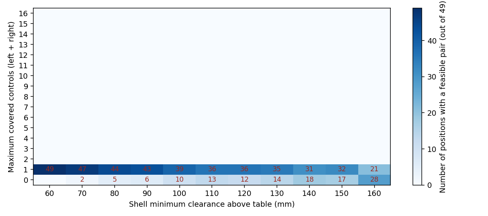
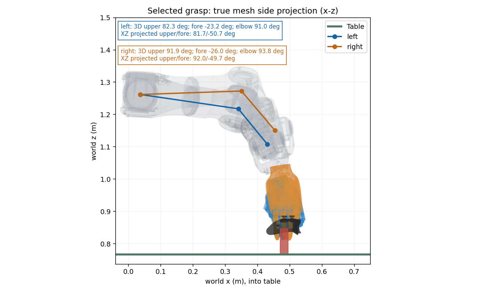
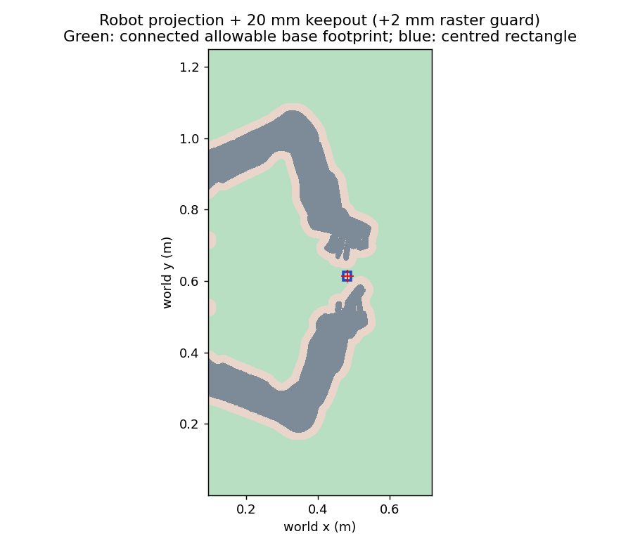
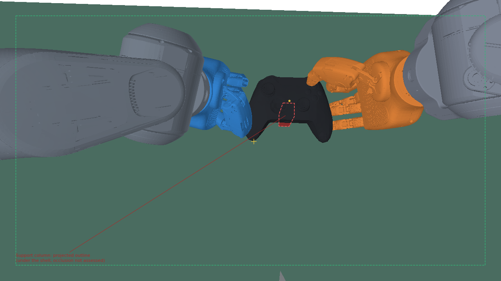

# K1-a：手柄位置、高度与自然握持姿态联合扫描

> 2026-10-23 注：仓库中的 `configs/workcell/station_g20_v4_5.json` 现指臂安装朝向修正版场景，与本研究生成的同名候选无关；本研究的候选配置已删除。


> **状态（2026-10-22）：审阅后不采纳，被 [K1-b](../2026-10-22-natural-grip/README.md) 取代。** 侧视图上臂几乎水平（约82–92°）、前臂下扎（约−25°），手竖直、手指朝下，自上方抓住手柄；自然偏差约4.8–5.9且随高度增大。审阅者给出的根因是K0相对握持候选均为自上而下的手型，有限腕部活动范围使固定手型不能获得所需自然臂姿；60 mm仅是所有候选不合格时的最小偏差回退。K1-b改从自然臂姿和人类式握持种子联合优化。左右FK参考净空209.99/175.51 mm保留作复核。本正文和图保留为负结果；旧v4.5见[历史配置快照](../2026-10-22-natural-grip/rejected-k1a-v4_5.json)。K1-b现已按用户决定停止，公共v4.5配置已删除，摆放由审阅者另行确定；下文历史推荐不再有效。

**推荐候选 v4.5：外壳最低点距桌面 60 mm；手柄 root 距桌面 89.86 mm，world root=(0.482493, 0.613669, 0.856859) m；支柱净高 79.12 mm，细截面20×24 mm。** 这是当前有限静态搜索中 `right:Y` 档位的候选，左右合计覆盖 **1/16** 项；539个摆放的完整全控件双手掌位对均为0，不能作为全手柄操作或最终制造证书。

**自然姿态不可同时满足。** 最佳覆盖档位内没有双臂同时通过自然硬条件的摆放；按用户指定回退选择最小自然偏差，不把回退解标成自然合格。 所选最大归一化自然偏差为 **4.790**（合格须≤1且肘在肩的+x侧）。

- 通过最佳覆盖、30 mm桌面净空、相机及自然硬筛的可接受高度：**无**。
- 仅通过最佳覆盖及几何/相机门槛的高度：60–160 mm（离散步长10 mm）；这些高度均不能升级为自然合格区间。
- 位置：手柄几何中心像素为 (739.17, 258.28)，距标定主点偏差 138.34 px；相机门槛最小余量 193.35 px（要求≥40 px）。腕部偏差在画面中心之前排序，因此没有另行越过已授权顺序去强行选正中心。
- 实物支架：柱顶接触局部点 (-0.243, -0.443, -10.741) mm；world接触点 (0.482050, 0.613912, 0.846118) m。柱体world中心姿态位置 (0.482493, 0.613669, 0.806559) m，yaw −90°。柱顶向下至少 **46.52 mm** 保持细截面，细段底面 world z=0.799596 m；以下最多有 32.60 mm 可考虑加宽。两握把背面 |x|>25 mm、肩键/扳机上缘及运动通道必须悬空。

左臂自然参考净空 209.99 mm，稳定性上限为160 mm。 右臂自然参考净空 175.51 mm，稳定性上限为160 mm。

底座方面，本次保守投影允许的居中矩形仅22×24 mm，不能完整覆盖world 24×20 mm柱脚，尚未得到可直接制造的居中加宽方案；固定方式仍需决定。

## 需要用户决定的事项

1. 是否接受这个“1/16静态覆盖”的审阅候选继续作为试验起点；目前自然姿态硬条件不合格，应决定保持160 mm稳定性上限，还是另行改变安装/握姿设计；本次没有放宽。
2. 全控件内部瓶颈下一步怎样处理：继续扩大接触斑/有指导握姿搜索，还是另行讨论掌位模式等约束变化。没有自行改手指分工、松开握持、训练BC/DAgger或宣称高度已解决瓶颈。
3. 打印材料、壁厚/加强筋、固定和夹紧方式、底座紧固、实际载荷及安装偏移的测量。20×24 mm只规定顶部碰撞包络，尚无强度或抗倾覆证书；左右手mount仍为未验证实物安装。
4. 是否采用v4.5、是否切换采集默认场景，均由用户决定。本次只生成配置；没有切换、连接采集台或发送硬件命令。

## 审阅者裁决

完整逐条记录见[decisions.md](decisions.md)。裁决1覆盖原“固定xy、柱顶40–300 mm”的扫描，改为壳底60–160 mm、10 mm步长、光轴交点附近7×7位置和30 mm完整网格桌面净空；160 mm硬上限不扩展。裁决2增加FK参考高度、自然IK偏好与无自然解时的最小偏差回退；裁决3取代其姿态数值，改为上臂20°目标/10°–35°、前臂+10°目标/−10°–25°、朝向≤30°，肘角只报告，腕部中立为软偏好。

最终排序：完整覆盖对数（全零时改为左右覆盖数之和）→自然硬筛或最小偏差回退→最低高度→腕部偏差→画面中心→最小视野余量。自然筛选只在最佳覆盖档位内进行，不以低覆盖自然解替代高覆盖档位。每个固定掌位的冗余IK先按自然偏差选合格解，再比较不同掌位对。

## 已核实的基础几何

v4.4桌面顶面world z=**767 mm**；root z=**797.9 mm**，距桌面**30.9 mm**（约31 mm），正面朝上、yaw −90°。v4.4 root xy=(473.415,625.200) mm；K0方向键任务的xy=(501.415,647.867) mm，二者不能混用。新裁决允许本次重新搜索xy。

臂基座轴线距桌面**495 mm**。ego `camera_3` 沿用2026-10-20标定，光心距桌面 **677.846 mm**，world光轴 (0.177952, -0.013565, -0.983946)；fx=906.561、fy=905.986，1280×720，视场约 **70.44°×43.34°**。没有为改善结果移动相机。数值见[geometry-validation.json](geometry-validation.json)。

外壳最低局部z=-29.858977 mm；故本次root高度=壳底净空+29.858977 mm，支柱净高=壳底净空+19.118184 mm。K0的raise40指root相对旧摆放抬高40 mm，其柱顶净高约60.16 mm，不是本次“40 mm柱高”或“60 mm壳底净空”。

## 相对候选与高度无关的瓶颈

每侧分母4096掌位；背壳两指点IK成立左2487、右2463。整手—手柄原生接触和碰撞筛选后，左 **10**、右 **5** 个纯握持掌位，保存静止变体分别52和30个；所有数量按掌位去重。

- 左手：四向Dpad、LS、L3、LB、LT共8项，本轮完整原生目标接触覆盖均为0。
- 右手：ABXY、RS、R3、RB、RT共8项，只有Y在1个相对掌位通过，其余为0。
- View、Menu、Xbox排除；Pair没有分配，不计入这16项。

因此高度/位置变化能改变环境、臂和相机条件，不能把这批候选的内部静态覆盖上限从1变为16。有限搜索失败不是全局不可达证明。相对汇总和原参数见[relative-summary.json](relative-summary.json)。

## 可检验的解释与尚未执行的对照

| 命题或原因假设 | 对照、测量与支持/推翻条件 | 是否已执行 |
|---|---|---|
| 这批相对候选的内部覆盖瓶颈不能仅靠整体移动修复 | 固定掌位、关节和目标，整体施加相同世界刚体变换；测手—手柄接触/穿透及控件覆盖。刚体变换保距，世界层只应增加环境拒绝，不能创造相对层没有的覆盖 | 已执行相对层原生检查、世界分层及最终新场景重放；结论仅针对这批样本 |
| 无自然解可能来自六初值未找到更好的冗余支路 | 固定所选掌位、位置、所有接触/碰撞/相机门槛；A为原六初值，B仅增加冗余初值或做保持末端精度的自然偏差优化。测最佳自然偏差、合格解数及IK残差；B出现合格解支持搜索不足，B仍失败也不构成全局不可达证明 | 未执行；本次不因零结果无限追加搜索或放宽容差 |
| 安装高度/方向与握姿要求存在几何冲突 | 固定相对样本和随机初值，对照中只改仿真假想安装高度或经测量的mount参数，重算参考高度和自然偏差。若可行区随该单因素系统变化，支持安装敏感性；若不变，则不能把失败归咎于它 | 未执行；当前实物mount未验证，不把该解释写成已确认原因，也未改base/mount配置 |

没有把原审阅者“约200 mm可能出画”的粗估当成真实网格测量结果：本次硬范围止于160 mm，报告只给实际范围内的投影证据。

## 高度扫描表

共11个高度×49个位置=**539个摆放**。下表的30 mm候选是该高度全部49个位置的单侧唯一掌位数之和，分母左490、右245；“双手对·摆放”也是49个位置的合计，同一左右掌位在不同位置可重复计数，不能视为独立握姿数。每个高度的最佳摆放采用同一优先顺序；档位为左右最大合计控件数。

| 壳底净空 mm | 最佳覆盖档位 | 全控件对·摆放 | 30 mm候选 左/右 | 双手对·摆放 | 最佳位置中心偏差 px | 自然偏差 | 视野余量 px |
|---:|---:|---:|---:|---:|---:|---:|---:|
| 60 | 1/16 | 0 | 340/138 | 934 | 138.34 | 4.790 | 193.35 |
| 70 | 1/16 | 0 | 329/177 | 1163 | 140.68 | 4.908 | 190.44 |
| 80 | 1/16 | 0 | 346/179 | 1224 | 143.11 | 5.025 | 184.34 |
| 90 | 1/16 | 0 | 344/175 | 1190 | 145.62 | 5.141 | 172.87 |
| 100 | 1/16 | 0 | 338/165 | 1102 | 148.22 | 5.256 | 160.80 |
| 110 | 1/16 | 0 | 341/167 | 1095 | 150.92 | 5.370 | 148.07 |
| 120 | 1/16 | 0 | 331/153 | 936 | 153.71 | 5.483 | 134.64 |
| 130 | 1/16 | 0 | 335/150 | 907 | 156.61 | 5.596 | 120.44 |
| 140 | 1/16 | 0 | 326/159 | 882 | 159.63 | 5.708 | 105.40 |
| 150 | 1/16 | 0 | 333/149 | 809 | 162.76 | 5.820 | 89.45 |
| 160 | 1/16 | 0 | 327/141 | 706 | 166.02 | 5.932 | 72.50 |

下表角度单位均为度，来自上述每高度最佳摆放；前倾是**三维离竖直角**，不是xz投影角。肘角为内角，只报告；腕偏差只作软排序。

| 净空 mm | 左前倾 | 左俯仰 | 左朝向 | 左肘角 | 左腕偏差 | 右前倾 | 右俯仰 | 右朝向 | 右肘角 | 右腕偏差 |
|---:|---:|---:|---:|---:|---:|---:|---:|---:|---:|---:|
| 60 | 82.3 | -23.2 | 0.6 | 91.0 | 56.5 | 91.9 | -26.0 | 3.1 | 93.8 | 58.1 |
| 70 | 89.6 | -30.6 | 1.1 | 89.7 | 49.8 | 93.6 | -26.1 | 3.0 | 92.7 | 58.1 |
| 80 | 86.2 | -23.8 | 1.1 | 88.4 | 56.3 | 95.4 | -26.1 | 2.9 | 91.7 | 58.1 |
| 90 | 87.9 | -17.1 | 8.1 | 71.7 | 55.1 | 97.1 | -26.1 | 2.8 | 90.7 | 58.1 |
| 100 | 91.3 | -19.3 | 8.4 | 70.7 | 53.1 | 98.8 | -26.1 | 2.8 | 89.7 | 58.1 |
| 110 | 94.3 | -27.5 | 1.6 | 84.8 | 53.0 | 100.5 | -26.0 | 2.8 | 88.9 | 58.2 |
| 120 | 92.9 | -17.0 | 8.5 | 68.9 | 55.4 | 102.2 | -25.9 | 2.8 | 88.1 | 58.2 |
| 130 | 95.1 | -31.4 | 21.6 | 55.0 | 39.8 | 103.9 | -25.8 | 2.9 | 87.4 | 58.3 |
| 140 | 98.2 | -19.2 | 8.7 | 67.3 | 53.3 | 105.6 | -25.7 | 2.9 | 86.7 | 58.4 |
| 150 | 97.9 | -16.7 | 8.6 | 66.7 | 55.6 | 107.3 | -25.6 | 3.0 | 86.1 | 58.6 |
| 160 | 100.4 | -24.2 | 1.8 | 80.1 | 56.3 | 109.0 | -25.4 | 3.1 | 85.5 | 58.7 |



### 每高度最佳位置的逐控件计数

下表仍按单侧唯一掌位计数，已经过臂、环境、30 mm和单侧相机门槛；双手操作覆盖还需配对复核，不能把单侧相加当作完整证书。

| 净空 mm | 手侧 | 各控件候选数 |
|---:|---|---|
| 60 | 左 | Dpad_up=0；Dpad_down=0；Dpad_left=0；Dpad_right=0；LS=0；L3=0；LB=0；LT=0 |
| 60 | 右 | A=0；B=0；X=0；Y=1；RS=0；R3=0；RB=0；RT=0 |
| 70 | 左 | Dpad_up=0；Dpad_down=0；Dpad_left=0；Dpad_right=0；LS=0；L3=0；LB=0；LT=0 |
| 70 | 右 | A=0；B=0；X=0；Y=1；RS=0；R3=0；RB=0；RT=0 |
| 80 | 左 | Dpad_up=0；Dpad_down=0；Dpad_left=0；Dpad_right=0；LS=0；L3=0；LB=0；LT=0 |
| 80 | 右 | A=0；B=0；X=0；Y=1；RS=0；R3=0；RB=0；RT=0 |
| 90 | 左 | Dpad_up=0；Dpad_down=0；Dpad_left=0；Dpad_right=0；LS=0；L3=0；LB=0；LT=0 |
| 90 | 右 | A=0；B=0；X=0；Y=1；RS=0；R3=0；RB=0；RT=0 |
| 100 | 左 | Dpad_up=0；Dpad_down=0；Dpad_left=0；Dpad_right=0；LS=0；L3=0；LB=0；LT=0 |
| 100 | 右 | A=0；B=0；X=0；Y=1；RS=0；R3=0；RB=0；RT=0 |
| 110 | 左 | Dpad_up=0；Dpad_down=0；Dpad_left=0；Dpad_right=0；LS=0；L3=0；LB=0；LT=0 |
| 110 | 右 | A=0；B=0；X=0；Y=1；RS=0；R3=0；RB=0；RT=0 |
| 120 | 左 | Dpad_up=0；Dpad_down=0；Dpad_left=0；Dpad_right=0；LS=0；L3=0；LB=0；LT=0 |
| 120 | 右 | A=0；B=0；X=0；Y=1；RS=0；R3=0；RB=0；RT=0 |
| 130 | 左 | Dpad_up=0；Dpad_down=0；Dpad_left=0；Dpad_right=0；LS=0；L3=0；LB=0；LT=0 |
| 130 | 右 | A=0；B=0；X=0；Y=1；RS=0；R3=0；RB=0；RT=0 |
| 140 | 左 | Dpad_up=0；Dpad_down=0；Dpad_left=0；Dpad_right=0；LS=0；L3=0；LB=0；LT=0 |
| 140 | 右 | A=0；B=0；X=0；Y=1；RS=0；R3=0；RB=0；RT=0 |
| 150 | 左 | Dpad_up=0；Dpad_down=0；Dpad_left=0；Dpad_right=0；LS=0；L3=0；LB=0；LT=0 |
| 150 | 右 | A=0；B=0；X=0；Y=1；RS=0；R3=0；RB=0；RT=0 |
| 160 | 左 | Dpad_up=0；Dpad_down=0；Dpad_left=0；Dpad_right=0；LS=0；L3=0；LB=0；LT=0 |
| 160 | 右 | A=0；B=0；X=0；Y=1；RS=0；R3=0；RB=0；RT=0 |

### 未通过原因分布

以下为全部49位置的单侧掌位拒绝数量：先判臂IK，之后若所有静止变体都失败，记该掌位变体中最常见的失败原因，每掌位只计一次。`table_clearance_30mm`为完整网格距桌面不足30 mm；`camera_border`为网格/指尖/掌根边缘余量不足40 px；`camera_distance`为表面质心距光心不足0.30 m；其余碰撞按实际几何分类。点IK/手柄内部失败在相对层另计，不重复混进世界层分母。

| 净空 mm | 手侧 | 拒绝分布 |
|---:|---|---|
| 60 | 左 | arm_ik=150；camera_border=7 |
| 60 | 右 | arm_ik=61；table_clearance_30mm=46 |
| 70 | 左 | arm_ik=161；camera_border=7 |
| 70 | 右 | arm_ik=66；arm_or_cross_robot_collision=2 |
| 80 | 左 | arm_ik=144；camera_border=10 |
| 80 | 右 | arm_ik=64；arm_or_cross_robot_collision=2 |
| 90 | 左 | arm_ik=146；camera_border=11 |
| 90 | 右 | arm_ik=68；arm_or_cross_robot_collision=2 |
| 100 | 左 | arm_ik=152；camera_border=10 |
| 100 | 右 | arm_ik=78；arm_or_cross_robot_collision=2 |
| 110 | 左 | arm_ik=149；camera_border=16 |
| 110 | 右 | arm_ik=76；arm_or_cross_robot_collision=3；camera_border=2 |
| 120 | 左 | arm_ik=159；camera_border=21 |
| 120 | 右 | arm_ik=89；arm_or_cross_robot_collision=3；camera_border=6 |
| 130 | 左 | arm_ik=155；camera_border=33 |
| 130 | 右 | arm_ik=93；arm_or_cross_robot_collision=2；camera_border=3 |
| 140 | 左 | arm_ik=164；camera_border=40 |
| 140 | 右 | arm_ik=84；arm_or_cross_robot_collision=5；camera_border=9 |
| 150 | 左 | arm_ik=157；camera_border=51 |
| 150 | 右 | arm_ik=96；arm_or_cross_robot_collision=2；camera_border=10 |
| 160 | 左 | arm_ik=163；camera_border=58 |
| 160 | 右 | arm_ik=104；arm_or_cross_robot_collision=3；camera_border=12 |

配对层另检查手—手、交叉手—臂、臂—臂。静态掌根组合50对中3对原生几何距离为负，强制排除；不是以“自动contact表为空”视为通过。各位置完整`pair_rejections`、自然条件和控件数量均见[scan.json](scan.json)。配对拒绝分布按实际静止变体/IK尝试计数，与上表唯一掌位分母不同。

## 推荐姿态、FK参考高度与自然条件

- 左臂：前倾 82.35°，俯仰 -23.22°，朝向偏差 0.57°，肘内角 91.04°，腕部偏差 56.55°；上臂倾角超界 47.35°；前臂俯仰超界 13.22°。
- 右臂：前倾 91.85°，俯仰 -26.01°，朝向偏差 3.09°，肘内角 93.82°，腕部偏差 58.08°；上臂倾角超界 56.85°；前臂俯仰超界 16.01°。



参考构型固定上臂处于world xz平面、前倾20°，前臂上扬10°并在水平面朝向所选手柄中心。掌心为源URDF掌部网格的表面面积质心；中位数每个相对掌位只取一次，人口左10、右5。此定义不同于相机门槛使用的掌根原点，详见[方法](method.md)。

| 臂 | 腕心距桌面 mm | 掌心距桌面 mm | 掌心高于壳底偏移中位数 mm | 参考壳底净空 mm | 四角点壳底净空范围 mm |
|---|---:|---:|---:|---:|---:|
| 左 | 231.17 | 331.10 | 121.12 | 209.99 | 45.62–344.05 |
| 右 | 231.17 | 270.49 | 94.98 | 175.51 | -1.87–331.13 |

| 上臂前倾目标 ° | 前臂俯仰目标 ° | 左参考净空 mm | 右参考净空 mm |
|---:|---:|---:|---:|
| 10 | -10 | 45.62 | -1.87 |
| 10 | +25 | 326.70 | 276.68 |
| 35 | -10 | 77.12 | 52.25 |
| 35 | +25 | 344.05 | 331.13 |

参考构型没有把掌心xy及六维朝向约束成所选握持目标，不能用参考高度代替候选的完整末端IK。约束FK参考先用六个局部初值，再以已收敛角点作暖启动，在数值合格解中取距home最近者，不宣称全局最优，也不把它当作碰撞证书。用所选握姿单独换算，左参考净空231.82 mm、右134.51 mm；中位数参考与单一握姿不能混作同一分母。完整构型、残差、失败初值见[natural-reference.json](natural-reference.json)。左臂自然参考净空 209.99 mm，稳定性上限为160 mm。 右臂自然参考净空 175.51 mm，稳定性上限为160 mm。

## 支架的3D打印参考要求

- 柱顶局部接触点：(-0.243, -0.443, -10.741) mm，取K0的40000点中部采样结果。截面居中于局部x/y零点；接触点的微小横向偏移在20×24 mm柱顶面内，不移动截面中心。
- 柱高 **79.12 mm**，world柱心 (0.482493, 0.613669, 0.806559) m；柱顶接触world坐标 (0.482050, 0.613912, 0.846118) m。
- 推荐握持和已保留操作端点中，手/臂最低world z=0.809596 m，距桌面 42.60 mm。细截面需从柱顶向下保持到最低点再下10 mm，即细段高 **46.52 mm**，底部 world z=0.799596 m；该高度以下才可讨论锥台/底座。
- 在1 mm栅格近似及20 mm外加2 mm栅格保守量下，柱心相连可用区域面积约 589586 mm²。可容纳的最大居中、world轴对齐矩形为 22.00×24.00 mm，world xy下角 (0.471415, 0.601200)、上角 (0.493415, 0.625200) m；对应支柱局部x/y尺寸交换。完整允许范围见掩膜和边界图，不限于该矩形。 **该保守居中矩形不能完整覆盖现细柱的world 24×20 mm柱脚；它不是可直接打印的承托底座。本轮未得到可制造的居中加宽方案，名义20 mm边界仍需更精确轮廓与固定方案设计。**
- 允许区计算使用推荐握持与被计入操作端点的全部原始手/臂三角面的桌面投影（不包含停放到握持的连续路径）；不是只用掌心、TCP或指尖。加宽不得穿进该投影外扩20 mm的区域。额外2 mm为明确的栅格保守量，不能把1 mm网格估计称为解析精确制造轮廓。
- 两侧握把背面、|x|>25 mm握持区、肩键/扳机的上缘及运动包络必须开放；不得用整面托盘或跨控件拉带替代细中部支撑。柱顶与曲面背壳的贴合、夹紧、电池舱、线缆、紧固和实际承载仍需工程设计。



绿色是与柱心相连的可用区域，蓝框是可用居中矩形；精确到本次栅格的允许区见[base-allowed-mask.png](base-allowed-mask.png)，栅格world原点和步长见[fixture-design.json](fixture-design.json)。仿真仍使用**全高细柱**，未把建议的加宽段加入v4.5。

## v4.5配置、开手home与ego预览

[v4.5配置](../../../configs/workcell/station_g20_v4_5.json)继承v4.4，仅更新名称/notes、手柄root位置、两臂单独求解的开手停放home_q，并增加design支柱；保留相机、安装、资产和原手部home值。扫描所选握持姿态的双臂位置误差分别 0.00000/0.00000 mm，旋转误差 1.07728e-08/3.0474e-13 rad。

所选握持掌位直接q=0开手会碰桌面，不能作安全home。最终home是同一握持掌位向上 **60.00 mm** 的停放目标，单独做六初值IK并选合格解；开手和继承的配置手部home值都按真实arm FK掌位校验，完整手/臂网格距桌面≥30 mm，且无支柱或其他场景碰撞。home_q写入该停放解；握持时仍使用[selected-pair.json](selected-pair.json)的所选握持臂/手关节值。两者分别归档，不把停放home当成已经在握持。

开手初始失败、最终停放偏移、两套home场景的真实FK网格净空及原生碰撞证据均在[validation.json](validation.json)。从停放到握持的连续路径没有在本任务验证。预览使用所选握持姿态，符合其自然偏差最小的回退定义。



绿虚线为40 px门槛，黄十字为相机主点；红虚线是支柱真实投影轮廓，可能被外壳遮住，明确作为投影标注。画内门槛不检查遮挡。完整手柄网格、十指尖、两掌根及质心距离均在最终新场景重新测量。

## 验证与修复记录

- 节点独立源码副本、运行前`nvidia-smi`；使用CPU，`CUDA_VISIBLE_DEVICES=""`，未占用GPU训练资源。基础副本来自Git归档再加入本任务分析代码，没有把N任务的工作站/采集网页改动同步到部署目录。
- 相对层耗时左 224.75s、右 224.70s；世界层和配对耗时见[execution.json](execution.json)。计时取结果构造前，不含末尾JSON序列化；不把中断的首轮环境扫描混作成功结果。
- 支柱最小/最大尺寸与位置边界原生碰撞8项、标定投影2点、肩肘腕轴线恒等式均通过；静态掌根补查通过，3个相交左右组合已剔除。
- 最终新场景恢复手柄SDF，并为静态掌部接触显式添加原生pair；握持、被计入的操作端点、30 mm网格净空、相机、两手/两臂/交叉间距重新核查，详见[validation.json](validation.json)。原生接触不等于已经动力学按压。
- FK回归4项通过（0.17s）；Python编译通过。本次验证范围是几何/数值搜索，不声称通过所有N任务回归或实机任务成功。
- 运行发行包版本：numpy=2.2.6; scipy=1.15.3; trimesh=5.1.1; mujoco=3.16.0+concon.sdf3689.2; xbox-gamepad-physics=0.4.0; matplotlib=3.10.9; Pillow=12.3.0。MuJoCo须看发行包版本，不能用其基础模块版本替代。

| 步骤 | 修复次数 | 实际问题、处理及证据 |
|---|---:|---|
| 世界层分层执行 | 1/3 | 首轮仍重复相对SDF接触，耗时无必要；停止该轮，复用原生相对证据，只重算世界相关项。正式结果来自优化后完整539摆放，最终再新场景重放 |
| 支柱预检 | 1/3 | 两个无自由度mocap探针不会自动产生接触；改用有自由度探针验证移动/缩尺寸，并识别静态过滤规则。8项正/负对照通过 |
| 静态掌部补查 | 1/3 | 包围盒重叠不能证明右掌与外壳分离；显式原生pair补查，15掌位均通过；原生距离发现3个掌根组合穿透，配对强制拒绝 |
| FK参考高度 | 1/3 | 初始六个局部初值未得到目标20°/+10°中心构型；保留失败残差，改用已经收敛的容差角点作暖启动，不放宽角度或残差门槛 |
| home导出 | 1/3 | 所选握持姿态张开后碰桌面；改为单独求解最小向上停放偏移，保留握持选择不变，实际FK开手及原手home均重新检查 |
| 侧视图标注 | 1/3 | 首张侧视图左右角度文字重叠；移到上下分开的说明框，网格、姿态和统计不变，仅重渲染侧视图 |
| 配对证据导出 | 1/3 | 已有state含camera字段，重复关键字构造导致异常；改为显式覆盖合并，旧失败无统计结果，修复后完整重跑 |

各步未超过3次，没有为获得正结果修改容差。失败日志、中断结果和原始NPZ/转换网格均保留在计算节点；公开目录只放审核数据、配置和图，不上传模型、数据集或转换资产。

## 我自行做出的未授权选择

以下为完成已授权分析而自行选定、未逐项再次征求确认的可撤销定义，不作为用户已批准的实物设计：

- 几何中心采用表面面积质心；指尖采用distal最前0.15 mm顶帽均值；相机掌根取URDF根原点，参考高度的掌心取掌部原网格质心。
- 上臂前倾采用三维离竖直角；参考构型额外固定上臂在xz平面。侧视图同时列三维角和xz投影角，避免混读。
- 沿用K0样本及六IK初值，保存全部K0静止变体后再按掌位去重；不宣称全局最优或复现旧K0数量的每一个随机位。
- 开手home采用0–120 mm、10 mm步长的最小共同向上停放偏移，和握持姿态分别归档；这是为满足已要求的开手网格净空作出的实现选择，不是改变手柄高度。连续转移路径未验证。
- 为补齐实际自动碰撞过滤缺口，启用静态掌部原生pair审计和相交掌根对拒绝；没有更改K0历史结论或全局自碰撞范围。
- 底座范围用1 mm三角投影栅格与额外2 mm保守量；只给设计范围，不生成锥台、打印件、夹具承载结论或硬件动作。
- 保留K0已公开的非方向键试验行程、右手对称安装假设和未验证状态；没有新增BC/DAgger、训练、物理参数放宽或采集场景默认切换。

## 复现入口与证据边界

完整数学口径、分层不变性、静态过滤补查和原始资料见[method.md](method.md)。运行应在配置的计算节点独立代码副本内完成；资产、缓存、NPZ和输出留在计算workspace。已有K0正式缓存可复用；缺缓存时先按K0原命令生成，不能用pilot替代。

```bash
source scripts/site_settings.sh
export CUDA_VISIBLE_DEVICES="" OPENBLAS_NUM_THREADS=1 OMP_NUM_THREADS=1 PYTHONPATH="$PWD/src"
PYTHON="$GAMEPAD_VLA_WORKSPACE/envs/fixed-gamepad-mujoco-py311/bin/python"
OUT="$GAMEPAD_VLA_WORKSPACE/runs/k1-a-reproduction"
K0="<K0正式输出目录>"
nvidia-smi
for side in left right; do
  "$PYTHON" scripts/search_gamepad_height.py relative --side "$side" --k0 "$K0/$side" --output "$OUT/$side-relative"
done
"$PYTHON" scripts/audit_gamepad_height_static_pairs.py --left "$OUT/left-relative" --right "$OUT/right-relative" --output "$OUT/static-pair-audit/result.json"
for side in left right; do
  "$PYTHON" scripts/search_gamepad_height.py world --side "$side" --relative "$OUT/$side-relative" --output "$OUT/$side-world"
done
"$PYTHON" scripts/check_gamepad_height_pairs.py --left "$OUT/left-world" --right "$OUT/right-world" --static-audit "$OUT/static-pair-audit/result.json" --output "$OUT/pairs"
"$PYTHON" scripts/k1_natural_reference.py --selected "$OUT/pairs/selected_pair.json" --left-relative "$OUT/left-relative" --right-relative "$OUT/right-relative" --output "$OUT/natural-reference.json"
"$PYTHON" scripts/finalize_gamepad_height.py --pairs "$OUT/pairs" --output "$OUT/evidence" --config-output "$OUT/station_g20_v4_5.json"
```

两侧相对层、两侧世界层分别可独立并行；配对等待两侧完成。若全部握持或相机候选为零，依用户条件停止，只报告诊断，不编造v4.5成功证书。

本次没有训练、没有连接采集台、没有硬件命令、没有修改兄弟仓库，没有改v4.4、N任务文件或默认采集场景，也没有commit。有限静态结果不证明连续操作路径、接触力、摩擦稳定性、实机握持或全手柄任务成功。
