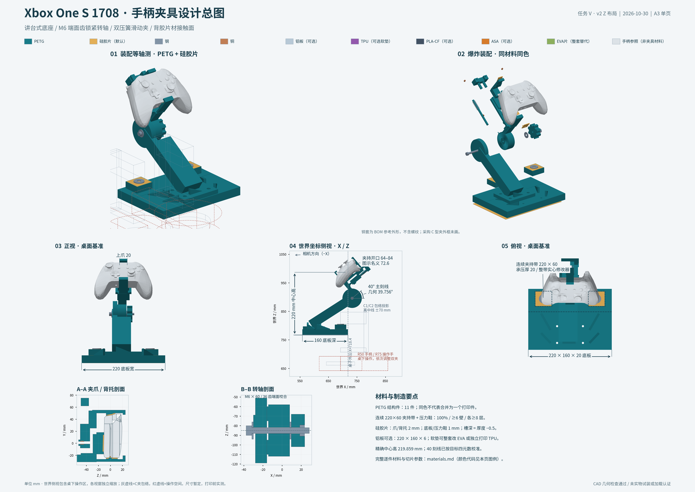

# 任务 V：Xbox One S 1708 参数化夹具 · v2 Z 形布局

更新：2026-10-30。v2 将立柱脚移至靠相机的桌内端，桌边留出完整平夹持带，斜柱向桌外上方伸到转轴，托架再向相机方向支承手柄。**手柄目标位置与四元数保持不变；本版仍未实物试打、装夹或加载认证。**

[单页设计总图 PNG](../../../hardware/gamepad_fixture/design_sheet.png) · [A3 PDF](../../../hardware/gamepad_fixture/design_sheet.pdf) · [分部件材料表](../../../hardware/gamepad_fixture/materials.md) · [逐项检查摘要](validation.md) · [手部与C夹详细验证](v2-validation.md)。

源码：[fixture.py](../../../hardware/gamepad_fixture/fixture.py)、[检查脚本](../../../hardware/gamepad_fixture/check_fixture.py)、[手部FK](../../../hardware/gamepad_fixture/hand_geometry.py)、[渲染](../../../hardware/gamepad_fixture/render.py)、[总图生成](../../../hardware/gamepad_fixture/design_sheet.py)。没有提交git、改兄弟仓库、改采集场景或采集台，也没有发送硬件命令。

## v1 → v2 改动

| 部位 | v1 | v2 |
|---|---|---|
| 底板 | 220×160×14 mm，内侧有空白 | **220×160×20 mm**；内侧放柱脚，外侧为夹持带 |
| 柱脚法兰世界X范围 | 636.4…712.4 mm，贴近桌边 | **560.4…636.4 mm**，移到相机侧 |
| 桌边平夹持面 | 两个角落44×40 mm位置 | **全宽220×深60 mm连续平面** |
| C夹中心 | 沿桌边±82 mm | **±70 mm**，距桌边26 mm；双夹依次操作 |
| 填充修改器 | 两个局部体 | **一个整带 `base_clamp_band.stl`** |
| 转轴局部中心 | (0,0,−85) mm | **(0,−40,−85) mm** |
| 轴线外伸 | 45.3742 mm | **14.6232 mm**，收回30.7510 mm |
| 柱体／固定齿盘最大外伸 | 79.3738 mm | **48.6041 mm** |
| 全夹具最大外伸 | 80.0096 mm | **仍为80.0096 mm，由导轨盖决定** |
| 底座螺栓 | 打印版M5×25 | **打印版M5×35**；铝板版仍M5×20 |
| 负载粗估 | 75 mm力臂、3 N·m | **110 mm力臂、4 N·m设计扭矩**，重新计算94 mm底板跨距 |
| 新增检查 | 主要为手柄及握把保留体 | 14个C夹／操作包络、79个历史真实手部状态、全夹持带平面及v1/v2世界范围 |

斜柱采用一条连续斜梁，宽加强脊沿同一受力路径延伸，并在距轴心38 mm处结束，以让开半径27 mm的转动毂；根部侧筋高24 mm。v1源码、检查及图纸快照保存在忽略目录 `.local/gamepad_fixture_v1/`，小型世界范围对照另见[基线JSON](../../../hardware/gamepad_fixture/reference/v1_fixture_world_bounds.json)。

## 世界坐标、Z布局与目标位姿

相机在较小的世界X一侧；**−X为相机方向，+X为桌外方向**。桌面顶面Z=767 mm，远端桌边X=718.4 mm，中线Y=625.2 mm。总图和第7张预览使用世界X／Z侧视，并标出“相机方向”和“桌子外沿”。C夹位于中线两侧，其侧视投影会重叠；碰撞按三维实体计算。

模型固定基坐标F原点为世界 `(718.4,625.2,767.0) mm`：F X=世界−Y、F Y=世界X、F Z=世界Z。底板F Y=−160…0，对应世界X=558.4…718.4；连续夹持带F Y=−60…0，对应世界X=658.4…718.4。柱脚法兰F Y=−158…−82，位于夹持带内侧且不侵入带面；四孔F X=±34、F Y=−142／−98 mm。加强筋均留在夹持带内侧。

手柄根位姿读取原 `station_g20_v4_4_raised_interim.json`：世界位置 **(709.415,625.2,986.859) mm**，wxyz **(0.664976434,0.240429496,−0.240429496,−0.664976434)**。中心实际高出桌面219.859 mm，图示名义220 mm。倾角39.756021°；40°长刻线与移动指针对齐时即为此位姿，不再额外补0.244°。

新轴心世界位置约 **(733.0232,625.2,895.9324) mm**，即桌边外14.6232 mm。固定柱／齿盘最远世界X=767.0041 mm。收回轴线时保留了连接毂与中央承托件的连续截面；没有把“轴线收回”写成“整机外廓收回”：导轨盖仍至X=798.4096 mm，超过桌边80.0096 mm。该值在每版JSON中逐件报告。

## C型夹包络与人的操作空间

选择两把普通C夹，固定上钳臂在桌上，螺杆和横杆在桌下。双夹中心沿桌边相隔140 mm，避免单夹偏心摇摆；现场按下面的规定位置和方向安装。**包络是暂定采购／安装约束，不是已测量的某品牌C夹。**

| 参数 | v2默认值 |
|---|---|
| C夹轴心 | F X=±70、F Y=−26 mm；世界X=692.4、Y=555.2／695.2 mm |
| 连续夹持带 | 220×60×20 mm，整带实心；压力鞋可拆放在规定轴心 |
| 暂定桌面叠层 | 35 mm，需实测 |
| 上臂最高点 | **底板顶面以上60 mm**；打印版F Z=80.25 mm |
| 外框／上臂 | 臂宽32 mm，外框F Y=56…72 mm，包含下钳臂与螺杆 |
| 喉深 | 轴线至外框中心90 mm、包络内缘净距82 mm；采购建议标称≥90 mm并输入实际框形复核 |
| 开口建议 | ≥100 mm；实际桌厚、底板与压力鞋叠层必须一起核对 |
| 横杆旋转区 | **R50 mm**，高12 mm，中心F Z=−100 mm（桌底以下65 mm） |
| 操作手空间 | 横杆R50外加25 mm，**R75、高50 mm**；另有从桌外伸入的包络 |
| 操作顺序 | 依次调整双夹，不要求两只操作手同时旋转 |

`out/envelopes/`单独导出14个包络：每夹含上臂、外背架、下臂、螺杆、横杆旋转区、操作手旋转区和伸入通道。它们没有混成真实打印件或加入夹具GLB。自身手与横杆／螺杆的接触按预期握持处理；其与自身框架、另一夹硬件仍检查。

默认实算：操作手至自身非操作结构最小约 **15 mm**，至另一夹横杆扫掠区最小 **15 mm**。这些结果只支持所设R75／高50的包络，现场人手、柄形与实际C夹必须测量后更新参数；不能仅凭“开口100”认为所有C夹都符合。厂商把喉深定义为螺杆中心至最近框架内缘，采购时应按此测量。[BESSEY原厂FAQ](https://besseytools.com/en-us/bessey-tools-north-america/support/faqs/faq-clamping-tools)

全宽夹持带只在顶面以上1 mm内要求无柱脚／筋，161个探针均通过；更高处允许斜柱跨过，但两个规定位置的真实C上臂另按60 mm高度逐实体检查。没有把整条带上方60 mm都假定为空，也没有因为侧视投影重叠就跳过三维碰撞。

## 真实左右手状态检查与覆盖边界

使用历史 `b_raise40` 的原始记录，恢复11个握持姿态、3个保存的静态终点，以及65个已有point-IK诊断终点。原名字 `b_raise40` 指原任务抬高40 mm的场景，不能把它当作本次39.8°倾角的名称。本轮将手相对手柄的掌位与关节状态通过FK放入当前目标root_pose，未重新求双臂IK。

每手使用22个原始碰撞网格及mimic耦合。部分厂家STL非水密，因此用FCL原始三角BVH检查距离／穿面，另给逐link凸包保守对照；没有用整手AABB冒充真实手碰撞结论。

| 已恢复状态 | 数量 | 到全部夹具实体最小间隙 | 到C夹及操作包络最小间隙 |
|---|---:|---:|---:|
| 保存的握持／静态终点 | 14 | **18.34211 mm** | 默认 **63.40993 mm** |
| 已计算point-IK诊断终点 | 65 | **3.30580 mm**；逐link凸包保守值3.25999 mm | 默认 **63.40993 mm** |

79个已恢复状态均无穿面。铝板版上臂更低，对手最小间隙76.60993 mm；TPU版同默认几何。完整逐状态、link、控制状态和原始记录哈希见各版 `hand_clearances.json`、`hand_states.json` 和 [v2详细验证](v2-validation.md)。

**没有完整的全控件手操作记录。** 左参考掌位3218仅保存LS的2／8方向终点，原搜索未认证完整控件组；右参考掌位531仅有Y静态见证。D-pad四向、View、左侧Xbox／LB、右B／Menu／RB／RT等缺少相应参考掌位的成功终点，配对键没有手指分配或操作状态。其他掌位的Xbox／LT或RS诊断终点已纳入65个，但不能拼成同一固定掌位的全控件操作能力。

因此 `full_control_motion_certified=false`。手柄控件自身完整URDF行程包络已检查，不等于机器人手完成了所有动作；本次也未认证连续路径、手—手柄接触力、手—手／手—臂碰撞或实物操纵。

## 夹爪、转轴与统一软片

上夹爪宽20 mm，小于肩键内沿暂定46 mm；下爪宽24 mm，支承中央凹口。前唇Y≥47.5 mm，Xbox键资产上沿45.7 mm。背托30×36 mm，软垫24×28 mm，只占两握把之间；握把背面仍留空。所有控件的URDF限位包络对夹具检查通过，最紧Pair键原始间隙1.2557 mm，减0.35 mm采样余量后0.9057 mm。

壳面由实际资产外层射线交点构造，2 mm采样面用于排除CoACD内部面，最终软片再按原壳三角面修剪。刚性面扣除每个凸体与0.25 mm公差立方体的Minkowski和；上下承托件对壳最小刚性间隙0.25 mm。此处几何来自资产，尚不代表实物扫描。

导轨使用两根Ø6×88.6 mm打印杆，滑孔Ø6.6、座孔Ø6.25 mm；64…84 mm开口覆盖72.6±6 mm。两根OD9.5、线径约0.7、自由长40 mm压簧，目标k=0.35 N/mm、并紧高≤10 mm。最小／名义／最大开口下安装长38.6／30／18.6 mm，合力0.98／7／14.98 N，并紧余量8.6 mm。采购以刚度、并紧高及闭口端圈数据为准，CAD螺旋只是名义外形。[Lee Spring原厂设计说明](https://www.leespring.com/learn-about-compression-springs)

默认整套使用同一牌号背胶硅胶片；可整套改EVA，TPU平片为可选打印版。厚度包括胶层，槽深=片材厚度−0.5 mm，默认压缩0.25 mm：

| 位置 | 数量 | 剪裁轮廓／自由厚度 | 槽深／名义受压厚度 |
|---|---:|---|---|
| 上爪 | 1 | 16×15×2 mm | 1.5／1.75 mm |
| 下爪 | 1 | 20×19×2 mm | 1.5／1.75 mm |
| 背托 | 1 | 24×28×2 mm | 1.5／1.75 mm |
| 压力鞋上下两面 | 4 | 42×38×1 mm | 0.5／0.75 mm |
| 贴桌底垫 | 1 | 212×152×≤1 mm，四个Ø12孔随柱脚后移 | 0.5／0.75 mm |

[夹爪与压力鞋A4模板](../../../hardware/gamepad_fixture/out/pad_templates_A4.svg)和[底垫A4横向模板](../../../hardware/gamepad_fixture/out/pad_template_base_A4.svg)按100%实际尺寸打印，先测100 mm校准线。压缩后底板刚性平面高于桌面0.25 mm，这个值已经计入柱高；不能加厚海绵替代薄底垫。

## 新跨距的承压、抗弯、抗扭估算

每个C夹按1…2 kN校核，压力鞋仍44×40×16 mm，两面各贴1 mm片；上面放DIN9021 M8钢垫圈（OD24、ID8.4、厚2）再承接Ø15…20压脚。夹紧力是明确假设，没有从手拧扭矩假算实际夹力。

| 2 kN局部模型 | v2估算 |
|---|---:|
| 鞋外廓1760 mm²平均压力 | 1.136 MPa |
| 按底片实际1596 mm² | 1.253 MPa |
| 有效面积仅外廓40% | 2.841 MPa |
| 20 mm实心带，E=1500 MPa轴向压缩 | 0.01515 mm |
| 底面局部10 mm悬空条，宽44／厚20，端载2 kN | 6.818 MPa、0.01515 mm挠度 |
| 压力鞋按40 mm简支跨，宽44／厚16 | 10.653 MPa、0.11837 mm挠度 |
| 无钢圈，Ø15脚直接压塑料 | 11.318 MPa，默认方案不采用 |
| 24／8.4钢圈环面平均压力 | 5.038 MPa |

柱脚中心到C轴的投影跨距由v1的18 mm增为 **94 mm**。另以宽96 mm条带、完全离桌、30 N端力加4 N·m端矩，作保守失去支承的模型：

| 完全无桌面支承的条带 | 20 mm PETG打印底板 | 6 mm铝板 |
|---|---:|---:|
| 有效E假设 | 1500×0.4=600 MPa | 69000 MPa |
| 最大弯曲应力 | 1.066 MPa | 11.840 MPa |
| 条带端挠度 | 0.67651 mm | 0.21788 mm |
| 条带端转角 | **0.75878°** | **0.24437°** |

公式为 `I=b*t³/12`，`σ=(F*L+M)*(t/2)/I`，`δ=F*L³/(3EI)+M*L²/(2EI)`。打印有效E按填充比例缩减只是保守假设，不是实测材料定律。这个94 mm全悬空模型的打印转角超过0.5°，**不能据此认证受载位姿**；正常安装要求平底、薄片与桌面连续贴合，拉拽失去支承时需重新加载验证。建议反复拉拽实验优先采用铝板版；铝板也不消除软垫压缩误差。梁弯曲公式依据[MIT工程力学教材](https://web.mit.edu/emech/admin/OldFiles/dontindex-build/full-text/emechbk_8.pdf)，本件未做FEA。

新轴中心下移后按110 mm力臂、30 N合力取3.3 N·m扰动，设计校核4 N·m。36齿、10°档位、r10…25 mm、齿高1.6 mm；假设仅4齿有效、齿根许用剪应力5 MPa，容量约9.16 N·m。0.5 N·m旋钮扭矩、K=0.2时M6预紧约417 N，4 N·m引起分离力约218 N，预紧／分离比约1.91。K=0.15…0.30时该比值约2.55…1.27。它是打印径向V齿适配，不具有工业钢制Hirth的精度或额定容量。[Voith原厂Hirth说明](https://www.voith.com/corp-en/products-services/connection-components-couplings/hirth-serrations/our-product-portfolio.html)

默认PETG便于较大结构打印且有韧性，仍会冷蠕变；PLA-CF侧重室温刚度，不能从短纤推断耐热／长时抗蠕变；ASA侧重耐温但大件翘曲与层间质量需重验。[Bambu官方材料指南](https://cdn1.bambulab.com/filament/filament-guide/wksdyyzd8n9/filament-guide-en.pdf) 100%填充不等于零蠕变，塑料预紧保持机制参考[SPIROL原厂说明](https://www.spirol.com/product/compression-limiters/)。首次夹紧后10分钟、1小时、24小时复测；之后每次实验前检查松动、永久压痕和姿态，按需复紧。

## 打印、整带修改器及铝板选项

各打印STEP/STL已按推荐朝向摆放Z=0，全部通过300×300×300 mm检查。完整逐件参数和选择理由在下一节材料表；尚未实际切片验证3MF或试打。

1. 导入 `out/print/base_printed.stl`，保持给定竖印方向。
2. 作为该对象的“修改器／加载”导入 **`out/modifiers/base_clamp_band.stl`**，与底板共享变换，不单独居中。
3. 设置整带100%填充、至少6壁、顶／底各至少8层。两块压力鞋整件也用相同实心设置。
4. 逐层检查完整220×60 mm带贯穿底板实体；默认实料交集 **258064 mm³**。底部0.5 mm为片材槽；它不应被误当成漏掉的填充。
5. 打印板内侧长边朝下，8 mm brim、筋下局部支撑；底槽竖直避免212 mm大桥接。齿盘朝上的柱／托架按导出方向局部支撑，齿面不加支撑。

`--aluminum`使用标准220×160×6 mm铝板，按STEP钻四个Ø5.5孔、底面90°沉头。0.8 mm打印浅槽衬片提供0.5 mm底垫槽，无需在金属上铣整面大槽；衬片完整背面朝下、槽朝上打印。M5×20连接铝板，打印版使用M5×35。厚度差自动由柱高补偿，目标手柄位姿不变。铝板、衬片、软垫仍分别进入仿真网格。

# v2 材料表与颜色代码

默认配置为 **PETG 结构件 + 整套背胶硅胶片 + 钢制五金 + 铜制热熔螺母**。颜色按[统一调色表](../../../hardware/gamepad_fixture/materials_palette.json)表示材料，同一种材料始终使用同一种颜色；颜色是图纸识别编码，不要求购买对应颜色的耗材。手柄只作为尺寸、装配和操作空间参照。

本表对应 `v2-Z`：默认底板 **220 × 160 × 20 mm**；柱脚位于底座坐标 F 的 **Y=−158…−82 mm**，四个 M5 孔为 **X=±34 mm、Y=−142/−98 mm**。远端桌边为 F Y=0，负 Y 指向桌内。全宽 **220 × 60 mm** 的连续夹持带位于 **Y=−60…0 mm**，用一个整带修改器；两只 C 夹轴心为 **F X=±70 mm、Y=−26 mm**。打印件与软垫数量不变。

### 颜色代码图例

| 材料代码 | 材料／用途 | 颜色 HEX | 配置 |
|---|---|---|---|
| `PETG` | 全部默认打印结构件 | `#187B88` | 默认 |
| `silicone` | 单面背胶硅胶片，包括胶层的名义厚度 | `#E3AF57` | 默认软垫，全套同一牌号 |
| `steel` | 螺栓、普通螺母、垫圈、压簧、C 型夹 | `#8193A5` | 默认五金 |
| `copper` | 热熔铜螺母 | `#C17E55` | 默认嵌件 |
| `PLA-CF` | 可替代的结构打印材料 | `#425163` | 非默认，需单独确认打印与受力表现 |
| `ASA` | 可替代的结构打印材料 | `#D77B2A` | 非默认，需单独确认打印与受力表现 |
| `TPU` | TPU 95A 软垫打印件 | `#9358AC` | 非默认，使用 `out_tpu/` |
| `EVA` | 同一牌号背胶 EVA 片 | `#8CAF5D` | 非默认，整套替代硅胶 |
| `aluminum` | 6061 铝底板 | `#B8C9D7` | 非默认，使用 `out_aluminum/` |
| `reference` | Xbox One S 1708 手柄参照 | `#DCE2E7` | 非夹具材料，不打印 |

### 默认打印结构件

以下均用 `PETG`（`#187B88`）、FDM 打印。共同设置为 **0.4 mm 喷嘴、6 壁、顶／底各 8 层**；表中逐件给出层高、填充、支撑、朝下位置与修改器，填补原简表未逐项重复的共同设置。填充为 100% 的小件使用直线实心路径，其余使用 gyroid。温度、流量、回抽和冷却使用实际 PETG 牌号对应的 H2D 材料预设，并做常规材料校准。

| 打印件／部位 | 数量 | 材料代码／颜色 | 制作方式 | 层高／填充／壁数／顶底层 | 朝下位置、支撑与 brim | 修改器 | 选择理由 |
| --- | ---: | --- | --- | --- | --- | --- | --- |
| `base_printed` 讲台底板，220 × 160 × 20 mm | 1 | `PETG`／`#187B88` | 打印 | 0.20 mm；整体 40% gyroid；6 壁；顶／底各 8 层 | 内侧长边朝下竖印；8 mm brim；悬挑处局部支撑；底垫槽保持竖直 | **必须**加载单个 `base_clamp_band`，整条 220 × 60 mm 带设 100% 填充、≥6 壁、顶／底各≥8 层 | 20 mm 底板及整带实心区承担后移柱脚与双夹之间的载荷；长期蠕变仍需复查 |
| `column` Z 形立柱／固定齿盘 | 1 | `PETG`／`#187B88` | 打印 | 0.16 mm；60% gyroid；6 壁；顶／底各 8 层 | 按导出方向让法兰侧边落板、固定齿面朝上；柱身及法兰悬空处局部支撑；齿面不加支撑 | 无 | 柱脚后移到 F Y=−158…−82 mm，腾出前方连续平带；细层高保留齿形，实际层间承载待测 |
| `cradle_lower_jaw` 背托／下爪／转动齿盘 | 1 | `PETG`／`#187B88` | 打印 | 0.16 mm；60% gyroid；6 壁；顶／底各 8 层 | 按导出方向让骨架外侧边落板、Hirth 齿面朝上；凸出骨架下方局部支撑；清理浅槽 | 无 | PETG 较韧，适合薄唇和重复装夹的骨架；连续背托传力并覆软片保护外壳 |
| `slider_upper_jaw` 上爪滑块 | 1 | `PETG`／`#187B88` | 打印 | 0.16 mm；60% gyroid；6 壁；顶／底各 8 层 | 上爪外面朝下、导孔轴线竖直；局部悬挑支撑按切片预览确认 | 无 | PETG 韧性适合滑块和热熔螺母座；导孔实际摩擦与配合仍须试装 |
| `guide_cap` 可拆导轨盖 | 1 | `PETG`／`#187B88` | 打印 | 0.16 mm；100%；6 壁；顶／底各 8 层 | 宽端朝下，止挡套筒朝上；无支撑；细套筒启用可变线宽 | 无 | PETG 较韧，降低细止挡套筒装配时脆裂风险；实心打印支承弹簧 |
| `guide_rod_1` 第一根导杆 | 1 | `PETG`／`#187B88` | 打印 | 0.16 mm；100%；6 壁；顶／底各 8 层 | 端面朝下竖印；6 mm brim；无支撑；与第二根同板打印以增加冷却时间 | 无 | 与主体使用同一 PETG，便于打印和重制；轻磨试配，直线度与摩擦待实测 |
| `guide_rod_2` 第二根导杆 | 1 | `PETG`／`#187B88` | 打印 | 0.16 mm；100%；6 壁；顶／底各 8 层 | 端面朝下竖印；6 mm brim；无支撑；与第一根同板打印 | 无 | 与第一根使用同一 PETG；双杆限制偏转，实际导向配合需试装 |
| `M6_hand_knob` 主轴旋钮 | 1 | `PETG`／`#187B88` | 打印 | 0.20 mm；60% gyroid；6 壁；顶／底各 8 层 | 垫圈侧端面朝下，轴向竖直、螺母开口朝上；无支撑 | 无 | PETG 韧性适应拧握与螺母装入；主要螺纹载荷由钢螺母承担 |
| `lock_screw_spacer` 锁紧螺丝隔套 | 1 | `PETG`／`#187B88` | 打印 | 0.20 mm；100%；6 壁；顶／底各 8 层 | 小环平面朝下；无支撑 | 无 | PETG 小环易打印且有韧性；实心截面承担局部压紧并限制伸入长度 |
| `pressure_shoe_1` 第一块压力鞋 | 1 | `PETG`／`#187B88` | 打印 | 0.20 mm；**100%**；**≥6 壁**；顶／底**各≥8 层** | 44 × 16 mm 窄侧边朝下，两面浅槽竖直；无支撑 | 无；整件实心 | PETG 可打印厚承压截面；整件实心并配钢圈分压，持续夹紧仍需复查蠕变 |
| `pressure_shoe_2` 第二块压力鞋 | 1 | `PETG`／`#187B88` | 打印 | 0.20 mm；**100%**；**≥6 壁**；顶／底**各≥8 层** | 44 × 16 mm 窄侧边朝下，两面浅槽竖直；无支撑 | 无；整件实心 | 同材质 PETG 实心承压，维持双夹对称支承；不能以材料名称代替蠕变验证 |

朝向来源为已生成并通过包围盒检查的默认版 `out/print/*.stl` 和 `manifest.json` 中的 `print_transform`，不是装配网格的朝向。保持这些打印文件的原坐标；默认、铝板与 TPU 三版 v2 的打印实体均已通过 300 × 300 × 300 mm 检查，摘要见 [v2 验证记录](v2-validation.md)。**支撑、brim、填充和壁数仍是切片建议，尚未生成／验证 H2D 3MF，也未完成实物试打。** 双喷头可用于支撑界面；不要让支撑接触 Hirth 齿面或残留在接触槽内。

**单个** `out/modifiers/base_clamp_band.stl` 必须与底板共享同一变换，不能单独居中；不再加载旧版两个 `base_clamp_zone_1/2`。默认 v2 检查中，整带修改器与竖印底板实料相交 **258064.0 mm³**。切片时将对象类型设为“修改器”，设 **100% 填充、≥6 壁、顶／底各≥8 层**，并在逐层预览确认整条 220 × 60 mm 带贯穿厚度的实心路径。压力鞋仍各自整件 100% 填充。

### 默认软垫部位

以下均为 `silicone`（`#E3AF57`）、**购买单面背胶硅胶片后按模板裁切、弯曲贴入槽**；各行都是独立片材位置。厚度包括胶层。所有位置使用同一牌号，分别采购 1 mm 和 2 mm 厚片材；名义压缩量均为 0.25 mm。制作方式不是 FDM，所以层高、填充、壁数、支撑、朝下方向和打印修改器均为“不适用”。

| 软垫部位／网格名 | 数量 | 材料代码／颜色 | 制作方式 | 剪裁轮廓与自由厚度 | 槽深／名义受压厚度 | 打印参数 | 选择理由 |
| --- | ---: | --- | --- | --- | --- | --- | --- |
| 上爪 `pad_upper_jaw` | 1 | `silicone`／`#E3AF57` | 购买片材、剪裁 | 16 × 15 × 2 mm | 1.5／1.75 mm | 不适用：裁切贴附 | 顺应顶部外壳截面，避开 Xbox 键和肩键区 |
| 下爪 `pad_lower_jaw` | 1 | `silicone`／`#E3AF57` | 购买片材、剪裁 | 20 × 19 × 2 mm | 1.5／1.75 mm | 不适用：裁切贴附 | 顺应下缘中央凹口，并保护外壳 |
| 背托 `pad_back` | 1 | `silicone`／`#E3AF57` | 购买片材、剪裁 | 24 × 28 × 2 mm | 1.5／1.75 mm | 不适用：裁切贴附 | 在两握把之间传递按键反力，保持握把背面开放 |
| 底板贴桌面 `pad_base_bottom` | 1 | `silicone`／`#E3AF57` | 购买片材、剪裁 | 212 × 152 × **≤1 mm**；四个 Ø12 mm 让位孔 | 0.5／0.75 mm | 不适用：裁切贴附 | 提供薄接触层；该压缩后高度已进入安装位姿 |
| 压力鞋 1 下侧 `pad_shoe_1_lower` | 1 | `silicone`／`#E3AF57` | 购买片材、剪裁 | 42 × 38 × 1 mm | 0.5／0.75 mm | 不适用：裁切贴附 | 压力鞋与底板之间的整面接触 |
| 压力鞋 1 上侧 `pad_shoe_1_upper` | 1 | `silicone`／`#E3AF57` | 购买片材、剪裁 | 42 × 38 × 1 mm | 0.5／0.75 mm | 不适用：裁切贴附 | 在压力鞋与 M8 钢分压垫圈之间提供同材质接触层 |
| 压力鞋 2 下侧 `pad_shoe_2_lower` | 1 | `silicone`／`#E3AF57` | 购买片材、剪裁 | 42 × 38 × 1 mm | 0.5／0.75 mm | 不适用：裁切贴附 | 压力鞋与底板之间的整面接触 |
| 压力鞋 2 上侧 `pad_shoe_2_upper` | 1 | `silicone`／`#E3AF57` | 购买片材、剪裁 | 42 × 38 × 1 mm | 0.5／0.75 mm | 不适用：裁切贴附 | 在压力鞋与 M8 钢分压垫圈之间提供同材质接触层 |

剪裁使用 `out/pad_templates_A4.svg` 与 `out/pad_template_base_A4.svg`，选择实际尺寸／100%，先核对 100 mm 校准线。装配前实测自由厚度和受载后的压缩量；不能用厚海绵替代薄底垫。CAD 接触片展示名义受压状态，不代表片材硬度、胶层和蠕变已经实测。

### 默认五金部位

下表均为**购买标准五金后装配**，全部打印参数（层高、填充、壁数、支撑、朝下方向和修改器）均不适用。钢件统一 `steel`／`#8193A5`，热熔铜螺母统一 `copper`／`#C17E55`。主轴和弹簧有装配外形；小螺栓与热熔嵌件主要通过真实孔位和螺母窝表达，铜套预览为 BOM 参考外形，不含螺纹。

| 五金部位 | 数量 | 材料代码／颜色 | 制作方式／规格 | 打印参数 | 选择理由 |
| --- | ---: | --- | --- | --- | --- |
| 远端桌边双 C 型夹 | 2 把 | `steel`／`#8193A5` | 购买普通 G 字夹；开口≥100 mm、喉深约90 mm、旋转压脚 Ø15–20 mm；轴心 F X=±70/Y=−26 mm；固定上臂置于桌上，螺杆与 R50 横杆置于桌下；最终开口按实测桌边叠层加约39 mm桌上组件确认 | 不适用 | 双夹稳定底板；桌下各预留 R75 操作区，依次操作；当前外廓是参数化选型包络，具体采购件须逐尺寸核对 |
| 主轴贯穿螺栓 | 1 | `steel`／`#8193A5` | 购买；M6 × 60 内六角，8.8 级 | 不适用 | 贯穿固定耳和转动毂，提供齿面预紧 |
| 固定耳外侧主轴垫圈 | 1 | `steel`／`#8193A5` | 购买；M6 平垫，OD18、ID≥6.4、厚 1.6 mm | 不适用 | 扩散螺栓头对固定耳的压紧力 |
| 旋钮内侧主轴垫圈 | 1 | `steel`／`#8193A5` | 购买；M6 平垫，OD18、ID≥6.4、厚 1.6 mm | 不适用 | 扩散旋钮侧压紧力，减少塑料端面直接摩擦 |
| 旋钮内普通六角螺母 | 1 | `steel`／`#8193A5` | 购买；M6，AF10、高约 5 mm；从旋钮外侧装入 | 不适用 | 用标准钢螺纹配合打印握持外形 |
| 底板至柱脚沉头螺栓 | 4 | `steel`／`#8193A5` | 购买；默认 20 mm 打印底板用 DIN7991 M5 × 35、90° 沉头；铝板版用 M5 × 20；孔位 F X=±34/Y=−142、−98 mm | 不适用 | 配合 v2 底板厚度和后移柱脚；头部不高于刚性底面，保留平整安装基准 |
| 柱脚普通六角螺母 | 4 | `steel`／`#8193A5` | 购买；M5，AF8、高约 4 mm；放入柱脚上方螺母窝 | 不适用 | 形成可拆卸的柱脚连接 |
| 导轨盖固定螺栓 | 2 | `steel`／`#8193A5` | 购买；M3 × 22 内六角圆柱头，实配头部沉孔和嵌件长度 | 不适用 | 盖可拆装，便于装导杆、滑块与压簧 |
| 导轨盖 M3 热熔铜螺母 | 2 | `copper`／`#C17E55` | 购买；M3，OD4.6、长 4.0 mm；设计热熔孔 Ø4.1 | 不适用 | 为反复拆装导轨盖提供金属螺纹；使用温控工具安装 |
| 滑块锁紧螺栓 | 1 | `steel`／`#8193A5` | 购买；M4 × 25 内六角；尖端平滑，配 3 mm 打印隔套 | 不适用 | 轻顶固定背板，实验时锁住滑块 |
| 滑块锁紧平垫圈 | 1 | `steel`／`#8193A5` | 购买；M4 平垫，厚约 1 mm | 不适用 | 与隔套共同控制螺栓伸入并分散头部载荷 |
| 滑块 M4 热熔铜螺母 | 1 | `copper`／`#C17E55` | 购买；M4，OD6、长 6 mm；设计热熔孔 Ø5.4 | 不适用 | 给锁紧螺丝提供可重复操作的金属螺纹 |
| 导杆 1 外压簧 | 1 | `steel`／`#8193A5` | 购买；OD9.5、ID约8.1、自由长40 mm；线径参考0.7 mm；目标 k=0.35 N/mm；并紧高≤10 mm | 不适用 | 夹爪装卸回位；刚度、端圈与并紧高度以厂家数据或实测确认 |
| 导杆 2 外压簧 | 1 | `steel`／`#8193A5` | 购买；与第一根相同，同规格同批次采购 | 不适用 | 对称提供夹紧回复力，避免滑块偏斜 |
| 压力鞋 1 顶部分压钢垫圈 | 1 | `steel`／`#8193A5` | 购买；DIN9021 M8，OD24、ID8.4、厚 2 mm；置于上侧软片之上 | 不适用 | 将 C 夹小压脚载荷扩散到塑料；不得省略后继续引用分压计算 |
| 压力鞋 2 顶部分压钢垫圈 | 1 | `steel`／`#8193A5` | 购买；DIN9021 M8，OD24、ID8.4、厚 2 mm；置于上侧软片之上 | 不适用 | 同第一块压力鞋，维持双夹对称承压 |

C 夹包络采用暂定桌边叠厚 35 mm：桌下横杆中心为 F Z=−100 mm，R50 横杆扫掠区外再加 25 mm 手掌余量，形成 **R75、高50 mm** 的操作区。桌上固定上臂包络延伸至底板刚性顶面以上 **60 mm**。两夹依次操作，因此两个人手示意包络可重叠，但单个操作手仍须避开另一把夹具的横杆；默认 v2 实算最小间隙为 **15 mm**。这些包络单独放在 `out/envelopes/`，不是具体采购 C 夹的精确实体或实测操作能力。

### 非默认替代材料

这些是可选择的替代路线，不与默认图中的 PETG／硅胶混称。改变材料后，实测压缩量、打印配合、齿面与螺栓预紧保持仍须确认；不能直接把默认 PETG 的假设视为替代材料的实测性能。

| 替代部位／方案 | 数量 | 材料代码／颜色 | 制作方式与完整打印设置 | 理由与适用边界 |
|---|---:|---|---|---|
| 整套接触片材替代 | 对应上述 8 个位置，各 1 片 | `EVA`／`#8CAF5D` | 购买同一牌号背胶 EVA，沿用各位置自由厚度和剪裁模板；不打印，所有打印参数不适用 | 可整体替代硅胶；需重新测量受压厚度并更新参数，不混换局部硬度 |
| 可选底板 `base_aluminum` | 1 | `aluminum`／`#B8C9D7` | 购买 6061、220 × 160 × 6 mm 定尺矩形板；按 STEP 加工四个 Ø5.5 孔和底面 90° 沉头；不打印 | 减少底板长期夹持的塑料承压风险；使用 `out_aluminum/` 和 M5 × 20 螺栓 |
| 铝板版浅槽衬片 `aluminum_pad_recess_tray` | 1 | `PETG`／`#187B88` | FDM：0.16 mm；100%；6 壁；顶／底各 8 层；完整背面朝下、浅槽朝上；无支撑；无修改器 | 0.8 mm 打印衬片提供 0.5 mm 软片浅槽，避免在铝板上铣大面积凹槽 |
| 选定结构件的 PLA-CF 替换 | 按所替换的对应 PETG 行 | `PLA-CF`／`#425163` | FDM：继承对应行层高、填充、6 壁、顶／底各 8 层、打印方向、支撑和修改器要求；材料温度／速度使用厂家与 H2D 对应预设，单独校准 | 侧重室温刚度与较低挠度的备选；未独立试打，不能由短纤推断耐热或长期抗蠕变已提高 |
| 选定结构件的 ASA 替换 | 按所替换的对应 PETG 行 | `ASA`／`#D77B2A` | FDM：继承对应行层高、填充、6 壁、顶／底各 8 层、打印方向、支撑和修改器要求；材料温度／速度使用厂家与 H2D 对应预设，单独校准 | 侧重耐温使用的备选；大件翘曲、层间结合与热熔嵌件配合需重新验证 |

可选 TPU 使用 `--tpu-pads --out hardware/gamepad_fixture/out_tpu`，每个位置单独导出为**自由厚度平片**，打印后弯曲贴入曲面槽；装配模型仍使用名义压缩后的形状。所有 TPU 片均为 `TPU`（`#9358AC`），下表给出可执行的起始切片建议，尚未实际试打，也未认证粘接或压缩表现。温度与进料／速度使用实际 TPU 95A 的 H2D 材料预设，不沿用 PETG 配置。

| 可选 TPU 打印件／位置 | 数量 | 材料代码／颜色 | 制作方式 | 自由厚度／层高／填充／壁数／顶底层 | 朝下／支撑／修改器 | 选择理由 |
| --- | ---: | --- | --- | --- | --- | --- |
| `pad_upper_jaw` 上爪 | 1 | `TPU`／`#9358AC` | 打印 | 2 mm；0.20 mm；100%；3 壁；顶／底各 4 层 | 自由平片大面朝下；无支撑；无修改器 | 可独立打印、弯曲贴入对应软垫槽；保持片材式可更换接触层 |
| `pad_lower_jaw` 下爪 | 1 | `TPU`／`#9358AC` | 打印 | 2 mm；0.20 mm；100%；3 壁；顶／底各 4 层 | 自由平片大面朝下；无支撑；无修改器 | 可独立打印、弯曲贴入对应软垫槽；保持片材式可更换接触层 |
| `pad_back` 背托 | 1 | `TPU`／`#9358AC` | 打印 | 2 mm；0.20 mm；100%；3 壁；顶／底各 4 层 | 自由平片大面朝下；无支撑；无修改器 | 可独立打印、弯曲贴入对应软垫槽；保持片材式可更换接触层 |
| `pad_base_bottom` 底板 | 1 | `TPU`／`#9358AC` | 打印 | 1 mm；0.20 mm；100%；3 壁；顶／底各 4 层 | 自由平片大面朝下；无支撑；无修改器；保持四个让位孔 | 可独立打印、弯曲贴入对应软垫槽；保持片材式可更换接触层 |
| `pad_shoe_1_lower` 压力鞋 1 下侧 | 1 | `TPU`／`#9358AC` | 打印 | 1 mm；0.20 mm；100%；3 壁；顶／底各 4 层 | 自由平片大面朝下；无支撑；无修改器 | 可独立打印、弯曲贴入对应软垫槽；保持片材式可更换接触层 |
| `pad_shoe_1_upper` 压力鞋 1 上侧 | 1 | `TPU`／`#9358AC` | 打印 | 1 mm；0.20 mm；100%；3 壁；顶／底各 4 层 | 自由平片大面朝下；无支撑；无修改器 | 可独立打印、弯曲贴入对应软垫槽；保持片材式可更换接触层 |
| `pad_shoe_2_lower` 压力鞋 2 下侧 | 1 | `TPU`／`#9358AC` | 打印 | 1 mm；0.20 mm；100%；3 壁；顶／底各 4 层 | 自由平片大面朝下；无支撑；无修改器 | 可独立打印、弯曲贴入对应软垫槽；保持片材式可更换接触层 |
| `pad_shoe_2_upper` 压力鞋 2 上侧 | 1 | `TPU`／`#9358AC` | 打印 | 1 mm；0.20 mm；100%；3 壁；顶／底各 4 层 | 自由平片大面朝下；无支撑；无修改器 | 可独立打印、弯曲贴入对应软垫槽；保持片材式可更换接触层 |

层数超过薄片总层数时，切片器会将其全部作为实心顶／底路径处理；应在逐层预览确认，不把稀疏填充引入 1 mm 接触片。图中的手柄统一用 `reference`／`#DCE2E7` 表示，是已存在的实物参照，不列入待制作零件数量。

## 装配步骤

1. 先按卡尺清单核对实物，再改参数、重导并运行检查。去支撑、毛刺，确认底板平整、导杆直、端面齿清楚；不靠拧螺栓拉直翘曲件。
2. 用温控热熔工具装两颗M3铜螺母（OD4.6／长4，孔Ø4.1）到背板上端、一颗M4（OD6／长6，孔Ø5.4）到滑块背面；试配实际牌号，冷却后上螺丝。
3. 柱脚放到底板**靠相机的内侧**。四颗M5螺母放入上方六角窝，沉头螺栓自底面穿入；打印版M5×35，铝板版M5×20。头部不得凸出刚性底面。
4. 用100%模板裁同材软片，贴上下爪、背托、压力鞋两面和底槽；按胶片说明清洁、干燥、固化。底垫四孔对准后移的柱脚螺栓。
5. 导杆插下座，套入滑块，再各套一根压簧；盖的止挡套筒伸入簧内，用两颗M3×22固定。检查64…84 mm行程与簧端，没有卡在盖缝中。
6. 主轴依次为M6×60→平垫→固定耳／齿→转动毂→平垫→旋钮M6螺母。螺母从旋钮外口装入；调角时须先脱齿再转，不能带齿硬扭。
7. 拉开上爪，下凹口坐在下软片，背面贴背托；放回上爪，检查Xbox、Pair、肩／扳机无压迫。M4×25锁紧螺丝配3 mm打印隔套和约1 mm平垫，轻顶固定背板锁住。
8. 将移动指针对准**40°长线**并让齿完全坐合，再锁紧旋钮；该线已对应39.756021°目标，不再补角。
9. 底板外侧直边与世界X=718.4桌外沿齐平，左右中点对桌面中线。把两鞋放到距边26 mm、沿边±70 mm处，上软片放M8大钢圈。C夹从外侧跨桌边，固定上臂在上、螺杆与横杆在下；确认符合上臂60、横杆R50和桌下通道包络，再交替逐步夹紧。
10. 实际夹力／手柄重量下复测root位置、角度，执行下面加载和蠕变试验。刻线对齐不等于实物误差已经合格。

## 实物风险、实验方案与卡尺清单

名义CAD定位误差很小，但 `physical_pose_certified=false`：底垫均匀压缩±0.3 mm使root高度变化0.3 mm，背垫均匀变化再贡献沿手柄Z轴0.3 mm，上界合计0.6 mm。背垫两端差分0.6／28 mm可引起1.2276°；底垫差分0.6／152 mm可引起0.2262°、约0.8679 mm横移，再叠加均匀变化得到1.4679 mm位置上界。均可能超过1 mm／0.5°，尚未实测。

| 待验证假设 | 最小对照实验与测量 | 支持／推翻标准 | 状态 |
|---|---|---|---|
| 1708随形面正确 | 卡尺截面与资产对照，再比较未贴／贴规定片材的接触印记 | 不顶按键、不翘角，印记位于预期面；否则改截面参数 | 未执行 |
| 默认片材压缩0.25 mm | 同批片在工作压力与较小压力下保持，测自由厚、10分钟／24小时厚及两端差 | 真实压缩量带回参数；若姿态超差则推翻均匀压缩假设 | 未执行 |
| C夹操作包络足够 | 测实际C框、横杆全转、现场人手握持外廓；与参数14包络逐项比对 | 超出任何包络就更新参数重查，不按“普通C夹”直接放行 | 未执行 |
| 齿盘保持4 N·m | 100 mm试验臂施40 N，正反向各保持60秒，测卸载前后角度 | 不跳齿／裂纹，角变化≤0.5°；否则改齿／预紧或降载 | 未执行 |
| Z柱／底板保持位姿 | 在贴桌与模拟局部失支承两条件下，正面、侧面、上下端各施30 N | 百分表／高度尺测位移≤1 mm、角≤0.5°；超差则调整刚度／材质／支承 | 未执行 |
| 夹紧不持续蠕变 | 相同桌面下打印版与铝板版对照，10分钟／1小时／24小时复测 | 无永久压痕／松夹／超差；两版都漂移优先检查软片与桌面 | 未执行 |

卡尺按优先级核对：

1. 中央上下基准距离（暂定72.6 mm）、顶部／下凹口厚度（28／26 mm），测中心和两侧的截面变化。
2. LB/RB内沿净距（46 mm），Pair位置／宽度、LT/RT全行程内缘；确认20 mm上爪和手指空间。
3. Xbox键上沿到上壳边的距离及突出厚度，核对Y=47.5前唇不碰键。
4. 24×28 mm中央背壳曲率、盖缝／贴纸／凸台；保持握把背面开放。
5. 同牌号1／2 mm片的含胶层自由厚度和受压厚度，测上下／前后差分。
6. 桌边叠层（默认35）、桌下框架让位、实际C上臂高度、内缘喉深、螺杆长度、横杆R50与人手附加尺寸；确认桌下Z=−100处能从外侧进入。
7. 铜螺母、钢螺母、垫圈、打印杆孔及弹簧自由长／并紧高；刚度须厂家数据或力—位移实测，卡尺测不出刚度。
8. 整机153×104.6×50.2 mm仅作最后比例核对，不替代局部截面测量。

所有关键尺寸在源文件四组参数中。整体尺度会改变参考几何；名义夹距联动下爪、止挡与导杆，爪宽联动垫槽和模板。局部厚度调整口深，但单个厚度值不会生成未知实物曲率。改参数后须重查：任意组合都满足避障／预压并未得到保证。

## 输出、复算与预览

[默认完整检查](../../../hardware/gamepad_fixture/out/checks.json)、[铝板检查](../../../hardware/gamepad_fixture/out_aluminum/checks.json)、[TPU检查](../../../hardware/gamepad_fixture/out_tpu/checks.json)；所有适用几何检查已重跑。[逐项摘要](validation.md)与[v2详细证据](v2-validation.md)明确区分几何通过、未覆盖控件、未执行实物试验。

- `out/print/`：每打印件STEP／STL，推荐方向已摆好；`out/assembly.step`：装配体。
- `out/simulation/fixture.glb`：米单位、独立零件和材质，软垫单独薄片；未对握把空间作整机大凸包。
- `out/assembly_mesh/`和STEP/STL：手柄局部毫米；`world_from_pad`平移为毫米，`world_from_simulation_m`为米。
- `out/reference/controller_neutral_mm.stl`可与装配STEP一起在CAD查看器中打开；已应用URDF中性FK和毫米换算，是参照而非打印件。
- `out/envelopes/`：C夹及操作手包络；`hand_clearances.json`／`hand_states.json`：79状态证据。
- `out_aluminum/`、`out_tpu/`均已重建相应几何、检查和预览。全部输入URDF／网格只读复制并记录SHA256，来源0.4.1；不改上游或采集场景。

依赖只在 `.local/cad-env`，包含用于真实三角面查询的python-fcl。手部复算还需本地G20资产和本轮恢复的 `.local/two-hand-k0`诊断记录；详见hand_geometry.py和JSON来源／哈希。没有运行新可达搜索、训练或硬件。完整命令见[生成说明](../../../hardware/gamepad_fixture/README.md)。生成物不纳git；大于5 MB的文件在`.local/gamepad_fixture_large/`，输出目录保留相对链接。

总图按材料类别着色，以下细节预览保留部件识别配色；第7图为带C夹／操作空间的世界坐标侧视。

