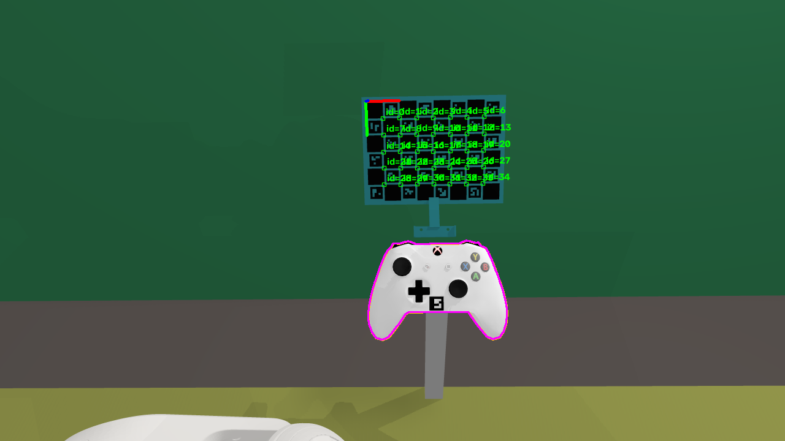
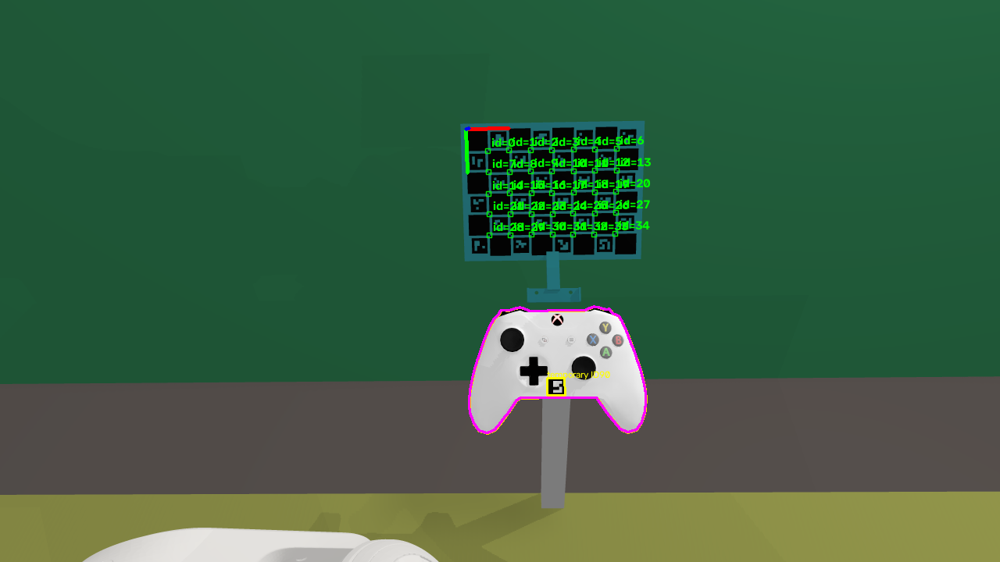
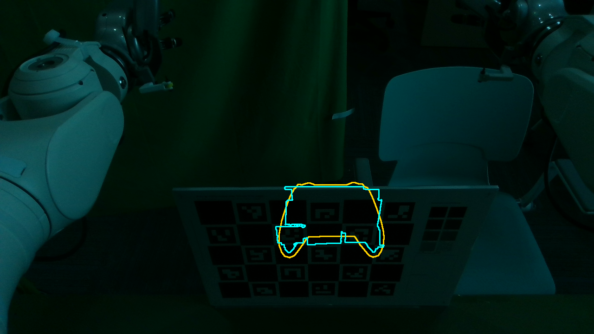

# 任务 W：夹具验证、托架标记卡与临时手柄贴纸

[可打印验证单](../../../hardware/gamepad_fixture/VALIDATION.md) · [CLI](../../../scripts/station/check_gamepad_pose.py) · [标记卡测量逻辑](../../../src/gamepad_vla/workstation/gamepad_marker.py) · [轮廓粗调逻辑](../../../src/gamepad_vla/workstation/gamepad_pose_check.py)

**验收主方案已改为托架 ChArUco 卡；轮廓法只做粗调和目视叠加。** 可拆支架、打印模板、CAD变换、绝对/相对测量和同图贴纸↔托架测量均已实现。没有commit，没有改v2主体，没有打印/加载实物，没有执行手/臂命令，8780保持运行。

**当前采用的验收路径：** 托架卡测绝对/两图相对位姿，贴纸只测左右、沿夹爪方向的面内平移和绕法线转角。按修订判据，手姿接触仅列信息；16mm纸边通过控件扫掠CAD筛查，最小模型间距0.355mm，仍须贴后人工全行程复核。贴纸面内16例合成位置最大误差0.311mm，亚毫米平移已得到条件合成证据；转角最大0.982°，不据此认证0.5°。法向/倾角由背托持续接触、托架卡和独立检查保证。尚未执行实物贴卡正样本、加载/长时蠕变或多张平均降噪实验。
## 1. 机械附件与打印

```bash
XDG_CACHE_HOME="$PWD/.local/cad-env/.cache" \
  .local/cad-env/bin/python hardware/gamepad_fixture/fixture.py --marker-card
.local/cad-env/bin/python hardware/gamepad_fixture/fixture.py --coupons
```

| 输出（本地 `hardware/gamepad_fixture/` 下） | 用途 |
|---|---|
| [out_marker/marker_bracket.stl](../../../hardware/gamepad_fixture/out_marker/marker_bracket.stl) | 已摆打印方向的可拆支架，背板面朝下，局部支撑托住安装座；PETG起始建议0.16mm、6壁、实心背板/安装座，具体时间待切片 |
| `out_marker/marker_bracket.step` / `marker_bracket_pad_mm.stl` | 手柄局部mm坐标装配参考；不能直接当打印朝向 |
| [marker_card_A4.pdf](../../../hardware/gamepad_fixture/out_marker/marker_card_A4.pdf) / [SVG](../../../hardware/gamepad_fixture/out_marker/marker_card_A4.svg) | 1:1 A4，8×6格、20mm方格、15mm码，DICT_4X4_100 ID60–83，非legacy；图案160×120mm，加白边170×130mm；100mm校准线 |
| [sticker_ID90_A4.pdf](../../../hardware/gamepad_fixture/out_marker/sticker_ID90_A4.pdf) / [SVG](../../../hardware/gamepad_fixture/out_marker/sticker_ID90_A4.svg) | 15mm黑码，含白边16×16mm，独立ID90；100mm校准线；仅验证时用低粘纸/美纹纸贴，正式采集前撕掉 |
| `out_marker/manifest.json` | CAD给出的 `gamepad_from_board`（米）、格长/ID/安装信息及贴纸平面/候选；不是手贴位置标定 |
| `out_coupons/*.stl` | 11件原实体截取小样：上下爪/背托、Hirth对、杆/滑块、M3/M4嵌件孔、底板夹持区/压力鞋 |

附件用**卡槽**绕既有导轨盖两侧定位，复用两颗M3轴线连接到转动托架，与手柄一起转动；主体不钻孔、不加孔、不改随形面。名义槽宽46.2mm（原盖46mm），用M3×30替换M3×22，名义2.5mm金属隔套；实测确认3–4mm有效啮合且不顶孔底，不能只按螺栓名义长度放行。背板厚3mm，卡面前倾20°，中心在手柄局部(0,165,−42)mm，以缩短近正视平面PnP的弱条件区；卡片下沿高于控件。

支架为有效单实体、封闭STL，体积约73.56cm³，PETG密度1.27g/cm³时约93g，实际应称重。它会增加自重和力矩，需带附件重做位姿/刚度试验；拆附件后也要复核回弹。切片、实打、装配定位重复性与长期平整度均未执行。

[79个保存/诊断手姿检查](marker-hand-clearance.json)：按每个手链节的保守凸包查询，附件0碰撞、最小间距28.395mm；这不证明所有连续机器人动作或真人手都避让。卡面四角在camera_3内；SAPIEN最终16例均检出35个ChArUco角点，图中控件未被卡遮挡。附件与原托架/盖的接触是安装接口，不作为避障失败。

原参数类、`build`、`mechanics`及已有整件导出函数与任务开始快照逐AST比较不变；原main只增加独立出口。小样已实际导出，11件均封闭/正体积/落在打印面，[网格检查](coupons-check.json)通过；Hirth小样的两处亚微米STL重合顶点以1e−6mm精度焊接，未改CAD齿形。[验证单](../../../hardware/gamepad_fixture/VALIDATION.md)保留所有输入/装配/加载/蠕变/重装记录及v3参数建议。

## 2. 三种坐标测量，分开理解

默认仿真目标与camera_3外参只读 `configs/workcell/station_g20_v4_4_raised_interim.json`。目标root=(709.415,625.200,986.859)mm，桌面Z=767mm、外沿X=718.415mm；所以root高度219.859mm、距边内侧9.000mm、左右偏移0。目标倾角39.756021°，判据仍按40°±0.5°，不取整配置四元数。夹具I.table_edge_x=718.4与场景差0.015mm，保留设计，工具按场景计算。

`T_A_B`表示把B坐标变成A坐标。C是同一台相机的光学坐标（右/下/前），B是托架卡，P是手柄root，S是临时贴纸。内部米，输出误差mm/°，JSON位姿 `[x,y,z,qw,qx,qy,qz]`；四元数整体反号仍表示相同旋转。

**绝对：** `T_W_P = T_W_C T_C_B inverse(T_P_B)`。`T_P_B`由CAD manifest给出；相机世界外参、板尺寸/平整度、卡槽安装误差都进入不确定度。单张ChArUco标定的0.24px重投影中位误差不能证明世界板摆放毫米级准确，见[原始标定限制](../../../references/calibration/2026-10-23-ego-upright/README.md)。默认显示5mm位置、1°旋转工程先验，再加入相机旋转的root距离杠杆项（约距离×sin角误差）、合成恢复包络、卡位置/角度预算；**先验不是经过验证的置信界**，`calibration_known=false`时绝不判绝对合格。

**托架两图相对：** `T_C_Pi=T_C_Bi inverse(T_P_B)`，`Delta_P=inverse(T_C_P0) T_C_P1`。这个式子不含世界相机外参；共同的任意左乘外参误差严格抵消，单测另施8°旋转/数厘米平移验证范数不变。位置在推算root处计算，包含卡→root的杠杆修正；不是只量卡中心。卡/手柄相对不滑、卡支架不松、纸张不变形仍是独立假设。

**同图手柄↔托架：** 每张图先算 `T_B_S = inverse(T_C_B) T_C_S`；10次重装之间比较 `inverse(T_B_S0) T_B_Si`。没有使用世界外参，也没有使用候选贴纸→root的CAD变换；同一张低粘贴纸固定在手柄上不反复撕贴，手贴偏差不需要标定。位置是贴纸中心，角度是贴纸姿态，不能未经标定就把它们改称root变化。托架卡本身稳定不能排除手柄在软垫中的滑移，这正是ID90的作用。

输出高度+Z、距边内侧−worldX、左右−worldY；俯仰/横滚/偏航是夹具F轴下 `Fᵀ R_est R_targetᵀ F` 的外禀xyz分解（F x=−worldY，y=worldX，z=worldZ）。三维位置和旋转范数另列，避免把逐轴限值当范数限值。

## 3. 识别与两图配准实现

输入是camera_service的原始ZIP（image.png/camera.json），或原尺寸PNG+内参JSON；采用同帧K/D，拒绝尺寸不匹配/不支持的畸变模型。裁剪照片不可沿用原K。

按[OpenCV ChArUco原始文档](https://docs.opencv.org/4.11.0/df/d4a/tutorial_charuco_detection.html)检出棋盘角，ID60–83区别于旧站点标定板；至少10角，使用[IPPE候选与LM重投影细化](https://docs.opencv.org/4.11.0/d5/d1f/calib3d_solvePnP.html)。选解依重投影，不依“接近目标”；目标只用于轮廓叠加和误差比较。平面双解和近正视弱可观测性没有消失，低像质不自动判合格。

两图相对测量保留小块灰度PNG基线在JSON中（固定一块，不是增长日志）。卡/贴纸身份先由编码识别，再将基线像素反投影到该平面，用[有界最小二乘](https://docs.scipy.org/doc/scipy-1.15.3/reference/generated/scipy.optimize.least_squares.html)拟合当前六自由度刚性平面，使归一化亮度一致；这减少两次独立角点检测的亚像素偏差。最多80次函数迭代，失跟踪返回 `tracking_failed` / `indeterminate`，不把失败写成零移动。纸张变形、反光、阴影变化和很小的标签仍会使模型不准。

轮廓逻辑保留为 `--method silhouette`：0.4.1中性URDF/CoACD凸块投影并集、绿幕/GrabCut分割、真实边缘支持筛查、六自由度距离场拟合；依据[OpenCV投影](https://docs.opencv.org/4.11.0/d9/d0c/group__calib3d.html)和[GrabCut](https://docs.opencv.org/4.8.0/dd/dfc/tutorial_js_grabcut.html)。它不参与严格验收，仍能在无手柄照片上输出目标黄线和 `not_detected`。

## 4. SAPIEN合成精度：完整分母与成像条件

同一16组扰动：名义1例、三个平移轴各±3mm共6例、三个转轴各±2°共6例、组合2例、模糊σ0.65px+每通道σ2灰度噪声组合1例。真值仅用于打分，拟合不读真值。相对误差比较相对名义照片的完整SE(3)，不是只比较两个标量移动距离。名义自比较为零，仍保留在16分母中。

SAPIEN 3.0.3复用 `SapienBackend → robotwin.create_scene/load_into_scene`、spec appearance与`create_spec_camera`；新增的仅是CAD卡/附件可视几何，没有第二套采集渲染或推流。卡的黑格由同一打印矢量定义生成面片，卡/支架随手柄一起移动。近裁面改10mm、黑面z=0/白底后移0.25mm，避免近共面栅格覆盖不稳；前后差异未单独拆分这两个因素的贡献。

| 方法／图像条件（16/16均检出） | 绝对位置 中位/P95/最大 mm | 绝对旋转 中位/P95/最大 ° | 两图相对位置 中位/P95/最大 mm | 两图相对旋转 中位/P95/最大 ° |
|---|---:|---:|---:|---:|
| 轮廓，原1280×720光栅图 | 5.437/6.545/**7.272** | 1.132/1.890/**2.291** | 1.344/2.449/**3.180** | 0.579/1.299/**1.685** |
| ChArUco，原1280×720点采样光栅图 | 1.531/2.566/**2.614** | 0.757/1.252/**1.259** | 0.917/3.689/**4.054** | 0.203/1.067/**1.392** |
| ChArUco，4×渲染后面积积分到1280×720 | 0.705/1.389/**2.014** | 0.245/0.500/**0.700** | 0.180/0.412/**0.458** | 0.087/0.192/**0.198** |
| 同一SAPIEN面积积分图，本地OpenCV4.11回放 | 0.632/1.259/**2.088** | 0.291/0.544/**0.689** | 0.271/0.515/**0.638** | 0.088/0.184/**0.243** |

[轮廓逐例数据](synthetic-sapien.json)、[轮廓相对数据](silhouette-relative.json)、[标记卡点采样数据](synthetic-marker-native.json)、[标记卡面积积分数据](synthetic-marker.json)、[本地16例回放](synthetic-marker-local.json)。同模型轮廓投影的16例另为最大1.548mm/0.413°，见[数值回归数据](synthetic-projection.json)，它有共享正反模型的乐观偏差，不拿来声称物理精度。

在该合成条件下，托架相对恢复误差0.458mm<0.5mm、0.198°<0.3°，满足误差目标；实际蠕变仍按测量值和不确定度留余量。

面积积分条件把相机分辨率和K都放大4倍，再以INTER_AREA输出原1280×720，模拟像素面积采样；不是把小图上采样增加信息。直接点采样图的角点混叠明显，结果单列，**没有隐去较差数据**。两种模式都包含附件和完整场景；轮廓原表沿用早期无标记附件场景，因此这是同扰动/同目标的比较，不是严格相同像素的算法A/B。真实camera_3的镜头模糊、噪声、打印翘曲和反光还需实物正样本验证。



默认不确定度采用保守原光栅包络（相对4.1mm/1.4°）。只有当前/基线角点数≥32且重投影RMS≤0.2px时，才注明“低残差合成条件”；OpenCV5.0采用0.46mm/0.20°，本地OpenCV4.11采用0.64mm/0.25°经验包络，其他或跨版本序列退回保守包络；这不是由残差证明真实覆盖率。相机误差界与卡安装误差界没有独立测定时，输出待验证。即使在较好条件下，0.5mm/0.3°阈值也必须用“测得变化+不确定度<限值”留余量，不把低于阈值的点估计直接当通过。

## 5. 临时贴纸：面内测量、位置判据与划线对照

候选中心约手柄局部(−2,−15,16.893)mm，在两握把之间的下方中央空白壳面。15mm黑码、16×16mm含白边、ID90。修改后只以**camera_3可见、控件扫掠无接触**筛选；[完整控件间距](sticker-controls-clearance.json)显示16mm纸边的最小模型间距0.3545mm（十字键），右摇杆0.9608mm。余量较小，应精细定位、贴后人工检查所有控件完整行程、纸边不翘/不影响按键，再开始验证；不用放大标签侵入控件区。



原[候选搜索](sticker-placement-search.json)和[14个point-IK诊断手姿接触](sticker-hand-contacts.json)作为信息保留，**不再否决贴区**：验证时无人手/灵巧手在该区域操作，正式采集前撕除。它们不是14个已认证工作姿态。本轮不把原始FCL负距离当物理穿透深度。

算法不再求小贴纸自由六自由度。取ArUco四个亚像素角点，以透视对角交点求中心；用托架卡位姿、CAD卡→root变换和正面接触平面，将中心/角点射线与该平面求交，得到左右、沿夹爪方向坐标和边线绕法线角。不同照片只比较同一贴纸的这些值，手贴平移/面内角偏差不必标定。法向深度/倾角是**背托持续贴合的约束假设**，小贴纸不测它们；壳体离托或外壳翘起时应停止该判定，用托架卡和独立量具复核。

合成16例：面内两轴各±0.2/±0.5mm共8例、绕法线±0.3/±1°共4例、名义1例、卡与手柄共同横移3mm/转动2°而相对不滑各1例、模糊+噪声组合1例。仍复用完整SAPIEN场景/附件/卡，4×渲染后面积积分到1280×720；16/16均检出。标签平面在碰撞近似壳外抬1mm用于可视化，工具投影平面未用真值修正，固定深度偏差在相对面内测量中基本抵消；这不代替实物贴附检查。

| 面内ID90测量 | 检出/总数 | 面内平移误差 中位/最大 mm | 绕法线角误差 中位/最大 ° |
|---|---:|---:|---:|
| 采集台OpenCV5.0 | 16/16 | **0.151 / 0.311** | **0.267 / 0.982** |
| 同一图本地OpenCV4.11回放 | 16/16 | **0.151 / 0.384** | **0.267 / 0.982** |

[站上逐例结果](synthetic-sticker-planar.json)、[本地回放](synthetic-sticker-planar-local.json)。工具采用0.39mm/1.0°经验包络，十次分散另计两次测量的包络。这支持亚毫米面内平移；转角尚不足以认证0.5°，应以长基线/划线法补证。历史自由3D试验最大7.729mm/4.813°、共同移动回放伪漂移11.223mm，保留在[旧诊断数据](synthetic-sticker.json)，它们说明为何放弃自由3D测法，**不是当前面内误差**。当前JSON明确列出未观测的法向位移/倾角，不把它们写成零误差。

10次重装汇总给出贴纸中心在固定接触平面内的最大两两距离、逐轴极差、绕法线分散；不冒充root三维位置认证。正式采集前撕除低粘纸/美纹纸并清残胶。验证时按压刚度也保留贴纸在同一位置，不能重新撕贴或影响按钮。

**划线法已列为独立测试。** 用可擦细笔在夹爪边缘和外壳上作两段跨接口对齐线，加载/卸载、24/48h、重装10次后用放大镜/微距+比例尺或卡尺看局部错位；保留线宽、量具分辨率和照片记录。采用[ITW/DYKEM原厂见证标记原理](https://www.itwprobrands.com/product/cross-check-fast)作视觉相对运动提示，本项目用细线作位移对照，不把标记漆的厂家用途或肉眼线条宣称成定量精度。线宽≤0.2mm为建议，刚度/蠕变对照<0.5mm、重装<1mm；视差或粗线不足时只作筛查。它能区分局部壳体滑动和托架整体漂移，不能证明所有方向都稳定，概念小注已解释。

**蠕变每个时刻建议10张、间隔0.5s。** `--capture --capture-count 10` 在同一个camera_service生命周期内保存10个ZIP，再对静止图像取像素平均后估计；原始帧保留，结束关闭相机。独立随机噪声的标准误差理论上按1/√N下降，10张约为单张的0.316倍；但0.458mm是合成最大总恢复误差，不是噪声sigma，**不能直接除√10保证0.145mm**。打印、外参、安装和系统偏差不会被平均消除。先做固定姿态两组各10张的现场静态对照，看组内/组间散布；本次仅测了批量所有权/文件/清理流程，未执行实物降噪验证。

```bash
"$POSE_PY" scripts/station/check_gamepad_pose.py --method marker --capture --capture-count 10 \
  --output ~/gamepad_vla_data/fixture-validation/my-batch/t0-avg
"$POSE_PY" scripts/station/check_gamepad_pose.py --method marker --capture --capture-count 10 \
  --reference-result ~/gamepad_vla_data/fixture-validation/my-batch/t0-avg.json \
  --output ~/gamepad_vla_data/fixture-validation/my-batch/t24h-avg
```

## 6. 真实负样本、测试和部署

真实照片为camera_service直接拍摄的ZIP，UTC **2026-10-29 23:10:48.859380**，原始数据在采集台 `~/gamepad_vla_data/fixture-validation-20261030/real-empty-final.zip`；报告日期沿用任务名2026-10-30。图中没有手柄/任务W标记卡，有旧ChArUco板和支架，光线较暗。轮廓模式返回未检测到可验证手柄，标记卡模式返回未检测到本卡，两者都不输出位姿；本地和采集台使用相同ZIP验证。旧 `position_mid_2.png` 也不被ID60–83卡或ID90贴纸误识别。负样本结果不能代替真实贴卡正样本精度。



8780前后均是PID294114、idle、revision0、remote_control_enabled=false；没有采集写API/服务重启，没有手部SDK/珞石节点/机器人命令。拍摄用已有camera_service，ROS domain89/loopback，结束后无RealSense或相机服务子进程遗留。占用冲突分支单测确认不启动Popen。新命令ROS_HOME/ROS_LOG_DIR限定到显式输出目录；没有新增常驻服务、周期日志或录像。

本地 `.venv` 保持最小依赖；视觉在 `.local/cad-env` 加 `opencv-python-headless==4.11.0.86`，原有NumPy2.2.6/SciPy1.15.3。采集台原SAPIEN3.0.3/xbox0.4.1/OpenCV5.0.0/NumPy2.2.6环境不修改，只将SciPy1.15.3以 `--no-deps --target ~/gamepad_vla/envs/pose-check-deps` 隔离叠加。新建隔离环境可使用pyproject的 `pose` extra；不要在已有cv2环境再混装第二份OpenCV。历史场景release字符串0.3.1保留，实际运行包版本核对为0.4.1。

本地OpenCV4.11与采集台5.0对同一图的角点细化有可测差异，已回放完整16例并单列，而非宣称两个版本同等精度。

本地 `test_axes_and_target_are_not_rounded`、`test_zip_and_resolution_contract` 等已修复并通过；12项视觉/所有权单测在本地隔离环境和采集台分别12/12通过。额外覆盖ChArUco身份、旧标定板拒识、外参抵消、同图贴纸比值、平面反投影、未知手贴偏差与批量清理。无视觉依赖的本地全套为197通过、18跳过（可选视觉/ROS/训练模块），不能把跳过写成视觉通过。

代码按 `scripts/station/sync_tree.py` 整树同步并逐文件SHA256核对；忽略的CAD附件/模板单独整目录归档到站点数据目录，不替代整树代码同步。站点 `.local/station.json` 未覆盖。所有合成图/原始ZIP/渲染工作留在站点数据目录，报告只保留小型数值和审阅图。没有commit。

## 7. 使用与复现

```bash
cd ~/gamepad_vla/code
export GAMEPAD_VLA_SITE_CONFIG="$HOME/gamepad_vla/code/.local/station.json"
export PYTHONPATH="$PWD/src:$HOME/gamepad_vla/envs/pose-check-deps"
export XDG_CACHE_HOME="$HOME/gamepad_vla/cache"
export TMPDIR="$HOME/gamepad_vla/tmp"
POSE_PY="$HOME/gamepad_vla/envs/sapien-3.0.3-py310/bin/python"

# 默认marker；首次基线，必须实际检出托架卡
"$POSE_PY" scripts/station/check_gamepad_pose.py --method marker --capture \
  --output ~/gamepad_vla_data/fixture-validation/my-batch/t0
# 已有ZIP，产生目标叠加PNG和JSON
"$POSE_PY" scripts/station/check_gamepad_pose.py --method marker \
  --snapshot /path/snapshot.zip --output ~/gamepad_vla_data/fixture-validation/check
# 蠕变/按压/重装：同一张卡、同一贴纸，不重复撕贴
"$POSE_PY" scripts/station/check_gamepad_pose.py --method marker --capture \
  --reference-result ~/gamepad_vla_data/fixture-validation/my-batch/t0.json \
  --output ~/gamepad_vla_data/fixture-validation/my-batch/reclamp-01
# 手动完成10次实际拆装后汇总，不用自动空拍代替装夹
"$POSE_PY" scripts/station/check_gamepad_pose.py \
  --summarize ~/gamepad_vla_data/fixture-validation/my-batch/reclamp-[0-9][0-9].json \
  --output ~/gamepad_vla_data/fixture-validation/my-batch/reclamp-summary
# 轮廓只供粗调
"$POSE_PY" scripts/station/check_gamepad_pose.py --method silhouette \
  --snapshot /path/snapshot.zip --output ~/gamepad_vla_data/fixture-validation/outline
```

`--card-geometry-mm` / `--card-angle-deg` 填独立量得的卡/安装误差；`--calibration-position-mm` / `--calibration-angle-deg` 填独立标定的外参界，不可为得到pass填0。没有手柄标记时卡只代表托架；贴后必须人工检查控件全行程和背托贴合；未做实物试验前不宣称机械验收已通过。正式采集前撕除ID90、清残胶，检查附件和控件状态。

读取字段：`components/acceptance`为绝对误差/判据；`relative_to_reference`为托架变化；`sticker.card_from_sticker`为同图比值，`sticker.change_from_reference`为跨图变化。十次汇总给出有效次数、缺测、逐轴极差、最大两两距离/旋转分散，少于10次或失跟踪不能称为完成重装验证。`not_detected`正常写PNG/JSON并退出0；输入/相机错误非零，所以不要以退出0代替检测状态。

复现完整SAPIEN卡/贴纸实验：

```bash
"$POSE_PY" scripts/station/validate_gamepad_marker.py --supersample 4 \
  --bracket-mesh ~/gamepad_vla_data/fixture-validation-20261030/marker-assets/marker_bracket_pad_mm.stl \
  --output ~/gamepad_vla_data/fixture-validation/reproduce-card
"$POSE_PY" scripts/station/validate_gamepad_marker.py --supersample 4 --sticker-slip \
  --bracket-mesh ~/gamepad_vla_data/fixture-validation-20261030/marker-assets/marker_bracket_pad_mm.stl \
  --output ~/gamepad_vla_data/fixture-validation/reproduce-sticker
# --supersample 1 可复现点采样条件，仍输出1280×720
"$POSE_PY" -m unittest discover -s tests -p 'test_gamepad_*py' -v
```

本地离线命令：`PYTHONPATH=src .local/cad-env/bin/python scripts/station/check_gamepad_pose.py --snapshot /path/snapshot.zip --urdf ../xbox_gamepad_physics/build/resources/robotwin/full_controls/mobility.urdf --output .local/pose-check/result`。默认卡几何在 [gamepad_marker_card_v1.json](../../../configs/workcell/gamepad_marker_card_v1.json)；改CAD后用新manifest覆盖 `--marker-manifest` 并重做合成/实物精度验证，不沿用旧精度声明。输出前缀会覆盖同名文件，应按t0/t24h/load-01/reclamp-01…保留记录。
