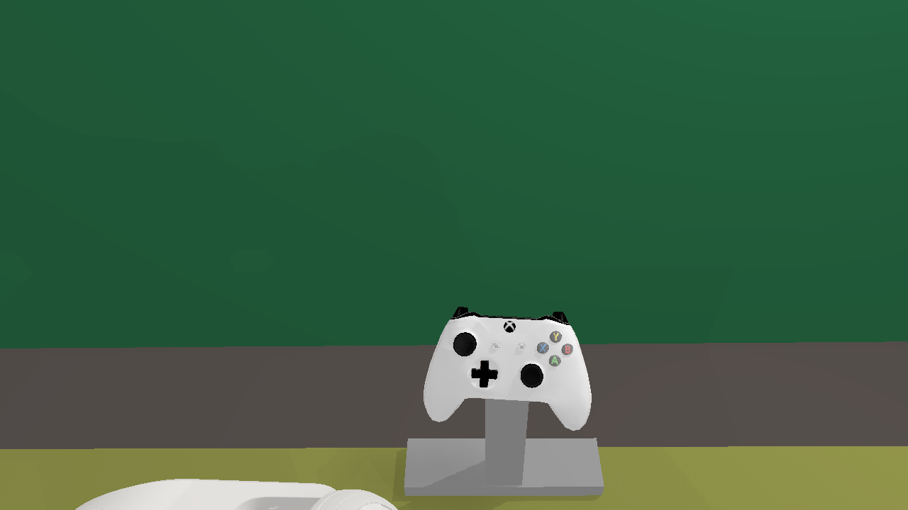
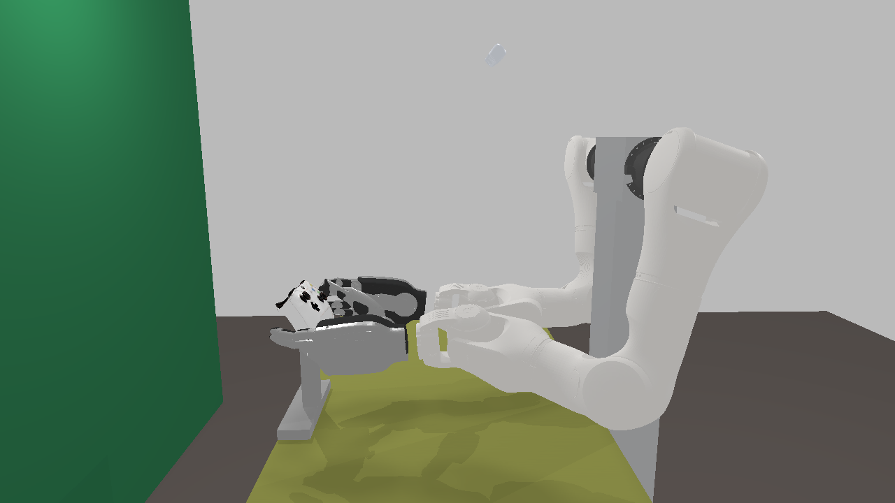

# 任务 X：camera_3 范围内的手柄位置选择

**推荐 d=50 mm、h=220 mm，倾角 46.67°（正对 camera_3 的姿态再 +10°）。** 左右手均找到任务 S 口径的自然臂姿＋纯握持；所选姿态完整控件覆盖为左 0/8、右 0/8。手柄真实视觉网格最小画面余量 110.94 px。

72 个粗网格候选中，59 个通过 20 px 可见性门，13 个未进入求解。完成 118/118 个单手求解及对应结果记录；39/59 个可见配置找到双手各自的自然纯握持解。这里的纯握持沿用任务 S：无名指、小指背壳原生接触通过，不代表整掌包握、力闭合或动态操作成功。

## 推荐与前三名备选

按可见性硬门、双手纯握持、臂姿偏差、完整控件覆盖、较小 d 排序。下表倾角增量均相对于该点正对相机的姿态；绝对倾角是正面相对水平面的倾斜角。

| 顺位 | d / h mm | 倾角增量 / 绝对倾角 ° | 余量 px | 双臂平均偏差分 | 所选左 / 右覆盖 | 同点观察到的最大左 / 右覆盖 |
|---|---|---|---:|---:|---|---|
| 推荐 | 50 / 220 | +10 / 46.67 | 110.94 | 0.03104 | 0/8 / 0/8 | 4/8 / 0/8 |
| 备选 1 | 75 / 190 | +10 / 43.04 | 48.48 | 0.03380 | 0/8 / 0/8 | 4/8 / 0/8 |
| 备选 2 | 25 / 250 | +10 / 50.42 | 173.48 | 0.03965 | 0/8 / 0/8 | 4/8 / 0/8 |
| 备选 3 | 50 / 190 | +10 / 45.00 | 85.45 | 0.04305 | 0/8 / 0/8 | 4/8 / 0/8 |

控件覆盖与臂姿存在取舍。排序使用臂姿分最低的已通过候选，控件覆盖随后比较；“同点最大覆盖”可能来自另一掌位，不与所选姿态混为一个结果。[summary.json](summary.json) 保留每点的全部已复核候选摘要。

推荐点的臂姿（括号内为相对理想值的有符号偏差）：

| 指标 | 左手 | 右手 | 硬门 / 理想值 |
|---|---:|---:|---|
| 上臂前倾 ° | 21.82 (+1.82) | 17.85 (-2.15) | 10–35 / 20 |
| 肘内角 ° | 94.48 (-0.52) | 98.70 (+3.70) | 记录 / 90–100，中值 95 |
| 前臂俯仰 ° | 5.08 (+5.08) | 0.11 (+0.11) | −10–25 / 0 |
| 前臂朝向偏差 ° | 7.26 (+7.26) | 2.21 (+2.21) | ≤30 / 0 |
| 腕部偏差 ° | 38.55 (+38.55) | 15.68 (+15.68) | 软偏好 / 0 |
| 肘心在肩心前方 mm | 110.73 | 28.67 | >0 |

推荐立柱的柱脚中心为 world x=675.91、y=624.87 mm，即柱轴距桌边往里 42.49 mm；立柱从 20 mm 底座顶面起高 192.31 mm，顶部支撑点离桌面 212.31 mm。与手柄中心 d、h 的差值来自倾斜后的背壳支撑点。尺寸仍是本次碰撞包络，未生成夹具 CAD。

三个备选的左右臂摘要，依次为“上臂前倾 / 肘内角 / 前臂俯仰”，单位 °：

| 备选 | 左手 | 右手 |
|---|---|---|
| 1 | 20.74 / 91.44 / 3.45 | 17.17 / 95.89 / -1.59 |
| 2 | 22.53 / 98.37 / 6.74 | 18.71 / 102.46 / 1.63 |
| 3 | 19.82 / 98.28 / 1.63 | 15.54 / 102.73 / -3.33 |

## d × h 全网格

每格 `V/B; L,R; Δ` 表示：3 档倾角中可见的数量 / 双手均找到解的数量；该格按上述规则最优倾角的左右完整控件覆盖；该倾角增量。`未找到` 是有限求解结果，未宣称不可行。全部 72 行及逐侧角度、理想值偏差见 [grid.csv](grid.csv) 和 [summary.json](summary.json)。

| h \ d mm | 0 | 25 | 50 | 75 | 100 | 125 |
|---:|---|---|---|---|---|---|
| 190 | 3/3; 0/8,0/8; +0° | 3/3; 0/8,0/8; +0° | 3/3; 0/8,0/8; +10° | 3/2; 0/8,0/8; +10° | 0/0；不可见 | 0/0；不可见 |
| 220 | 3/3; 0/8,0/8; +0° | 3/3; 0/8,0/8; +10° | 3/3; 0/8,0/8; +10° | 3/2; 0/8,0/8; +10° | 2/0; 0/8,未找到; +10° | 0/0；不可见 |
| 250 | 3/3; 0/8,0/8; +10° | 3/3; 0/8,0/8; +10° | 3/2; 0/8,0/8; +10° | 3/1; 0/8,0/8; +10° | 3/0; 0/8,未找到; +10° | 0/0；不可见 |
| 280 | 3/3; 0/8,0/8; +10° | 3/2; 0/8,0/8; +10° | 3/2; 0/8,0/8; +10° | 3/1; 0/8,0/8; +10° | 3/0; 0/8,未找到; +10° | 3/0; 0/8,未找到; +10° |

**真实网格复核盒估计：** h=190 mm 时，本网格最大可见内移为 75 mm；100 mm 的三档均未过。h=220 mm 时 100 mm 的正对姿态余量 25.2 px，−10° 档只有 19.2 px 被排除，+10° 档为 33.2 px。h=250 mm 时最大可见网格距离仍为 100 mm；h=280 mm 时 125 mm 的三档均可见。因而“220–250 mm 高度约 100 mm 内移”的估计得到支持；190 mm 高度的盒估计偏保守，本网格允许 75 mm。上述是 25 mm 网格的结果，不是连续空间的最大距离证明。

投影使用 0.4.1 全部 16 个视觉部件、6062 个真实 glTF 顶点及场景图变换，包含控件中性位置；未用盒子、凸包或抽样点替代。glTF 米制缩放、+90° X 轴转换和移动部件绑定与 `robotwin.visual` 相同，中性关节的 pivot 抵消误差为 0。另记录原生 SDF 网格投影作对照。可见性门只约束手柄的画面边界，不要求手臂入镜，也不把握持时的遮挡当作裁切。

## 右手覆盖是否改善

**本次已复核自然握持中，右手最大为 0/8；相对任务 S 的 0/8，未观察到改善。** 推荐及备选各自的结果见上表。每个可见点的已通过纯握持候选均完成控件流程；链长界排除项跳过数值 IK，其余使用任务 S 的有限 IK 和原生接触判据。

联合优化/精修新增的原生通过条目为左 1、右 0。这项计数单独保留，避免把迁移旧掌位的数量当作新的握持类型。

推荐点右手的 A、B、X、Y、RS、RB、RT 仍由当前掌位的链长界排除；R3 的有限点位 IK 未找到解。左手 4/8 的另一姿态通过 Dpad_up、Dpad_down、Dpad_left、L3。

刚体迁移旧握持保持 `palm_in_pad` 不变，因此单纯搬动世界位姿不会改变该掌位的手指链长界；只有位置允许另一个自然掌位时，覆盖才可能改变。本次每点额外做了全臂、手联合优化，允许掌位改变，并保留所有通过候选的覆盖结果。未找到覆盖改善只说明这次种子与计算上限下没有观察到，不能作为全部自然掌位都不可达的证明。

## 模型、求解与排序口径

- 固定 C 型夹锚点为桌边 `(0.7184, 0.6252, 0.767)` m；`d` 沿 world −x 往里。`h` 与任务 S 一致，指手柄资产根坐标系这个设计中心的离桌面高度，不是表面最低点或质量中心。左右居中，根位置为 `[0.7184−d/1000, 0.6252, 0.767+h/1000]`。推荐点完整根位姿、左右臂 7 关节、手主动关节和含 mimic 的 21 关节均在 [candidates.json](candidates.json)。
- 使用当前 v4.5 安装朝向，camera_3 的场景位姿和 1280×720 内参固定。已核对任务 S 留档的臂安装与当前一致，没有重复施加 J1 negation/offset。默认正面法线精确指向 camera_3，左右轴保持水平；相机略偏中线，因此 yaw 由此确定，约为 −90° 附近的小修正，并非新增搜索自由度。±10° 仅绕该左右轴旋转。
- 竖直立柱截面 world x 方向 30 mm、沿桌边 y 方向 40 mm，正对 K0 背壳支撑采样点下方；从 20 mm 高底座顶面到该点高度。底座在桌边为 220×60×20 mm，220 沿 y，向内延伸到完整柱脚；d=0 时背壳点略在桌外，包络也向外延到柱脚。这里保守地按全 220 mm 宽度延伸，未设计接头、C 夹实体或验证刚度，不修改夹具 CAD。
- 复用 [任务 S](../2026-10-23-natural-grip-fixed/README.md) 的 `FixedProblem`、`FixedNative`、轴线肩肘腕定义、接触和碰撞门。每点左 3 个、右 1 个任务 S 已通过种子；先做最多 100 次函数评估的定掌位臂 IK，再各做一次最多 65 次函数评估的联合可达偏好优化，满足近解条件时再最多 30 次原生可行性精修。联合 proposal 的 `reach_scale=3`、`natural_weight=3`；定掌位臂 IK 的理想角残差权重为 0.0002，自然边界残差乘 4。这些是提案权重，原生通过判据保持上述数值。没有新增大规模随机搜索。求解使用原有 [SciPy TRF](https://docs.scipy.org/doc/scipy-1.15.3/reference/generated/scipy.optimize.least_squares.html)；优化收敛本身不算通过。
- 硬门为上臂 10–35°、肘在肩前、前臂 −10–25°、朝向偏差 ≤30°，以及桌面、桌架、站立柱、安装座、新支柱和底座无穿透。沿用 K0 的 1 µm 原生数值容差；无名指、小指背壳接触、0.25 mm 点位容差、数字键 30° 法线锥、摇杆 8 个 80% 端点及扳机 80% 行程口径保持。30 mm 桌面净空只记录，腕偏差只作软偏好。机器人网格采用 K0 的 MuJoCo 原生凸近似。控件仍按两侧分别验收，固定本侧臂、掌、无名指和小指，只改变指定操作指；双手图额外检查静态组合，不宣称已验证双侧同时操作。
- 每侧臂姿分为 `mean(((上臂−20)/15)^2, ((肘内角−95)/25)^2, (前臂俯仰/25)^2, (朝向偏差/30)^2) + 0.1*(腕偏差/90)^2`，越小越好。每侧先选通过且分最低的候选，双侧取平均；随后比较完整控件覆盖总数，再偏好较小 d。这个分数是本次明确采用的工程排序，不是人体舒适度量表。

## 渲染与验证

推荐点 camera_3：

双手握持的同管线虚拟侧视：

另有 [双手 camera_3](images/both_camera_3.png)。渲染复用任务 S 的 `render_natural_grip_fixed.py` → `operator_view` → 公开 `robotwin.create_scene` 和现有 appearance；未另写渲染器。为使采集状态审阅真的能切到侧视，加入显式 `review_camera` 选项，默认采集路径不启用。现有采集视图测试 3 项通过，并实际查看了两个视角的图片。

前三名备选及推荐的双手组合均做了额外静态接触和跨机器人网格距离检查：4/4 通过，见 [pair-verification.json](pair-verification.json)。环境和接触证据仍沿用任务 S 的自身碰撞范围，不构成动态轨迹或真机证书。

计算窗口 42.97 分钟，截至计算结束的任务窗口 49.47 分钟，分别低于 60 和 90 分钟；按并行墙钟计，未把 worker 时长相加。完成 471 条候选条目、160 条纯握持控件复核；条目不等于几何唯一解。开始时查询的计算节点 GPU 均被其他进程占用，故求解与 SAPIEN Vulkan lavapipe 渲染都用 CPU。最终任务进程残留 0。

渲染环境实际为 SAPIEN 3.0.3、xbox-gamepad-physics 0.4.1。CPU 环境安装元数据显示 0.4.0，但沿用任务 S 的隔离 PYTHONPATH，实际接口源自该 0.4.1 包；旧 CPU 资源的 40 个碰撞文件及 full_controls motion 合同已与 0.4.1 逐文件核对一致。没有安装依赖或覆盖共享环境。版本、场景及源码校验见 [provenance.json](provenance.json)，结束状态见 [verification.json](verification.json)。

原始模型、所有求解和控件检查点、单次有界日志及每点运行场景副本保留于 `workspace://runs/gamepad-placement-x-20261103/`。采集场景 JSON 和夹具 CAD 未改；未 commit，未连接采集台、启动 SDK/珞石节点、发送硬件命令或打断 8780。

## 待实体实验验证的部分

本次已执行的是可见性投影、有限求解、原生静态复核和同管线渲染。实体位置、相机标定误差及安装推断仍需验证：固定相机，在推荐点和一个备选点人工放置同一手柄/标记卡，量四边像素余量；若均与投影一致且 ≥20 px，支持可见性模型，若系统性偏移则推翻其当前实物精度。随后在另行获得硬件执行授权的实验中，按导出的姿态测实际肩肘腕、接触和环境间隙；若图像通过而臂姿/间隙不符，应检查运动学或安装近似，不能把仿真通过写成真机握持成功。这里仅提出该验证方案，未执行实体实验。
