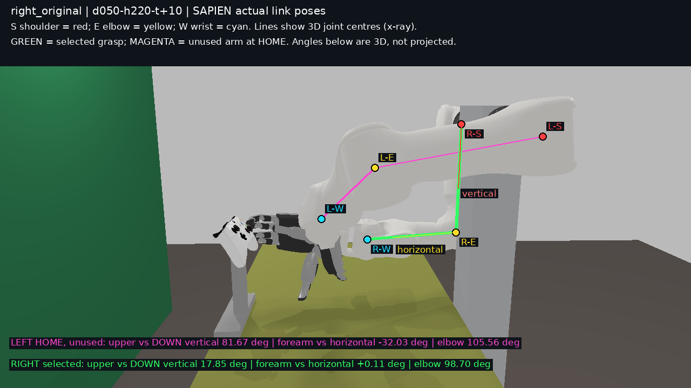
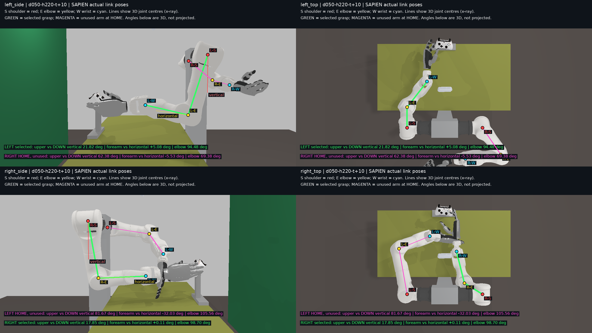

# 任务 Y：臂姿指标与渲染一致性核对

**结论：一致，无运动学 bug。** 原 `right_side.png` 前景中上臂接近水平的是未参与求解的**左臂 home**；推荐右臂位于后方，上臂受到立柱和前景臂遮挡。原图把两个不同状态的臂放在一起，没有标明左右和是否为所选解，容易混淆。

> 背景说明（审阅者）：用户原话是"为什么右臂的手肘选择了直角下垂？"。"上臂水平前伸、前臂直角下垂"是审阅者自己的理解，误作为用户观察写进了任务书，本次排查就是基于这个误读发起的。用户问题的直接答案是：右臂解（上臂前倾 17.9°、肘 98.7°、前臂俯仰 0.1°）正是任务 S/X 设定的自然姿态目标的中心。

推荐点的左右手分别复核；同时把三个备选的左右手也做了静态 FK 对照，共 8 组。指标、求解原生模型、SAPIEN 独立 FK、SAPIEN 实际 link 位姿的最大位置差 **0.000346 mm（0.346 µm）**，远小于 1 mm。实际渲染输入的关节值与导出值最大差为 **5.884×10⁻⁸ rad**。

基线 HEAD：`a643a8f`。按要求使用 `2026-11-04` 报告目录；实际执行时间为 2026-11-03 UTC。未修改生产代码、采集场景 JSON 或 CAD，未 commit。

## 直接看原图中的两条臂

下图完整复用原相机和原状态。新捕获的未标注原视角图与任务 X 的 `right_side.png` **逐像素相同**：平均通道差、最大差及不同像素比例均为 0，见 [image-replay.json](image-replay.json)。绿色是选中的右臂，品红色是未使用的左臂 home；点和线按实际三维关节位置投影，遮挡区域以透视标注显示，不表示关节表面可见。



| 原图中的臂 | 上臂相对向下竖直 / ° | 前臂相对水平 / ° | 肘内角 / ° | 状态 |
|---|---:|---:|---:|---|
| 前景左臂 | 81.67 | −32.03 | 105.56 | home，未参与右手求解 |
| 后方右臂 | 17.85 | +0.11 | 98.70 | 推荐右手解 |

因此，图中“水平伸出去的上臂”不能拿来和右手推荐解的 17.85° 比较；左臂 home 的真实前臂俯仰也不是 −90°，图像中的下降趋势含视角、遮挡与腕/手姿态。

## 左右手侧视、俯视标注

上排左手，下排右手；左列侧视，右列俯视。侧视从被检查臂这一侧看，以减少另一条臂的遮挡。红点 S 为肩、黄点 E 为肘、青点 W 为腕；绿色折线对应推荐解，品红对应另一条臂 home。红色参考线为向下竖直，黄色参考线在世界水平面内。角度是世界坐标三维夹角，不是图片中的二维投影角；俯视不用于直接读俯仰角。



单张原尺寸图：[左侧视](images/left_side_annotated.png)、[左俯视](images/left_top_annotated.png)、[右侧视](images/right_side_annotated.png)、[右俯视](images/right_top_annotated.png)。另存 [双手同时推荐解侧视](images/both_side_annotated.png) 和 [双手俯视](images/both_top_annotated.png)。

| 推荐解指标 / ° | 左手指标 | 左手实际 link | 右手指标 | 右手实际 link |
|---|---:|---:|---:|---:|
| 上臂相对向下竖直 | 21.81970 | 21.81970 | 17.85110 | 17.85110 |
| 前臂相对水平 | 5.08121 | 5.08122 | 0.10689 | 0.10690 |
| 肘内角 | 94.47610 | 94.47609 | 98.69860 | 98.69859 |

## 同一组 q 的世界坐标与差值

先固定推荐解的 7 关节 q，保持 v4.5 安装和手掌 mount 不变，再比较以下独立路径：

1. **指标**：`k1_natural_reference.ArmFeatures.frames/measure`，从原 URDF 串联 FK 和关节轴线计算。肩取 J1/J2 轴线最近点中点，腕取 J5/J6/J7 轴线最小二乘交点，肘取 J4 轴线上距肩腕连线最近的点。
2. **求解原生模型**：使用 `feasibility.clean_urdf` 和 `CollisionScene` 相同的裁链、`base_pose` 挂载与命名关节赋值方式，独立编译 MuJoCo 臂链，再 `mj_forward` 读位姿；掌位由实际 TCP 乘原 mount。这里没有把 `ArmFeatures` 算出的点作为原生模型输入。
3. **SAPIEN FK**：使用 `operator_view` 的同一 `SapienBackend` 场景及 `compose_robot_urdf` 产物，`set_review_state` 按名字赋值；调用实际 articulation 的 `create_pinocchio_model`，以实际 q 做 FK，再乘实际根位姿。
4. **实际 link 对照**：从渲染场景直接读 `get_entity_pose`；一份按轴线独立重建，一份直接取 link2/J2、link4/J4、link5/J5 的原点。后者是本模型与轴线定义的实测对照，不是预先用 link 原点替代指标。掌根读取 `hand_base_link`（右侧带 `right_`），掌质心为该 link 位姿变换原网格局部质心。

肩、肘、腕以及两种掌位置如下。单位 mm，三列均为 world `(x,y,z)`，显示到 0.001 mm；数值接近到这一精度后显示相同，跨舍入边界可能出现末位相差 0.001 mm，实际未舍入差值在后表和 [comparison.json](comparison.json)。

| 侧 / 点 | 指标世界坐标 | SAPIEN FK 世界坐标 | SAPIEN 直接 link 世界坐标 |
|---|---|---|---|
| 左 / 肩 | (36.914, 885.700, 1262.000) | (36.914, 885.700, 1262.000) | (36.914, 885.700, 1262.000) |
| 左 / 肘 | (147.645, 940.304, 953.631) | (147.645, 940.304, 953.631) | (147.645, 940.304, 953.631) |
| 左 / 腕 | (365.708, 769.319, 978.270) | (365.708, 769.319, 978.270) | (365.708, 769.319, 978.270) |
| 左 / 掌根 | (475.244, 767.606, 968.330) | (475.245, 767.606, 968.330) | (475.244, 767.606, 968.330) |
| 左 / 掌网格质心 | (554.813, 765.849, 960.751) | (554.813, 765.849, 960.751) | (554.813, 765.849, 960.751) |
| 右 / 肩 | (36.914, 354.700, 1262.000) | (36.914, 354.700, 1262.000) | (36.914, 354.700, 1262.000) |
| 右 / 肘 | (65.587, 452.403, 945.826) | (65.587, 452.403, 945.826) | (65.587, 452.403, 945.826) |
| 右 / 腕 | (335.998, 517.765, 946.345) | (335.998, 517.765, 946.345) | (335.998, 517.765, 946.345) |
| 右 / 掌根 | (445.301, 516.238, 958.608) | (445.302, 516.238, 958.608) | (445.301, 516.238, 958.608) |
| 右 / 掌网格质心 | (524.811, 515.427, 966.975) | (524.811, 515.427, 966.975) | (524.811, 515.427, 966.975) |

以下为相对指标坐标的欧氏距离，单位 **mm**；完整有符号 `Δx/Δy/Δz` 也记录在 JSON 的 `errors.*.*.delta_mm`。

| 侧 / 点 | 求解原生 FK Δ | SAPIEN FK Δ | 实际 link 轴线重建 Δ | 直接 link 原点 Δ |
|---|---:|---:|---:|---:|
| 左 / 肩 | 0.00000000 | 0.00016978 | 0.00006307 | 0.00005497 |
| 左 / 肘 | 0.00000000 | 0.00028759 | 0.00008992 | 0.00006915 |
| 左 / 腕 | 0.00000000 | 0.00014907 | 0.00008758 | 0.00009174 |
| 左 / 掌根 | 0.00000000 | 0.00011889 | 0.00006153 | 0.00006153 |
| 左 / 掌网格质心 | 0.00000000 | 0.00013763 | 0.00006967 | 0.00006967 |
| 右 / 肩 | 0.00000000 | 0.00007610 | 0.00012450 | 0.00016136 |
| 右 / 肘 | 0.00000000 | 0.00011239 | 0.00012724 | 0.00014822 |
| 右 / 腕 | 0.00000000 | 0.00014744 | 0.00015156 | 0.00015156 |
| 右 / 掌根 | 0.00000000 | 0.00016589 | 0.00018673 | 0.00018673 |
| 右 / 掌网格质心 | 0.00000000 | 0.00019946 | 0.00020397 | 0.00020397 |

## 安装、映射与候选排名

安装链已核对：指标在 `scripts/k1_natural_reference.py` 中使用 `base_pose @ inv(T_design_base_zero)`；求解原生模型在 `src/gamepad_vla/feasibility.py` 中裁到指定 base 并挂到相同 `base_pose`；渲染在 `src/gamepad_vla/workstation/sapien_backend.py` 中通过 `compose_robot_urdf` 裁同一链并 `set_root_pose(base_pose)`。任务 X 导出的各 rank `spec.json` 保留 v4.5 安装；本次没有施加额外 J1 符号或 offset 补偿。

`scripts/render_natural_grip_fixed.py` 的 captures 循环先给两侧填入 home，只用当前 active_side 的推荐 q 覆盖本侧；所以 `right_side.png` 原本就包括左臂 home。`operator_view.render` 按 `left/right` 拆状态，`SapienBackend.set_review_state` 按关节名写入各自 articulation。实测 FK 和逐像素重放表明：原图中未标记的闲置臂和遮挡容易引起混淆，推翻本次推荐解存在安装、左右臂映射或关节顺序不一致的假设。

推荐与三个备选的复核结果：每项最大差包括肩、肘、腕、掌根、掌质心和上述四种对照方式。

| 原顺位 / 点 | 左手最大差 mm | 右手最大差 mm | 本次处理 |
|---|---:|---:|---|
| 推荐 / `d050-h220-t+10` | 0.00028759 | 0.00020397 | 保留原解与顺位 |
| 备选 1 / `d075-h190-t+10` | 0.00031367 | 0.00026176 | 保留原解与顺位 |
| 备选 2 / `d025-h250-t+10` | 0.00034585 | 0.00020845 | 保留原解与顺位 |
| 备选 3 / `d050-h190-t+10` | 0.00031241 | 0.00017476 | 保留原解与顺位 |

**没有修复前后差异：没有发现不一致，因此未改求解/指标/渲染代码，也未重新优化或重复控件复核。** 这里按任务 Y 第 4 项完成；静态 FK 审计不产生新的握持或控件覆盖证据。任务 X 原排名和所选左右各 0/8 覆盖结果保持原样，左手另一掌位的 4/8 也没有被改成所选掌位结果。未新增生产回归测试；诊断脚本对 8 组坐标执行 ≤1 mm 断言并通过。

## 已执行验证与复现

计算节点运行目录：`$GAMEPAD_VLA_WORKSPACE/runs/arm-posture-y-20261104`。复用任务 X 的只读代码快照；7 个相关源码/场景文件哈希与本地 HEAD 工作树一致，见 [provenance.json](provenance.json)。SAPIEN 3.0.3、xbox-gamepad-physics 0.4.1；`CUDA_VISIBLE_DEVICES` 为空，Vulkan 只加载 lavapipe ICD，全部为 CPU。未安装依赖、修改共享环境或执行物理 step。

审计工具 [audit.py](audit.py) 的 `native` 使用既有 fixed-gamepad Python 3.11 环境；`fk`、`render`、`compare` 使用既有 SAPIEN Python 3.10 环境。之所以分阶段，是现有两个环境分别提供原生求解依赖与渲染依赖，无需安装包。

```bash
# 在计算节点；W 指向站点配置中的计算节点工作区（GAMEPAD_VLA_WORKSPACE）。
W=$GAMEPAD_VLA_WORKSPACE
cd "$W/runs/gamepad-placement-x-20261103/code"
export GAMEPAD_VLA_WORKSPACE="$W"
export PYTHONPATH="$PWD/src:$PWD/scripts"
export CUDA_VISIBLE_DEVICES=
export GAMEPAD_VLA_RENDER_DEVICE=
export VK_ICD_FILENAMES=/usr/share/vulkan/icd.d/lvp_icd.x86_64.json
export XBOX_GAMEPAD_PHYSICS_RESOURCES="$W/assets/xbox_gamepad_physics_v0.4.1/resources"
export OPENBLAS_NUM_THREADS=1 OMP_NUM_THREADS=1
Y="$W/runs/arm-posture-y-20261104"
X="$W/runs/gamepad-placement-x-20261103"
OUT="$W/runs/arm-posture-y-replay"  # 使用尚不存在的新目录
"$W/envs/fixed-gamepad-mujoco-py311/bin/python" "$Y/audit.py" native --source "$X" --output "$OUT"
"$W/envs/sapien-3.0.3-py310/bin/python" "$Y/audit.py" fk --source "$X" --output "$OUT"
"$W/envs/sapien-3.0.3-py310/bin/python" "$Y/audit.py" render --source "$X" --output "$OUT"
"$W/envs/sapien-3.0.3-py310/bin/python" "$Y/audit.py" compare --source "$X" --output "$OUT"
```

重新出图应使用新的 output 目录，避免读取旧 mmap、stop 或一次性审计文件。输出包含 `native.json`、`render-fk-all.json`、每张图的 `render-audit.json`（实际 q、Pinocchio 位姿、实际 link 位姿及实际相机矩阵）、`projected-points.json`、原图与有界日志；这些原始运行产物留在计算节点，报告只带结论、数值和图片。渲染调用原 `operator_view.render`，仅在一次性诊断进程中包裹 `set_review_state` 读取位姿；没有第二套场景、灯光、材质或渲染实现。

已执行：8/8 组原生 FK 和 SAPIEN FK/link 对照；7 张同管线原图及标注图；原视角逐像素重放；人工查看原视角标注和四视图，确认点线落在对应臂上；本任务进程残留为 0。在 1 小时预算内完成；未进入运动学 bug 修复循环。

本结论针对这些固定 q 的仿真内部一致性；v4.5 右臂 +15° 安装推断的实体精度未在本次验证。实体检验方案：另获硬件授权后，在相同 q 下测量肩肘腕位置并与这里的世界坐标对照；若仿真三路仍一致而实测系统性偏移，应检验安装/标定而非改动渲染映射。本次未执行实体实验。
