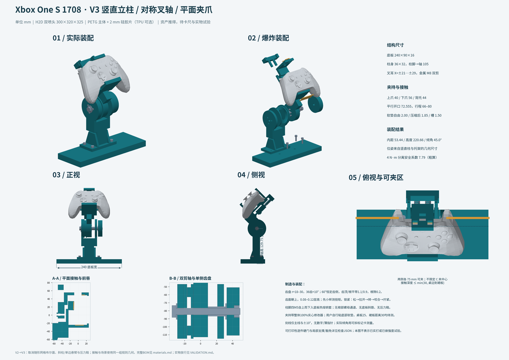
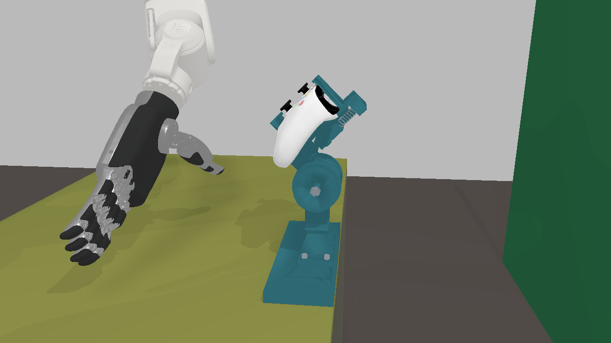

# 手柄夹具 V3：竖直柱、对称叉轴与平面接触

基线 HEAD `76ae32a`。本轮重构了参数化 CAD，并重生成默认 PETG、铝底板、TPU、小样、标记支架、全部预览、设计总图、材料表及实物验证单。**三套主件各18项硬门、小样和标记支架的适用硬门全部通过；47份打印件检查实例均为60k表面采样加全部三角面中心，未豁免标记为0。** 通过包含明确的局部支撑计划与边角豁免，不等于已经切片或实打。

默认手柄中心距桌边向内 **53.4378 mm**、台面以上 **220.6609 mm**、倾角 **45°**。实际 V3 网格已导入新仿真场景，手柄与 CAD 装配对齐；完整视觉网格及控件行程投影最小余量 **111.105 px**，SAPIEN 实际分割最小余量 **112 px**，均超过20 px。CPU原生复核保留左手严格/现实各 **5/8**、右手严格 **4/8**、现实 **6/8**，不能据此声称全控件操作成功。

[设计总图 PNG](../../../hardware/gamepad_fixture/design_sheet.png) · [A3 PDF](../../../hardware/gamepad_fixture/design_sheet.pdf) · [材料/BOM](../../../hardware/gamepad_fixture/materials.md) · [实物验证单](../../../hardware/gamepad_fixture/VALIDATION.md) · [完整硬门摘要](checks_summary.json)

## 逐条落实

| 要求 | V3怎么做 | 已执行结果／边界 |
|---|---|---|
| 位姿是结果，X/Z是区域 | 先选240×90×16底板、90×50×8柱脚、36×32直柱、柱脚到轴105、轴到背支撑竖向100、柱中心内距30等结构尺寸，再推root | d53.4378/h220.6609，位于25–75/190–250内部；未把d050-h220作为CAD输入 |
| 竖直立柱、Z轮廓 | 柱轴竖直，轴线与背支撑点的水平坐标一致；Z轮廓来自底板—柱—托架 | 导出实体和世界侧视复核；没有斜柱 |
| 删除无效底板斜筋 | 底板不再长4块接近法兰的斜筋 | 两个可夹区各3000条顶面射线，偏差≤0.000011 mm，无固定结构侵入上方60mm |
| 根部左右对称筋、方向正确 | 柱两侧各一块6mm厚钝端筋，位于前后载荷YZ平面，实际贴合柱体 | 从实际STL隔离筋体测惯性主平面，法向≈X、与主载荷面夹角0°；两侧对称 |
| 无根部螺母通道 | 四M5从上穿柱脚进入底板8mm热熔母，导孔深9；铝版改M5攻牙底孔 | 默认螺钉底隙约1mm，铝版2.5mm；根部受保护区无切除交叠 |
| 每次切除检查 | 63个实体切除记录前后体积、实际removed STL与允许位置，并独立检查柱根禁切区 | 全通过；不是只相信刀具体积或注释 |
| 取消压力鞋、夹带分压圈 | 两鞋、C夹用M8大圈及其垫片删除；使用者自贴底部薄垫不画入装配 | 新导出无旧件。转轴上的标准M8平垫是轴紧固件，予以保留 |
| C夹不定点、裙板约束 | 整带100%修改器，深度取min(夹带深度,桌边到裙板距离)，默认30；安装孔只在柱脚覆盖区 | 剩余平带X=[−120,−45]、[45,120]，各75、总150mm；实际压脚须完整落在平带内 |
| 未实测桌尺寸参数化 | 桌厚25、桌边到裙板30、底部自贴垫厚1/压缩0.25均为参数 | 新试验场景使用这些假设；采集默认场景不变，须实测覆盖 |
| 双剪对称叉轴 | 耳板X=−29…−21/+21…+29，转动毂居中，M8金属轴穿两耳 | 两耳均在|X|<30；骨架镜像通过，单侧孔/轴套等功能差异按局部区域豁免 |
| 轴向释放且不掰叉耳 | 左侧一对定位Hirth盘，右耳用可轴向滑动金属套；松—拉开—转—合—紧 | 不加分离弹簧/弹簧分度；避免两侧Hirth重复定心，右侧仍提供剪切支承 |
| 宽夹爪、抗扭 | 上爪40、下爪56、背托44宽；接触垫实际外宽36/52/40；下端小侧挡限位 | 实际避让后的垫片积分粗算0.46269 N·m，0.4工况SF1.1567；不能以外宽直接计算 |
| Pair、USB、肩键避让 | Pair位置正式从完整视觉网格测得，左右对称功能槽留2.1mm；默认保留USB插线通道 | 实际Pair最小2.100mm，肩键约3.088mm；插头外形仍待卡尺复核 |
| 接触面不得嵌开口/接缝 | 上下爪和背托均为规则平面，槽/唇为简单盒体；不再调用exterior_cutter或资产网格布尔贴合 | 耳机、扩展口、USB、Pair包络门通过；下垫在孔外平面跨口，没有资产缝隙凸棱 |
| 保留前唇 | 两爪前端Z=22…26的防脱唇保留 | Xbox控件最小间隙约2.925mm；真人前面板/指尖通路仍须核对，左Dpad_down见证碰下唇，见覆盖节 |
| 平行夹持、视觉优先 | 基于现有ControllerAsset增加上游visual binding读取，稳健射线拟合标量平面；CoACD仅对照 | 上下基准Y=48.62338/−23.93142，法向平行；残差和窗口见下节 |
| 背托避电池盖 | 背托取Y=12…34，名义电池盖/卡扣排除区Y≤8，平面斜率从视觉拟合 | 背托实际视觉净空≥0.27965mm；排除区是未实测假设，不能当实物盖缝位置证据 |
| 恰定约束说明 | 背托、下沿、侧挡承担3/2/1基准职责，上爪只预紧；有限面间冗余由软垫顺应 | 属柔顺的3-2-1近似，不宣称三个连续刚性平面严格恰定 |
| 软垫统一偏置链 | 自由2、压缩0.15、受压1.85；槽1.5、自由凸出0.5、受压凸出0.35 | 三处实际STL面/槽底误差≤约0.000003mm，满足≤0.05；实际硬件视觉净隙均≥0.25 |
| 真正恒侧角Hirth与根隙 | 36齿、工作r18…30、60°恒侧角；固定顶/根平带1.1/0.9；配对面连续裁平、根顶0.2间隙 | 六个实际STL截面各7200射线确认36齿；侧角误差约0.00146°，没有逐点relief尖台阶 |
| 锁紧SF≥3、预紧提升 | M6→M8；旋钮Ø60；握右旋钮，用左M8头13mm扭矩工具达到1.2N·m；碟簧仅可选 | 4N·m分离SF7.794；齿剪粗算12.912N·m/4≈3.228；材料/预紧均未实测 |
| 指针、刻线、数字 | 删除薄突出片和小字；转动盘凹槽对线，固定盘仅主线与±10°辅助线 | 刻线宽1.3/深0.9，超过1.2/0.8；无微小字孔，实际倾角用标记卡 |
| FDM自动硬门 | 双向法线射线测壁/缝、2mm聚类、逐件打印方向图、45°悬垂与床/下方支承查询 | 47实例60k+全部face中心；零未豁免；完整豁免/支撑清单见摘要，不按整件放行 |
| 切片对照 | 检查Linux PATH/常规目录及Windows常见安装位置 | 无Orca/Bambu CLI，未做切片体积对照；没有把采样门当切片成功 |
| H2D与0.2/0.4、材料 | 以双喷头300×320×325和0.4喷嘴/.42线宽检查，齿盘面朝上0.08–0.12层 | 全部打印包围盒通过；0.2/PETG与PA-CF限制见材料表，现场喷嘴仍须确认 |
| 小样与金属备选 | 重导11个生产实体小样、可拆标记支架与1:1纸卡；比较金属rosette | 小样和支架打印门通过；扭矩/蠕变试验方案已写，尚未实打；金属方案未假装已适配 |
| 实际网格入仿真 | 新v3 spec用37个实际CAD分件GLB外观，碰撞组合独立；接触区使用同一规则几何 | 37个运行GLB散列与最终本地产物一致，实际SAPIEN中碰撞代理分割像素为0 |
| 装配/FOV硬门 | root直接来自V3压缩垫装配；完整视觉全顶点和控件两端/中间网格投影，实际SAPIEN掩码交叉检查 | 最小投影111.105px、实际112px；root和37个外观actor位姿均与CAD对齐 |
| 范围与执行 | CPU、--lan、scalelab01隔离运行；不改兄弟仓库/共享环境，不发物理命令 | 覆盖/最终复验含等待窗口23.09分钟；没有切换默认场景/8780，没有commit |

## V2到V3的主要改动

| 项目 | V2 | V3 |
|---|---|---|
| 布局输入 | 固定旧手柄root，斜柱反推 | 简单整数结构尺寸，root由装配推出 |
| 底板/柱脚 | 220×160×20；脚后移、4块斜筋、螺母通道 | 240×90×16；90×50×8脚、对称外置根筋、顶装热熔母 |
| 夹带 | 60深，定点鞋/分压圈 | 默认30深，柱脚外150长自由选择，无鞋/分压圈 |
| 转轴 | 单边悬臂M6；盘与柱/托架一体 | 对称叉耳M8双剪，左可拆齿盘、右滑套 |
| 齿形 | 36齿/r10–25/定高1.6/尖顶根 | 36齿/r18–30/恒60°侧角/平顶与独立根隙 |
| 预紧/4N·m分离SF | 0.5N·m，约1.9 | 1.2N·m，7.794；实际须测扭矩与蠕变 |
| 上/下/背外宽 | 20/24/30 | 40/56/44；功能槽后的实际垫片积分另算 |
| 接触面 | 未实测网格随形布尔 | 视觉测量后的平行平面/背托斜平面，无缝隙凸棱 |
| 夹爪弹簧 | 每根0.35N/mm，名义总约7N | 每根2N/mm，名义总40N；为抗扭所需的设计假设，必须实测 |
| 软垫压缩 | 0.25mm | 名义0.15mm，确保实际网格硬边净隙；不是材料测得值 |
| 读数与打印门 | 细字/窄刻线/0.8指针；无打印硬门 | 三粗刻线，无突出指针/数字，逐件筛查与局部支撑 |

C夹的1–2kN、压脚15–20mm工况保留，未悄悄把最大夹力降成1kN来通过计算。取消压力鞋后2kN/15mm的局部压力约11.3MPa，超过旧版暂定10MPa短时假设；须量实际脚径/夹力和长期压痕，不能用“手拧紧”认定夹力。该未实测工况没有被伪装成材料强度通过。

## 资产测量、接触窗口与偏置

读取的上游为xbox-gamepad-physics **0.4.1**，HEAD `73c867636804ef80217c54564bcee01c18c7c695`。完整视觉来自 `build/resources/common/xbox_one_s/visual/05_Controller_Body_VISUAL_UNCALIBRATED.gltf` 等；使用现有 `appearance.json` 的尺度和Y-up转换、URDF的link/FK绑定。`physical/full_controls.calibration.json` 的覆盖项当前为空，未杜撰局部标定；原资产仍是未实测的美术网格。[测量记录](../../../hardware/gamepad_fixture/contact_fit.json)、[资源出处](asset_provenance.json)

| 接触区 | 射线试探范围mm | 视觉拟合 | 视觉RMS/max mm | CoACD对照／差异 |
|---|---|---|---|---|
| 上沿 | X±20，Z6…17；端口/Pair足迹剔除，MAD去离群 | Y=48.623380；保留点主要Z8…17 | 轴向0.01861/0.05578；无约束斜平面RMS0.01142 | CoACD Y=48.626397，差−0.003017 |
| 下沿 | X±28，Z−8…14；耳机/扩展口足迹剔除 | Y=−23.931418 | 0.00620/0.04414 | CoACD Y=−23.931421，差约0.000003 |
| 背壳 | X±20，Y12…34，避名义电池盖区 | Z≈−10.1460+0.0197876(Y−23)，倾1.1336° | 斜平面RMS0.02668；轴平面RMS0.13124 | CoACD轴平面偏移−10.198875，相差0.05285；斜面RMS0.03535 |

上沿1863次射线中剔除端口773、离群224、保留866；下沿5085次中剔除870、保留4215；背部3645点保留。以上残差属于明确窗口和剔除规则，不能把修剪后的RMS当整片外壳平度。

另外对**实际垫片全部足迹**做了独立扫描：[完整足迹残差](contact_residuals_full_pad.json)。上垫Z6…8连接裙落在坡段，最大低于平面约0.574mm，并非全部201.7mm²都必然承力；下垫跨过接口时射线可深入孔内约9.31mm，这是被排除的空口，不能用2mm垫片“补平”或嵌入。背垫实际足迹平面残差约−0.063…+0.069mm。以名义0.15mm可放松厚度筛掉未接触坡段/开口，再按可用表面采样均压粗算抗扭约 **0.44879N·m**，仍仅为条件模型，不是压力分布或力闭合解。[可用表面诊断](contact_residuals_available_surface.json)

下沿开口包络的入口使用正式测得的Y=−23.931418，替换审阅原型取整的−24；X/Z范围和孔内深度保留，不以缩小接口隐藏穿入。规则平面停在孔外，从几何上跨口。

三处均按 `刚性槽底=拟合面向夹具偏移(自由厚−压缩量)`；2−0.15=1.85，槽深2−0.5=1.5，受压凸出0.5−0.15=0.35。实际STL验证面重合误差≤约3e−6mm；实际视觉网格对硬件最小净隙上/下/背为0.33340/0.34999/0.27965mm。软片与曲面间的小交叠/间断由拟合残差和实际压缩决定，不把它们写成实体已贴合。

基准职责为背托的Tz/Rx/Ry、下沿的Ty/Rz、间隙侧挡的Tx；上爪弹簧提供预紧。下沿有限面也会对Rx产生柔性反力，因此这不是严格六点运动学定位。两毫米软垫、可滑上爪和侧挡间隙避免重复刚性基准强迫装配；重复装夹漂移和接触印记仍要实测。此适配参考 [Carr Lane定位原则](https://www.carrlane.com/engineering-resources/fixture-design-principles/locating-clamping-principles/ctl)，没有把连续面接触冒称为严格恰定。

## Hirth、抗扭与打印方案

参考 [Voith原厂Hirth资料](https://www.voith.com/corp-en/products-services/connection-components-couplings/hirth-serrations.html)，这里采用自定心正向咬合原理和恒定侧面角，不沿用工业硬化钢的精度或承载声明。原始侧面为60°平面，齿高随半径变化；固定面连续裁平，移动面以同一延长侧面在两端裁平，保留齿顶/根部间隙，避免小relief台阶。

| 齿数 | 角度档距 | r18的半节距约mm | 本次取舍 |
|---|---:|---:|---|
| 36 | 10° | 1.571 | 采用；顶/根平带1.1/0.9，0.4喷嘴硬门通过 |
| 48 | 7.5° | 1.178 | 当前平带下内圈齿高仅约0.31mm，不自动采用；需重设计/小样 |
| 72 | 5° | 0.785 | 当前平带会消耗内圈节距，不适用本参数；不能只改齿数 |

默认0.4喷嘴线宽0.42，独立实体壁厚≥0.84、缝≥0.63；刻线1.3×0.9。齿盘单独用0.2/PETG、0.08–0.12层高可改善边缘与层阶，但保留36齿时仍为10°档距。PA-CF可选，按具体厂家干燥和喷嘴适配；PAHT-CF的原厂说明不兼容0.2、推荐0.6，不能把细喷嘴与纤维材料直接组合。[PAHT-CF原厂说明](https://bambulab-us.myshopify.com/products/paht-cf)

计算采用1.2N·m拧紧、K=0.2、M8，预紧约750N。设计4N·m、平均工作半径24mm、60°侧角给出分离力约96.23N、SF=7.794；有效4齿、暂定齿剪5MPa得到12.912N·m，设计扭矩的约3.228倍。0.3/1/4N·m三载荷的分离SF分别约103.9/31.18/7.79，不能把按键工况代替拉拔工况。所有系数和有效受力齿数是粗算假设。

上/下垫的实际几何面积为201.701/1144mm²；均压积分平均力臂为6.27888/13mm。在每侧40N、μ=0.6下，`M=μF(6.27888+13)/1000=0.46269N·m`，0.4工况SF1.1567；前述可用表面诊断更保守约0.44879。背托连续预压接触、E=0.6MPa的条件下，刚度34.5946N·m/rad、0.4N·m转角0.6625°。不能用此结果认证干燥/污染表面摩擦、真实壳体顺应或无预压时的刚度。

若把E=0.6MPa也用于上垫，40N/201.7mm²的线性压缩预测约0.66mm，明显大于名义0.15mm。需以实际片材、实际面积和力测压缩量后覆盖参数，不能同时把这两个输入当已证实材料属性。测试方法详见[验证单](../../../hardware/gamepad_fixture/VALIDATION.md)。

金属rosette备选可免去FDM齿顶/磨损问题，但需匹配采购齿形、固定孔和轴径；不是当前打印盘的直接替换件。[HDRiG原厂rosette](https://www.hdrig.com/hdrig-arri-m6-rosette_p294.html)公开外径31.8、中心M6与周边M3固定孔，适合据选定图纸重建接口，本轮没有虚构其额定扭矩或完成金属适配。用户列出的三款MakerWorld锁紧关节只作结构参照；未移植其网格/零件，也未取得可追溯的强度测试数据。主轴坚持金属螺栓，不以塑料销替代。

操作为松开—轴向拉开—转档—咬合—拧紧，不带齿强转，不加分离弹簧。右侧碟簧仅可选替换原1.6mm平垫，实际受载厚度须带入参数，必要时换长螺栓。三条刻线只认档，名义“40”主线在当前装配有5°时钟偏置；实际目标45°须用标记卡确认。

## 打印硬门、豁免与全部检查

[checks_summary.json](checks_summary.json)列出五套每件的原始标记、未豁免数量、完整空间区域/法向/理由和必要支撑。默认/铝/TPU分别11/10/14打印件，加11小样和1标记支架，共47份实例；每件60k随机点加全部面中心。全部CLI退出0。

| 检查组 | 最终结果 |
|---|---|
| 主件18门 | 实体/网格有效、装配、完整控件行程、壳/接口、握把区、偏置、切除体、筋/镜像、夹带/紧固、机制、齿形截面、滑块、位姿、仿真单位和打印门全通过 |
| 夹持带 | 两区各3000/3000射线；实料/修改器交集114621.18mm³，CAD期望114620.94，网格误差约0.24mm³ |
| 滑块/锁止 | 66–80mm、每0.5mm共29位置无非预期交叠；每处9条锁紧背板射线；最小并紧余量约9.55mm |
| M5/M3实际安装 | 打印M5底隙约1、铝2.5；M3每侧17条框架+9条盖板通路射线无封皮，长度链无顶底 |
| 原型区分对照 | 10mm实块PASS；0.8指针、0.6缝、悬空屋顶分别被薄壁/窄缝/悬垂门拒绝，每例3000点+全部面中心 |
| 切片器对照 | 未执行，环境没有Orca/Bambu CLI；未报告虚构耗材、时间或切片体积 |

保留的薄壁短弦仅为Hirth内/外径终止边及刻线开放端：默认固定盘161点、转动盘93点，均受环带/局部盒限制，内部齿面和槽没有整盘豁免。背托底边与框架的开放凹角4个窄缝点，局部裁剪实料30.09894mm³、1连通体，按窄区域和两组法向豁免；标记支架两处开放连接角19点，对应实料21.90870/21.45341mm³、各1连通体。没有把独立薄片或封闭狭槽放行。

默认件的悬垂原始点为柱2130、托架11431、滑块2374、盖1138；这些必须按命名支撑区在切片中落实。区域可能重叠，不能把逐区域豁免计数相加当独立点数。生产件之外，小样和标记支架也单独验了打印方向；没有因为是小样就整件豁免薄壁/窄缝。

## 最终位姿、实际仿真与FOV

默认竖向尺寸链为0.75底垫+16底板+8法兰+105到轴=**129.75mm轴高**，再到背支撑点100mm。背支撑局部点(0,23,−10.1460)按45°旋转，得到root高度220.6609、向内53.4378。没有精确d050/h220目标参与反算。

默认/TPU世界root为 **(664.962223,625.200000,987.660865)mm**。倾45°、yaw−90°，相对于正对camera_3约再倾8.6°，属于“约+10°”范围。距可行区左右界分别28.44/21.56mm，高度距上下界30.66/29.34mm，位于内部。铝底板厚8，沿用相同柱结构，root高度为212.6609mm；不把它误报成与打印底板完全同高。覆盖与FOV复核针对默认/TPU装配姿态；铝版212.66mm点未另做覆盖求解。

试验spec：[gamepad_fixture_v3.json](../../../configs/workcell/placement_trials/gamepad_fixture_v3.json)。37个真实分件GLB按仓库资产规则存入 `workspace://assets/derived/gamepad_fixture_v3/`；本轮运行资产约2MB，原始STEP/STL与检查位于CAD输出，未写机器绝对路径到spec。背托斜平面及软垫用同一组旋转规则盒体；其余结构使用射线分栏的盒体组合，Hirth只简化单齿、保留内板/环带台阶。

[碰撞近似证据](collision_approximation.json)给出各件双向差异：最大采样偏差约2.80mm出现在齿盘环带简化；两边表面均细分到最大边长2mm并遍历顶点，利用距离的1-Lipschitz性质，连续最大偏差的保守上界约4.80mm。该上界是对最终网格/盒组合，不是实物尺寸精度；三处接触垫规则体保留原几何，不能拿齿区误差当接触面误差。

投影使用全部视觉分件、所有顶点；各分件按自己的关节祖先链组合端点，转动关节另取9点网格，包含摇杆的多轴组合、扳机、肩键和其他控件。无关关节不影响该分件顶点，因而无需对所有控件作指数级笛卡尔积。共444分件/状态案例、150304投影顶点。[projection.json](projection.json)

| camera_3余量px | 左 | 右 | 上 | 下 |
|---|---:|---:|---:|---:|
| 完整视觉网格/行程投影 | 597.414 | 443.631 | 439.758 | **111.105** |
| 实际SAPIEN分割，所有记录的camera_3画面最小值 | 597 | 445 | 440 | **112** |
| 硬门 | ≥20 | ≥20 | ≥20 | ≥20 |

实际取证复用 `operator_view → SapienBackend → robotwin.create_scene/load_into_scene → mmap`，没有另写采集渲染器；使用spec appearance与标定camera_3。SAPIEN **3.0.3**、手柄包 **0.4.1**、CPU lavapipe。最终中性态、整组下/上端点均有掩码记录，另有侧视；碰撞代理进入分割的像素数均为0，外观来自真实网格。[实际取证/对齐记录](render_verification.json)、[分割掩码](images/camera_3_mask.png)、[下端点](images/camera_3_all_lower.png)、[上端点](images/camera_3_all_upper.png)

37个运行GLB与本地最终文件散列相同，实际controller root及全部外观actor矩阵与CAD一致。投影保证进画面；分割保证实际渲染不触边，两者都不证明所有背面顶点未被自身/夹具遮挡。

## CPU覆盖复核

本点接近推荐点且不在边缘，仍对真实V3结构做了快速复核。scalelab01经`--lan`，空CUDA设备、CPU运行；复用Z的0.25mm点位、30°法线锥、原生碰撞/接触、80%控件行程与自然臂姿硬门。严格口径保持同一arm/palm；现实口径掌心≤20mm、SO(3)≤15°，掌根位移仅记录，未新增目标肘角。

先将Z接受的局部掌位做7DoF臂IK迁移，再原生重放；对右R3/X的约0.15–0.18°前臂俯仰越界用冗余臂自由度补正，对左Dpad_down用原Z接触模式优化定向补查，最后在**最终spec/网格**下再次原生验证。没有降低门槛或改控制范围。

| 手/口径 | Z同点来源覆盖 | V3复核覆盖 | V3计入控件 |
|---|---:|---:|---|
| 左/严格 | 6/8 | **5/8** | Dpad_up、Dpad_left、Dpad_right、LS、L3 |
| 左/现实 | 6/8 | **5/8** | 同上 |
| 右/严格 | 4/8 | **4/8** | A、B、Y、RB |
| 右/现实 | 6/8 | **6/8** | A、B、X、Y、R3、RB |

左Dpad_down的已迁移见证与**真实规则下前唇**对应碰撞盒产生约0.11mm拇指末端穿透；该盒就是前唇，不能以整体近似误差为由忽略。定向补查未找到完整通过替代，因此不计入。它证明这个见证被新夹具拒绝，不证明G20在所有握姿下绝对不可达。其余原Z未覆盖控件没有进行新的全局搜索，也不写成不可达。

最终原生复验含36条操作状态记录、其中34通过，另复核4个共同握姿；摇杆依然要求8/8状态才能计整组。两手是按Z口径分侧检验，不能拼成同时双手连续轨迹证书。[左手记录](coverage/left.json)、[右手记录](coverage/right.json)

覆盖、定向补查、最终重放与本轮CPU渲染所在窗口合计 **1385.09s≈23.09min**，低于30min；外层总截止1720s，未为重试重置预算。[预算](compute_budget.json)、[最终退出码](compute_exit.json)。模型、缓存及原始日志留在计算工作目录 `runs/fixture-v3-20261104/`，当前任务进程已退出。

原生CPU环境的发行元数据仍为手柄包0.4.0，MuJoCo为3.16.0+concon.sdf3689.2；未覆盖共享环境。实际使用Z的隔离接口和0.4.1资产，40个碰撞/合同资源文件已同时与当前0.4.1和Z留档逐一比对，全部一致；SAPIEN的包版本则实测为0.4.1。此版本元数据差异明确保留，不改成“所有环境都是0.4.1”。

## 风险、卡尺清单与复现

1. **先小样。** 齿盘锁紧/磨损、M3/M4/M5热熔与孔配合、软垫压缩、胶层、蠕变都未实测。HirthSF与抗扭只是给定假设下的粗算；未做切片区域体积对照或实体强度认证。
2. **真实尺寸未校准。** 量桌厚/裙板距离、肩键内沿全行程、Pair和USB/耳机/扩展口、上下边厚度/夹角/中线、前唇到Xbox/面板、背壳弧度与电池盖缝/卡扣、实际软垫自由/压后厚度。完整字段和三次记录表在[验证单](../../../hardware/gamepad_fixture/VALIDATION.md)。
3. **实际载荷未测。** 量C脚径与真实夹力、压簧刚度/并紧高、拧紧扭矩及24–48h后松弛。40N和0.15mm压缩之间的材料一致性尤其需要实验；抗扭工况已给出未接触区域诊断，不靠“面积变大”冒称高裕量。
4. **手指通路有明确缺口。** 左下方向现见证碰前唇，须找新握姿/轨迹，或结合实物重新核对唇高。前唇按要求保留。没有真机/动态轨迹验证。
5. **部署保持试验状态。** 新spec和派生资产已在计算节点验证；没有修改采集默认spec、没有切换8780，没有连接采集台或发送硬件/CAN命令，没有commit。切换应等使用者确认。

复现入口与单次参数覆盖见[硬件README](../../../hardware/gamepad_fixture/README.md)。源代码为 `fixture.py/contact_fit.py/asset_geometry.py`，检查为 `check_fixture.py/printability.py/print_policy.py`，图纸为 `render.py/design_sheet.py`，仿真转换为 `scene_export.py`；依赖仅在 `.local/cad-env`，本轮仅补录已经安装的OpenCV直接依赖，未改兄弟仓库或共享Python环境。报告目录沿用用户指定的2026-11-04，实际执行于2026-11-03 UTC。

## AB：碰撞表示更新

本报告中 834 盒子的实验结果保留为历史对照。当前试验 spec 改用 SAPIEN 静态 CAD 三角网格，夹具与固定根手柄通过碰撞组排除；MuJoCo 使用独立多凸块。原盒子配置另存为 `configs/workcell/placement_trials/gamepad_fixture_v3_boxes.json`。当前实现、几何误差、保护空间、原生物理与性能结果见 [AB 报告](../2026-11-04-fixture-convex-collision/README.md)。采集默认场景未切换。
