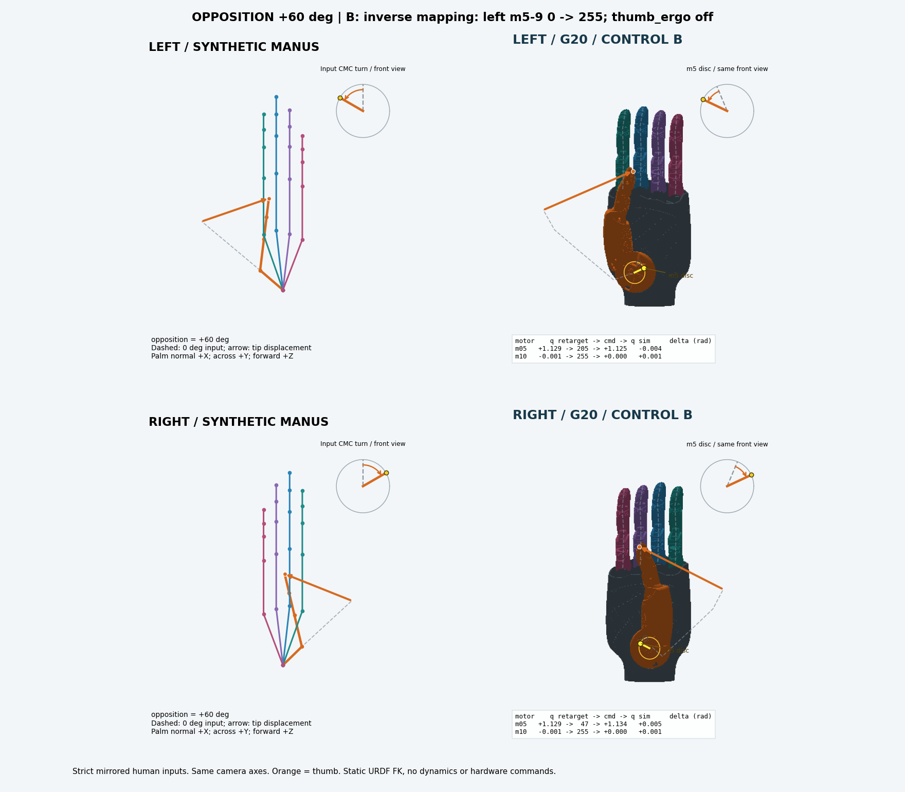

# 任务 AD：左拇指圆盘的合成手套全链路排查

结论：**问题在第 4 层 `motor_positions_to_joint_positions` 对左手电机 5 的解码方向。`5c1431b` 对电机 5 的修改是错误的。推荐对照 b：恢复左手电机 5–9 的 `commandlower/upper = 0/255`，与站点 HandCore 互逆；不增加重定向侧拇指镜像。** 电机编号均从 0 开始。

本次已经在采集台 workstation conda 环境离线执行真实重定向器、真实 HandCore 和当前仓库映射，并用 URDF FK 展示结果。没有修改工作树中的映射、站点运行配置或 `station_ws`；没有创建 ROS 发布者、发送控制消息或启动硬件。文末 diff 仅供审阅，没有应用或 commit。

## 先看圆盘转向

每张图都是四宫格：上排左手、下排右手；左列合成 Manus 人手骨架，右列 G20。黄色标记固定在 `thumb_metacarpals_base1` 的局部坐标，随电机 5 的 FK 旋转；右上角放大表盘显示圆盘方向，虚线表示同组 0° 输入，圆弧箭头表示相对转向。人手与 G20 使用相同观察轴。表盘用于比较转向，绝对零位不要求相同。

| 对照 | 对掌 +60° 四宫格 | 判定 |
|---|---|---|
| a：现状，左 5–9 解码 255/0 | [查看图片](images/opposition_p060_a.png) | 左圆盘相对人手反向，右手正常 |
| b：左 5–9 恢复 0/255 | [查看图片](images/opposition_p060_b.png) | 左右圆盘均与各自人手同向 |
| c：b 加左拇指重定向镜像 | [查看图片](images/opposition_p060_c.png) | 左圆盘重新反向，不采用 |



完整图片见 [images/](images/)。45 张图已生成并核对数量、统一尺寸及链接；已目视检查主 a/b/c、四指 a/b、外展 b 和圆盘单自由度 c 的代表图，圆盘/四指方向与数值判定一致。`opposition_*` 是主证据：电机 10 在这组全部为 255、yaw=0，排除了把电机 10 的动作误认成圆盘。`disk_only_*` 是额外的单自由度几何输入校验，方法和局限见下文。

## 实际执行的链路与对照

基线仓库 HEAD：`b988505758778109a17e9d901e864f88deb9403f`，包含 `2eadf46`。查询采集 API 后，现场原仿真会话仍在运行、`recording_status.state=idle`。用户明确允许保留会话进行短时离线计算。每次运行前再次读取该状态，求解阶段逐迭代检查；绘图阶段在单线程 Python 主线程通过每秒信号回调检查。若发现非 idle 或查询失败，立即使该次离线程序退出。

计算使用 `nice -n 19`，`OMP_NUM_THREADS=OPENBLAS_NUM_THREADS=MKL_NUM_THREADS=1`，`CUDA_VISIBLE_DEVICES=''`。每个离线程序设 180 秒上限，未使用 GPU。临时脚本、输入、结果、图像和渲染缓存先写入采集台 `~/gamepad_vla/ad-left-thumb-20261104/`，再复制本报告所需文件；8780 仅用于只读状态查询。原仿真、输入链和服务未重启。只读检查了正在运行的入口参数及启动日志，确认为 `motion_type:=manus_dex`、`enabled_hands:=left,right`、`calibration:=false`，日志同时确认 thumb_ergo 关闭、相关额外偏置为空。

1. 在 ROS domain 88、loopback 下，仅订阅 `/manus_glove_0` 一帧。实际消息为左手，包含 25 个 raw nodes、20 个 ergonomics。原始模板保存在上述私有任务目录，不发布它的设备 ID。
2. 通过已安装的 `ManusGlove` 类型和 `set_message_fields` 实例化合成消息，保留真实节点 ID、父子关系、chain/joint 标签和 ergonomics 类型。主实验使用模板的骨段长度，重建张开的四指及受控的拇指链，不把收到的现场姿态当成受控输入。
3. 用原运行入口相同的 `HandConfig` 和 `HandCore` 构造器加载站点配置与 URDF；用真实 `Retarget` 构造器加载左右 dex 配置，注入只返回 `None` 的 `NoROS` 对象承接创建接口。没有调用 `rclpy.init`，这些接口不创建真实 ROS 实体。
4. 直接调用真实 `Retarget._retarget_glove`，因此包含 `make_reference → dex 优化 → apply_thumb_ergo_to_robot_qpos → 所有偏置/范围处理 → logical_qpos_from_dex`。配置为 `manus_dex`、vector optimizer、`scaling_factor=1.5`、`low_pass_alpha=1.0`、`thumb_ergo.enabled=false`；不存在另外加入的瓶盖偏置。
5. 对每个静态姿态独立 `reset`，固定输入调用 40 次，读取最终 logical q，再调用真实 `HandCore.trans_to_motor_left/right`。固定姿态的 `_apply_smooth` 使用实际首帧路径，输出与原整数电机值一致。它验证静态方向，不评价输入跳变时的时延。
6. a 使用本地当前 `g20_mapping.py` 的字节一致副本；b 独立加载该副本，仅在临时模块中改左 5–9 的两个方向表；c 从同一原始 q 复制，只将左 `thumb_cmc_roll` 改为 `1.4-q`，再经相同 HandCore 和 b 映射。各对照共享同一原始求解结果，避免把优化器历史误差算成方向修复。
7. 使用采集仿真的 G20 URDF/visual mesh 做静态 FK，复用审阅脚本 `thumb_sweep.py` 的关节变换方法和现有 `hardware/gamepad_fixture/render.py` 的 CPU 光栅器。没有新建采集渲染场景或第二套推流。图是实际模型的几何姿态，不是动态物理执行或真机操作成功证明。

`retarget.py` 实际由 `station_ws/build/...` 导入，HandCore 从 `station_ws/src/...` 导入；本次核对 build/src 的 `retarget.py` 内容相同，左右求解 URDF 的 build/src 哈希也相同。求解资产额外含固定的 tip/pad landmarks；与仿真资产比较，影响本实验的关节 origin、axis、limit、mimic、parent/child 和 visual 变换一致。左右 visual mesh 的逐文件哈希也相同，核对记录见 [visual_provenance.json](visual_provenance.json)。求解源码与配置的哈希见 [results.json](results.json)，不以不同文件哈希推断运动学不同。

## 可检验假设及结果

| 假设 | 改变条件及测量 | 已执行的结果 |
|---|---|---|
| H1：第 4 层把左 m5 解码反了 | 固定原始 q 和 HandCore 电机值，只切 a/b；测 `q_sim-q_emit` 和圆盘旋转方向 | b 恢复同向；m5 最大往返误差由 1.401 rad 降为 0.00535 rad，支持 H1 |
| H2：关闭 thumb_ergo 后，必须另加左拇指镜像 | 在 b 上仅增加 c 的 roll 范围镜像；比较同一镜像人手输入的方向 | c 的左圆盘再次反向，推翻“本配置需要该补偿”；保持关闭 |
| H3：四指侧摆同样受 10-23 改动影响 | 左右输入严格镜像，四指保持伸直，仅绕 MCP 侧摆 ±12°；比较 a/b | a 左 6–9 均反向，b 均恢复；全部恢复 0/255 |
| H4：m10 受改动影响 | 比较全部输入、双手、a/b/c 的 m10 和 yaw | 数值逐项完全相同；对掌主实验 m10 始终 255 |

15 个输入档位 × 2 只手 × 3 组对照，共 90 个静态链路结果；最终求解程序耗时 **5.63 秒**。所有左右 raw node 位置严格满足 `(x,y,z)_R=(x,-y,z)_L`，残差为 0 m。旋转使用 `S R S`（`S=diag(1,-1,1)`），保证镜像后的四元数仍是合法旋转；ergonomics 使用相同的解剖动作标量。当前 `thumb_ergo=false` 且 vector reference 只读位置，因此 ergonomics/节点姿态的符号约定不参与本次结论。

固定 40 步后的最大末步变化仍为 0.00152 rad，未宣称优化器完全收敛；a/b/c 共享相同 q，故这不影响对解码反向的归因。HandCore 的整数截断与关节限位解释了 b 剩下的误差：m5 一格是 `1.4/255=0.00549 rad`，四指一格是 `0.46/255=0.00180 rad`。优化器允许约 0.001 rad 的界外容差，编码器随后会夹紧；表中误差保留了这部分，不将它伪装为精确恒等。

## 电机 5：实际数值

主对掌输入以左手 CMC 为轴绕 `-X` 旋转拇指链，右手从整个左骨架严格镜像得到；其余四指不变。`q_raw` 是原 `_retarget_glove` 输出的 logical roll，a/b 均直接将它交给 HandCore；c 先做 `q_emit=1.4-q_raw`。

| 输入对掌角 | 左 q_raw (rad) | a/b 左 m5 | a 左 q_sim | b 左 q_sim | c 左 m5 | c 左 q_sim |
|---:|---:|---:|---:|---:|---:|---:|
| −30° | 0.171608 | 31 | 1.229804 | 0.170196 | 223 | 1.224314 |
| 0° | 0.399022 | 72 | 1.004706 | 0.395294 | 182 | 0.999216 |
| +30° | 0.714958 | 130 | 0.686275 | 0.713725 | 124 | 0.680784 |
| +60° | 1.129493 | 205 | 0.274510 | 1.125490 | 49 | 0.269020 |

输入从 −30° 到 +60°，b 左 roll 增加 **0.95529 rad**，右 roll 也增加；a 左 roll 减少同样的幅度，c 左 roll 同样下降。圆盘标记和放大表盘直观显示这组方向。主实验的 yaw 固定在限位 0，m10=255；拇指 pitch/MCP 仍有优化耦合，不能声称这是所有电机都静止、只有 m5 输出变化。

额外 `disk_only` 输入从右 G20 FK 构造人手骨架（骨长除以 1.5），只把生成几何的 CMC roll 设为 0°、25°、50°、75°，其余生成关节固定，再严格镜像得到左手。它提供**只改变圆盘自由度的输入**，不是用直接电机扫描冒充完整链路：仍经过真实 raw_nodes reference、优化器、HandCore 和解码。实际优化结果存在耦合，yaw 约从 0.542 变到 0.702 rad，未将它称为电机层严格单变量试验；b 的圆盘仍随输入增加，a/c 反向。它不独立证明真实人体 CMC 与机器关节的精确角度标定，主结论也不依赖该几何构造。

所有关节完整向量见 [results.json](results.json)；六个重点电机每层的数值见 [layer_values.csv](layer_values.csv)。CSV 同时给 `q_raw`、干预后的 `q_emit`、电机值、`q_sim`、`q_sim-q_emit`、`q_sim-q_raw`。这避免 c 的编码往返误差很小，却掩盖其相对原始重定向方向被翻转的问题。

## 电机 6–9 与电机 10

电机 6/7/8/9 分别是食指/中指/无名指/小指的 `mcp_roll`。四指侧摆输入取 −12°、0°、+12°；其余输入不改变。

| 输入 | 左原始四指 q，约 (rad) | 左 6–9 电机值 | a 左还原 q | b 左还原 q | 右还原 q |
|---|---:|---:|---:|---:|---:|
| −12° | −0.2094 | 均为 11 | +0.2102 | −0.2102 | +0.2102 |
| 0° | 约 0 | 均为 127 | +0.00090 | −0.00090 | +0.00090 |
| +12° | +0.2094 | 均为 243 | −0.2084 | +0.2084 | −0.2084 |

a 中左 6–9 均反向，最大误差约 0.41960 rad；b 的各电机最大误差均不超过 0.00109 rad。四指伸直状态下，左右 URDF 的这些关节轴都是 `+X`，而严格镜像输入应得到相反的 q，所以“左右四指电机值相近”并不意味着应解码为同符号 q。c 未改四指，结果与 b 一样。

m10 是 `thumb_cmc_yaw`：本次所有档位、双手、a/b/c 的 m10 与还原 yaw 均逐项完全相同。外展主扫描 −30°、0°、+30°、+60° 时，左右 yaw 分别约为 0、0、0.271、0.702 rad；负外展被关节下限夹紧。没有建议改 m10。

## 为什么 10-23 的判断错了

`git show 5c1431b` 的提交说明明确记录：现场动左拇指时 m0/m5 在变化、m10 接近不变；静止时两手原始电机值接近，因而把左 5–9 改成和右手同一方向。该提交只改了解码表与注释，没有附带严格镜像输入的全链路对照证据。

已确认的逻辑错误有三处：

- **把电机值的左右相似，等同于关节 q 的左右相似。** HandCore 在左 m5 已经使用 `0→255`，右 m5 使用 `255→0`。严格镜像拇指产生近似相同 q 时，左右电机值应近似互补，不能仅依据静止值挑解码方向。
- **忽略编码器和解码器必须成对。** a 实际实现 `q_sim≈1.4-q_raw`；b 才恢复 `q_sim≈q_raw`。在关节中点附近两者相近，静止观测没有辨认斜率正负的能力。
- **把拇指和四指的轴关系混在一起。** 拇指 roll 左右轴相反；四指 roll 左右轴同为 `+X`，镜像动作要求相反 q。把 5–9 一起改成同一左右 q 关系，没有运动学依据。

上述是依据提交文本、当前代码和本次受控实验对当时推理的分析；没有重放当时的原始手套数据，不推断现场具体动作或操作者判断过程。`thumb_ergo.angle_direct` 的左 roll 镜像只适用于那条基于 ergonomics 公式的分支；关闭它，并不意味着 dex 优化器漏做了同样的变换。本次 c 是对这个猜想的实际反证。

## 推荐改动与未采用的方案

推荐仅应用 [recommended-b.patch](recommended-b.patch)：修改本仓库 `src/gamepad_vla/workstation/g20_mapping.py` 的左 5–9 下/上端为 0/255，移除误导注释；右手和 m10 不变。**无需改采集台 HandCore、base_config、dex 配置或启用 thumb_ergo。**

```diff
-    "left": [255, 255, 255, 255, 255, 255, 255, 255, 255, 255, 255, None, ...],
+    "left": [255, 255, 255, 255, 255,   0,   0,   0,   0,   0, 255, None, ...],
...
-    "left": [0, 0, 0, 0, 0,   0,   0,   0,   0,   0, 0, None, ...],
+    "left": [0, 0, 0, 0, 0, 255, 255, 255, 255, 255, 0, None, ...],
```

上面是便于阅读的摘录，完整可审阅 diff 在补丁文件。对照 c 的候选重定向侧改动也保存在 [rejected-c.patch](rejected-c.patch)，**不推荐应用**，没有写入站点。推荐补丁已通过 `git apply --check`，工作树映射文件仍与基线一致。最终只读状态见 [final_status.json](final_status.json)：原会话仍运行、录制 idle。

后续用户确认后才能实际改映射和部署。真机验收还需单独授权：以相同受控圆盘动作对照真实电机及采集画面。当前结果证明了软件链路的符号错误与修复方向，不证明物理手的驱动/安装方向。

## 输入档位与复现文件

| 输入组 | 角度 (deg) | 每个档位的对照 |
|---|---|---|
| opposition | −30, 0, +30, +60 | a/b/c |
| abduction | −30, 0, +30, +60 | a/b/c |
| disk_only | 0, +25, +50, +75 | a/b/c |
| finger_swing | −12, 0, +12 | a/b/c |

图片名如 `opposition_p060_b.png`：`p/m` 表示角度正/负，最后字符表示对照。共 45 张四宫格，两个手都包含在每张图中。

- [offline_chain.py](offline_chain.py)：站点真实链路调用、合成输入、a/b/c。
- [render_chain.py](render_chain.py)：既有光栅器、URDF FK、圆盘标记与四宫格。
- [summarize.py](summarize.py)：导出公开结果及逐层 CSV；仅删掉现场设备 ID 和不参与实验的传感器字段，未修改数值。
- [results.json](results.json)、[summary.json](summary.json)、[layer_values.csv](layer_values.csv)：实际测量与源码哈希。`optimizer_q` 字段实际指 `_retarget_glove` 最终的原始 logical q（已过其所有后处理），不是未后处理的优化器内部向量。

运行入口：采集台现有 `~/gamepad_vla/ad-left-thumb-20261104/offline_chain.py`，使用 workstation Python，先 source 项目的私有 runtime 和 `station_ws/install/local_setup.bash`，然后设置上述线程/GPU限制并经 `nice -n 19`、`timeout 180` 运行；程序自身再次检查 idle。例如：

```bash
source ~/gamepad_vla/code/.local/runtime.sh
source ~/gamepad_vla/station_ws/install/local_setup.bash
export ROS_DOMAIN_ID=88 ROS_LOCALHOST_ONLY=1 CUDA_VISIBLE_DEVICES=''
export OMP_NUM_THREADS=1 OPENBLAS_NUM_THREADS=1 MKL_NUM_THREADS=1
"$P" scripts/collection_ctl.py status --json
# 确认 recording_status.state 为 idle；离线程序内部还会再次检查。
timeout 180 nice -n 19 ~/miniconda3/envs/workstation/bin/python \
  ~/gamepad_vla/ad-left-thumb-20261104/offline_chain.py
```

渲染按输入组、按对照单独运行 `render_chain.py opposition b`，每次前查状态，不并行。模板和当前映射副本已留在该私有目录，无需安装依赖或改现有环境。
