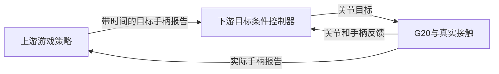

# 支线 AC：纯 RL 能否达到灵巧手 VLA 的效果

日期：2026-11-04（任务日期）。本文是文献调研和实验设计，面向初学者；外部数字均为作者报告，本轮没有复现其训练。项目证据来自仓库现有报告、结果 JSON 与实现，读取时仓库 HEAD 为 `2eadf46901d2e7d1ed8fa78c303778641238f11d`。

## 1. 先回答问题

**在目标明确、任务范围受限的灵巧操作上，强化学习可以达到很强的控制效果，也已有真机先例；现有证据不足以支持“从零纯 RL 能以相近成本获得通用 VLA 的全部能力”。** 对本项目，最有希望直接用 RL 解决的是“把目标手柄信号变成实际按压”。看懂游戏和决定怎么玩已由上游负责，下游不必为此再训练语言模型或理解游戏画面。

强化学习（Reinforcement Learning，RL）让机器人反复尝试动作，根据奖励更新控制策略；策略就是“看到输入后如何输出动作”的函数。视觉—语言—动作模型（Vision-Language-Action model，VLA）则以图像、文字指令及机器人状态为条件生成动作，通常先从大量视觉语言资料和机器人示范中学习。**RL 是训练方法，VLA 是模型与输入输出形式，两者可以结合。** 不能把二者当成互斥算法，再用不同任务上的最高成功率判断谁全面更强。

当前十字键结果支持“可靠 IK 已能解决这一窄任务，在它附近学习小幅动作修正的PPO没有增加平均收益”。IK 是逆运动学，即根据希望指尖到达的位置反求关节角；PPO是近端策略优化，一种强化学习算法。这种小幅修正称为残差控制。这个实验没有测试从零 RL，也没有测试视觉或语言泛化。我们建议先做一个同场景、同接触模型的最小判别实验，再决定是否扩展到单手全部控件，详见第 6 节。

## 2. “纯 RL”和“VLA 的效果”各指什么

### 2.1 四种不同的训练路线

模仿学习是从示范中的“状态—动作”配对学习；行为克隆（Behavior Cloning，BC）是直接拟合这些配对。蒸馏是把老师策略的行为教给另一个学生模型；学生可以使用更少的传感信息。DAgger 是反复让老师为学生实际访问的状态提供正确动作，再聚合数据训练学生的方法。监督微调（Supervised Fine-Tuning，SFT）指在已有模型上继续用示范监督训练。奖励塑形指除成功／失败外，还为接近目标等中间进展计分；它能帮助探索，但也引入了设计者的偏好。

| 路线 | 训练时真正用了什么 | 执行时输入 | 本文如何称呼 |
|---|---|---|---|
| 从零 RL | 随机初始化策略，用环境奖励学习；仍需要场景、动作接口、初始状态和奖励设计 | 可直接是关节、手柄反馈，也可以是图像 | 若没有示范、动作先验或预训练，才是最严格的“从零”；有几何塑形奖励时另外注明 |
| 特权老师→视觉学生 | 老师先读取仿真才能精确获得的物体位置、速度等信息，用 RL 学动作；学生再模仿老师 | 相机和可测机器人状态 | “RL 老师＋蒸馏”；老师的奖励学习与学生的监督学习分别记账 |
| RL 生成数据→视觉策略或 VLA | 专家执行并收集轨迹，学生用这些轨迹做模仿或 SFT；专家本身可能还用了示范 | 图像、状态，VLA 还含语言 | “RL 数据生成＋模仿”；不能称学生从零纯 RL |
| 预训练 VLA→RL 后训练 | 起点已包含视觉语言知识和机器人动作经验，RL 改善接触、成功率或速度 | 图像、语言、状态 | “VLA 的 RL 微调”；新增 RL 数据少，不代表总数据或总算力少 |

还要区分“RL 策略没有人类动作示范”和“整个系统没有监督训练”。Dactyl、DeXtreme 的控制策略可以没有动作示范，但视觉状态估计器另行训练。这与图像直接生成动作的端到端视觉策略不同。奖励中加入人类指法、轨迹或姿态分布，也已经引入了先验。[R1](https://arxiv.org/html/1808.00177v5)、[R3](https://arxiv.org/html/2210.13702v2)、[R4](https://arxiv.org/html/2304.04150v3)分别展示了这些区别。

### 2.2 五种不能互相替代的效果

| 能力 | 应怎样验证 | 单个技能高分还缺什么 |
|---|---|---|
| 多任务与语言条件 | 同一策略处理多种任务；测试新指令、同义改写、组合指令 | 用一个控件编号选动作，只证明目标条件控制；不证明理解开放词汇 |
| 视觉泛化 | 更换物体、背景、光照、相机或摆放，独立测试 | 精确读取仿真状态不能证明相机泛化；见过物体的新位置也不同于新物体 |
| 灵巧精度 | 正确控件、误触、连续幅值、接触力、动作时刻 | 能抓起物体不等于能独立控制多指或稳定按一个毫米级控件 |
| 长时序 | 长序列中的累计误差、失败恢复和整段完成率 | 将每个片段单独重置初态后的成功次数相加，不能证明连续执行成功 |
| 真机迁移 | 真实手、真实手柄、真实传感延迟与扰动下测试 | 仿真成功、梯度测试、渲染图和静态可达均不能替代 |

下表中的自由度（DoF）指可独立变化的运动坐标；机械关节数、独立驱动数和策略动作维度可能不同。F1 是精确率与召回率的调和平均：既考察按对了多少，也考察要求的按键漏了多少；它不是整段任务成功率。仿真到真机迁移简称 sim-to-real。域随机化指训练时改变摩擦、质量、观测噪声等参数，让策略适应一组可能的真实条件。

## 3. 一手文献证据

本文核对论文标题、署名、年份或版本、任务设定与表中采用的关键数字。作者完整名单可由第 7 节的论文页面查询；正文用首位署名及“等”简写。未确认的硬件、总预算或数据量统一写“未核实”，不据此估算本项目成本。不同论文的 F1、成功率、连续成功次数和任务进度分别保留原单位，不作跨论文排名。任务进度衡量完成了多少，最终成功率要求整项任务完成；二者不能互换。

PPO反复采样，并限制每轮策略变化；SAC（软演员—评论家）会复用历史交互数据，并用随机性鼓励探索。DroQ 是 SAC 的一种变体。仅在任务成功／失败时给分，称为稀疏奖励；给中间进展分则能提供更密集的反馈。下列文献中的“老师”“专家”并不自动表示用了 RL，需看训练信号一栏。

RGB指普通彩色图像，点云用一组空间点表示物体形状。把多关节手姿压缩成少量常见运动组合，可以降低动作维度；主成分分析（PCA）是其中一种方法。OpenVLA、Octo等名称指已有的机器人策略模型。表中的K表示千、M表示百万；一张GPU使用一小时记为一个GPU小时，多卡合计GPU小时与实际等待的墙钟时间不同。一次“动作—环境推进—观测”的交互记为一个transition，若每次执行一段动作，须另列该段长度。

### 3.1 从奖励学习灵巧操作：能做到什么

| 文献 | 设定、任务、手类型 | 训练信号 | 样本量或算力 | 真机 | 关键结论与范围 |
|---|---|---|---|---|---|
| [R1 Dactyl，2018／2019 修订](https://arxiv.org/html/1808.00177v5) | 仿真 PPO；五指 Shadow Hand 掌内方块重定向 | 姿态误差、完成奖励、掉落惩罚；物理与观测随机化 | §6.3、§6.5、表10：8 V100＋6144 CPU 核；完全随机化约50小时、约100年仿真经验 | 有 | 控制策略不依赖人类动作示范；视觉估计器另行监督训练，还使用指尖动捕。证明窄任务的复杂接触控制可由 RL 学到 |
| [R2 解魔方，2019](https://arxiv.org/html/1910.07113v1) | Shadow Hand 翻转与转面；自动域随机化；上游求解器给子目标 | 子目标完成奖励；训练中还用策略克隆保留已有能力 | §6.3–6.4：64 V100＋920台32核工作机，连续改进数月 | 有 | §8.4.1：需15次面转的难度成功率60%，26次难度20%；Kociemba 求解器负责规划，RL 负责执行，并未从奖励自行发现完整魔方求解算法 |
| [R3 DeXtreme，2022／ICRA 2023](https://arxiv.org/html/2210.13702v2) | 四指 Allegro、固定手腕；方块连续重定向 | 位置／旋转误差、成功奖励、动作惩罚；另训视觉估计器 | §3.1：8 A40，最佳自动随机化策略约2.5天；每GPU 16,384环境，不含视觉模型训练 | 有 | 表7／9最佳平均配置的10次试验：平均连续成功27.8次，作者给平均值的90%置信区间为±19.0次；最好112次是单次记录，不能写成平均或成功率 |
| [R4 RoboPianist，CoRL 2023](https://arxiv.org/html/2304.04150v3) | 双 Shadow Hand、MuJoCo；DroQ 逐曲训练，时间标记音符作为目标 | 正确按键、误触、能耗；人类指法标签引导指尖接近 | §5.1：每曲500万步；150首曲库，Etude-12为12首评测子集 | 仅仿真 | Etude-12平均F1 0.79，用模型预测未来状态来规划动作的控制对照为0.43。150首主要由逐曲专家覆盖，多曲单策略另试了专家数据模仿；奖励有人类指法先验 |
| [R5 Bi-DexHands，2022](https://arxiv.org/html/2206.08686v2) | Isaac Gym 双 Shadow Hand；交接、开盖等；比较单任务、多任务等算法 | 各任务状态奖励与塑形项，主要是状态观测 | 摘要：单RTX3090、2048环境、超过3万FPS；总训练预算未核实 | 原论文无验收 | 单任务 PPO 类方法有效，多任务与少样本泛化更弱。吞吐是该基准的数据，不能搬作 G20 的实测速度 |
| [R6 真实钢琴，2025／2026 v3](https://arxiv.org/html/2503.15481v3) | 单 Allegro＋xArm7；DroQ逐曲学习；真实执行反馈用于重新校正仿真 | 按键、能耗、碰撞、动作变化与自动匹配指法奖励；无需手工指法标签 | §III自报每曲约3小时20分，训练机器未核实 | 有 | 简单曲目平均F1 0.881；拇指不用，动作含12个手指关节和1个平移。很接近“明确按键信号＋反复校正仿真”的项目路线，仍非开放语言通用策略 |

R2 的上下游分工尤其有参考价值：一个系统可以有很强的任务表现，同时由传统求解器或上游策略决定目标序列，RL 只解决物理执行。对手柄而言，“游戏智能”和“按压智能”可以分别评价。[R2 §2.2](https://arxiv.org/html/1910.07113v1#S2.SS2)

### 3.2 RL 老师或专家，再学习视觉策略／VLA

| 文献 | 设定、任务、手类型 | 训练信号 | 样本量或算力 | 真机 | 关键结论与范围 |
|---|---|---|---|---|---|
| [R7 Visual Dexterity，2022／2023](https://arxiv.org/html/2211.11744v3) | 特权 PPO 老师→两阶段点云学生；三指D’Claw 9DoF及改造四指12DoF；单深度相机物体重定向 | 老师用目标误差与塑形；学生用DAgger模仿老师，从完整点云转向渲染点云 | 150种训练物体；补充材料自报总训练少于400小时；硬件小节分别列老师3090、学生V100 | 有 | 表1桌面支撑、刚性指尖、0.4rad（弧度，约23°）阈值：训练物体81%，未见物体45%。支持视觉迁移，也显示泛化后可靠性下降；不是从零端到端视觉RL |
| [R8 DextrAH-RGB，2024／2025 v2](https://arxiv.org/html/2412.01791v2) | 特权老师→RGB学生；Kuka iiwa＋四指Allegro；多物体抓取 | PPO抓取／抬升奖励；DAgger动作监督与物体位置辅助监督 | 老师8 H100、62小时；学生4 L40S、53小时 | 有 | 学生还用预训练图像编码器与PCA压缩的5维手姿，结合几何控制器。证明RL能给视觉多指策略提供行为，不证明语言理解或全关节从零学习 |
| [R9 PianoMime，CoRL 2024](https://arxiv.org/html/2407.18178v1) | 网络手部视频→指尖轨迹→IK＋残差PPO逐曲专家→BC通用钢琴策略；双Shadow Hand | 按键奖励、轨迹模仿奖励、IK名义动作；学生监督拟合专家 | v1：60首、431个30秒片段、25.8万状态动作对；硬件／墙钟未核实 | 仅仿真 | 未见曲目F1：v1摘要约0.56，作者项目页约0.57。它是目标序列泛化，不是语言VLA；也不是无示范RL |
| [R10 RLDG，2024／RSS 2025](https://arxiv.org/html/2412.09858v1) | 真机RL专家生成成功轨迹→OpenVLA／Octo监督微调；Franka二指夹爪，装配等 | 专家采用含示范／人工接管的真机RL；学生模仿成功轨迹 | 附录B部分任务20示范初始化，真机学习约1–3小时；学生单4090约3–5小时 | 有 | VGA特定实验使用45条RL轨迹；装配抓取阶段还用人类示范。支持“RL生成VLA训练数据”，不表示整个流程无示范或五指手已验证 |

这里有两种不同的迁移：R7/R8 把状态控制能力教给相机策略；R10 把专家轨迹加入已有通用模型。**语言知识不会因为下游抓取或按键奖励明确就自动出现。** 若项目以后确实需要视觉输入，可以先学状态控制，再单独检验视觉学生；是否使用 BC／DAgger 训练须先获得用户同意。

R9 的数字必须带版本：arXiv v1摘要和§4.4为约56%，§5结论却写70%，文本不一致；本文不采用70%。[作者项目页](https://pianomime.github.io/)报告约57%。R7 补充材料的总算力概述与分阶段硬件说明也不完全一致，本文不把“少于400小时”精确折算成单一型号的GPU小时。

### 3.3 预训练 VLA 的 RL 微调：已有能力怎样改进

| 文献 | 设定、任务、手类型 | 训练信号 | 样本量或算力 | 真机 | 关键结论与范围 |
|---|---|---|---|---|---|
| [R11 VLA-RL，2025](https://arxiv.org/html/2505.18719v1) | 预训练OpenVLA-7B在线PPO；LIBERO 40项夹爪操作 | 成功奖励＋学习的视觉语言过程奖励 | 文中有48 GPU小时的阶段性结果；GPU型号／总预算未核实 | 论文验证为仿真 | 表1同文OpenVLA SFT 76.5%→81.0%，增加4.5个百分点；不是相对所有基线都高4.5，也不是从零RL |
| [R12 RIPT-VLA，2025](https://arxiv.org/html/2505.17016v1) | 预训练QueST／OpenVLA-OFT互动后训练；LIBERO、MetaWorld夹爪 | 稀疏二元成功奖励及PPO变体 | OpenVLA-OFT：4 RTX A5000 24GB；总预算未核实 | 仿真 | 表1同文OpenVLA-OFT 96.7%→97.5%；低示范量的特殊实验不能扩大为所有任务、所有手型的结论 |
| [R13 ConRFT，RSS 2025](https://arxiv.org/html/2502.05450v1) | Octo-small特征＋离线至在线RL；Franka二指夹爪，8任务 | 离线BC与价值学习；在线成功奖励和人工接管；预训练骨干冻结 | 20–30示范；摘要报在线45–90分钟，表II另有30分钟任务 | 有 | 8任务各20次评测，平均96.3%。这是已有表征、示范与真实交互共同得到的结果，不是零示范五指控制 |
| [R14 SimpleVLA-RL，2025／ICLR 2026](https://arxiv.org/html/2509.09674v1) | OpenVLA-OFT先SFT再RL；LIBERO／RoboTwin，单／双臂夹爪 | 稀疏结果奖励与探索增强 | 真机迁移部分每任务1000条仿真轨迹SFT，再在1000仿真场景RL；总算力未核实 | 有迁移 | 表2 LIBERO 91.0%→99.1%；表6真机17.5%→38.5%，4任务各50次。仿真99.1%不能写成真机或五指成功率 |
| [R15 π*0.6／RECAP，2025](https://arxiv.org/html/2511.14759v1) | 通用VLA离线RL预训练，目标任务示范微调，再从真实执行改进；夹爪叠衣、装箱、咖啡 | 示范、自主尝试、结果标签、人工纠正；价值函数给动作估计“比原策略更好”的程度，再条件化训练 | 预训练为数万小时示范；§VI-C：叠T恤每轮300条自主轨迹，4机器人；总算力未核实 | 有 | 困难任务吞吐提高超过一倍、失败率约减半。证明VLA可从部署经验改善，仍不能称无预训练／无示范纯RL |
| [R16 高自由度VLA后训练，2026](https://arxiv.org/html/2609.19666v1) | π0.5＋手动作编码器→SFT→按需DAgger→按需残差RL；双7DoF Tianji臂＋双20DoF Wuji手，5个记号笔任务 | 示范、人工纠正；最后以终局成功训练潜动作残差 | 每任务起点200示范；两项RL任务各3000真实transition，每次执行25帧、30Hz | 有，多指 | 5任务最终各20/20；仅传笔、手内转笔用了RL，70%→100%、50%→100%，其余在SFT／DAgger阶段达标。不能把所有提升归给RL，或将20/20当普遍可靠性保证 |

R14 v1 的§5.3与表6在一个任务名称及局部基线数值上不一致；本文只采用表6总体和评测分母。R16 对本项目很有启发，但它的起点已是预训练 VLA、每任务示范和纠正数据，回答的是“RL 能否补足已有策略”，没有回答“去掉这些数据之后会怎样”。

### 3.4 模仿型 VLA、多指数据与动作先验

flow matching（流匹配）是通过监督学习把噪声逐步变成动作序列的生成方法；这里的“扩散专家”是动作生成网络，不是RL老师。对抗动作先验（AMP）用判别器区分参考动作与策略动作，再把“像参考动作”的程度作为奖励；对抗姿态正则（APR）把类似思想用于手部姿态。零样本转移指针对新的任务、物体或机体没有增加对应训练数据；必须明确“新”的是哪一项。

| 文献 | 设定、任务、手类型 | 训练信号 | 样本量或算力 | 真机 | 关键结论与范围 |
|---|---|---|---|---|---|
| [R17 π0，2024](https://arxiv.org/html/2410.24164v1) | 视觉语言底座＋跨机体动作模型；叠衣、装箱等，平台主要是单／双臂与移动夹爪 | 示范动作的流匹配监督 | 约1万小时作者自采数据、7种配置、68任务，另加公开数据 | 有 | 证明通用语义和多任务操作；文中“dexterous manipulation”指精巧操作，不自动等于五指手控制 |
| [R18 π0.5，2025](https://arxiv.org/html/2504.16054v1) | 多来源视觉语言、机器人动作与子任务联合训练；陌生家庭移动双臂夹爪 | 模仿和语义监督 | 直接相关移动数据约400小时、100个家庭环境，另有其他机体和网络数据 | 有 | 包含3个未见家庭的最终评测；支持视觉／语义泛化，不是G20独立多指精密接触的证据 |
| [R19 DexVLA，2025](https://arxiv.org/html/2502.05855v2) | 视觉语言模型＋扩散动作专家，三阶段模仿；Franka＋Inspire手倒水等 | 示范监督，动作专家没有采用RL训练 | 倒水100示范，6维末端＋6维手动作；总算力未核实 | 有，多指 | 附录另有夹爪→五指30个新物体、60%抓取，但把手限制为1DoF；不能据此宣称全关节零样本转移 |
| [R20 GR00T N1，2025](https://arxiv.org/html/2503.14734v1) | 人类视频、真机与合成轨迹联合监督；GR-1多指机器人 | 动作／潜动作流匹配；合成数据来自DexMimicGen示范扩增 | 模型预训练约5万H100 GPU小时；仿真扩增540K轨迹；另有视频生成成本，不包含在5万内 | 有 | 表3 GR-1平均76.8%，扩散策略对照46.4%；主动手自由度本轮未核实。主要短时桌面任务；不能把其数据生成写成纯RL |
| [R21 UniDex，2026](https://arxiv.org/html/2603.22264v1) | 人手视频重定向、统一动作空间、3D VLA；Inspire／Wuji等手，工具使用 | 人类／机器人动作监督预训练与微调 | 超过50K轨迹、8种手、9M帧；下游每任务50示范；算力未核实 | 有，5任务 | §5.2图11下方汇总：平均任务进度81.0%，最终成功率76.0%；每任务／算法20次。进度和成功率必须分开，原文还列有各指标的散布范围 |
| [R22 GR-Dexter，2025首发／2026修订](https://arxiv.org/html/2512.24210v2) | 双21DoF ByteDexter V2；遥操、跨机体、人手数据联合模仿；整理和工具操作 | 示范监督，没有RL训练证据 | 整理约20小时真机数据，抓放另约20小时；总算力未核实 | 有，多指 | 陌生布局整理约0.89，但逐件给子任务、每子任务从初始姿态开始；不能当单提示完整长任务成功率 |
| [R23 DexMimicGen，2024／ICRA 2025](https://arxiv.org/html/2410.24185v2) | 以物体为参考变换、分臂切片与物理回放扩增，再训练视觉模仿策略；含双臂多指 | 示范＋仿真成功筛选；扩增算法本身不是RL | 60源示范→21K示范；真机分类4源示范→40条成功生成轨迹 | 有 | GR-1＋双6DoF Inspire；红／蓝杯共20次，视觉扩散策略0%→90%。证明数据扩增收益，不证明从零奖励学习 |
| [R24 DAPG，2017／RSS 2018](https://arxiv.org/html/1709.10087v2) | 24DoF ADROIT；搬物、转笔、开门、锤击；比较从零RL与示范增强学习 | BC初始化＋示范增强策略梯度和任务奖励 | §III-C记录25条成功示范；硬件／墙钟未核实 | 本文主要仿真 | 示范可明显改善探索与样本效率；采用这一训练路线需先获本项目用户同意 |
| [R25 残差RL，2018／ICRA 2019](https://arxiv.org/html/1812.03201v2) | 工程控制器＋RL修正；机械臂夹爪接触装配，不是灵巧手论文 | 任务奖励，RL动作叠加到传统控制输出 | §VI-B约8000样本、3小时真实训练；具体算力未核实 | 有 | 噪声装配传统控制2/20，残差15/20；支持纠正接触误差的机制，不保证本项目一定超过IK |
| [R26 AMP，2021](https://arxiv.org/html/2104.02180v2) | 物理仿真角色控制，不是机械手实验 | 任务奖励＋参考动作判别奖励 | §8.1：1亿–3亿样本、16 CPU核约30–140小时，随任务变化 | 无机械手真机 | 可借鉴动作分布先验；已经使用参考数据，不能称无数据纯RL |
| [R27 APR，IROS 2026](https://arxiv.org/html/2606.23848v1) | 双Shadow Hand；IK＋残差PPO＋人类姿态分布奖励 | 按键奖励、姿态判别奖励；名义轨迹仍有逐曲指尖参考 | 姿态参考18.7秒、746个双手过渡对；24环境、2000迭代；墙钟未核实 | 仅仿真 | 表IV四曲F1稍低而姿态指标更好；Adieu F1 0.962→0.960，姿态应变0.3162→0.2306。它主要改善动作形态，不能改写为按键性能提升 |

对“纯模仿 VLA 的现状”，本文采用准确的限定：上表 R17–R22 的动作学习主要依靠监督／模仿，没有从这些论文中核实到相应主策略的RL训练；视觉语言底座还包含其他预训练目标，因此整个系统也不能简单说成“只看机器人示范”。2026年的UniDex、GR-Dexter以及R16，使多指VLA有了直接真机证据，但各自任务分布、动作接口和数据成本仍不同。

本地 [APRPianist README](../../../../../APRPianist/README.md)提供APR-PPO、评测和Quest数据重定向流程；[特征实现](../../../../../APRPianist/robopianist/single_task/apr/apr_utils.py)当前使用每手41维关节／速度／指尖高度特征。它只能证明实现路径存在。G20与Shadow Hand关节、耦合和指腹不同，需要重新定义与重定向先验，不能直接复用钢琴判别器权重，也没有本轮运行得到的G20收益。

## 4. 哪些意义下能，哪些意义下还不能

**能：** 从明确奖励中学出复杂的接触技能；根据数值目标完成多种同类动作；通过足够好的仿真、随机化和实物反馈实现受限任务的真机迁移。R1/R3/R6分别给出掌内操作和按键真机先例。加入老师蒸馏，可以让视觉学生获得RL发现的动作；加入预训练与示范，RL也能把已有VLA变得更可靠。

**现有证据还不能支持：** 仅靠本项目的按键信号奖励，就自动获得开放词汇语言理解、广泛视觉语义、任意拿取与重新握持、跨硬件泛化，并以很少算力达到通用VLA的全部效果。文献已验证的任务范围比这个命题窄，更宽泛的结论还需要相应实验。

| 决定条件 | 对RL有利的情况 | 本项目怎样判断 |
|---|---|---|
| 奖励能否写清楚 | 成功可以从独立传感反馈直接计分 | 目标报告与实体手柄报告可逐通道比较，比“把房间整理好”容易定义；接触之前信号不变，探索仍可能困难 |
| 仿真是否够准确 | 接触位置、柔顺性、驱动、延迟与真实系统接近；残余差异可随机化 | 安装／相机与资产契约已有证据，材料、回弹与驱动还需实测；仅增加仿真样本不能修复错误的接触模型 |
| 任务分布有多宽 | 同一类控件、有限幅度与节奏、固定或小变化位姿 | 逐控件到跨控件序列是合理扩展；自由持握与任意游戏画面显著扩大分布，需要独立阶段 |
| 是否需要语义和语言 | 直接给定数值目标，省去语义学习 | 下游已收到虚拟手柄指令，可用小型目标条件策略；若以后输入变成自然语言或未知物体图像，预训练更有价值 |
| 算力与真实试错成本 | 大批量仿真能快速探索，有可靠的独立评测 | 四块候选GPU足以考虑小型状态策略试验，不等于能重做通用VLA预训练；实际成本取决于G20接触求解吞吐，需先测 |

“需要模仿或预训练”应理解为当前较有证据、较经济的路线，而非数学上的必要条件。拿起或重新握持手柄也可能用RL解决，但需要新的抓取奖励、可运动根部、物体状态感知、抗滑与扰动评测；固定手柄按键结果不能外推过去。

## 5. 落到本项目的证据与取舍

### 5.1 上游给目标，下游完成接触

项目 [AGENTS.md](../../../AGENTS.md) 和 [README](../../../README.md) 已明确分工：`resnake_gym`负责游戏逻辑与策略，`xbox_gamepad_physics`负责手柄资产，本项目负责手部物理执行。下游控制器不要求一定是VLA，现有`src/gamepad_vla/vla/`路径暂缓。

这个图的关键是反馈来自实际接触后产生的手柄状态。训练奖励也应比较目标和该反馈，不用目标直接改写手柄状态。当前 [FixedGamepadPhysics](../../../src/gamepad_vla/tasks/fixed_gamepad.py) 与 [FixedDpadEnv](../../../src/gamepad_vla/tasks/dpad_env.py) 采用了这一执行关系。

| 子问题 | 建议优先路线 | 现有证据与边界 |
|---|---|---|
| 固定位置的逐控件操作 | 先保留非学习基线，试状态RL与残差RL | 指令与反馈定义明确；从零策略能否有效探索仍需实验 |
| 时序按压、释放、跨控件切换 | 目标条件RL，显式提供实际可获得的时间信息 | 训练分布覆盖切换、保持和中性；预先给完整序列与在线只知当前目标须分开 |
| 看懂游戏、决定下一步 | 保留在上游 | 这是游戏策略问题；不能靠下游按键信号F1证明视觉或语言理解 |
| 拿起、重新握持、抗滑 | 后续独立抓持任务；可评估示范、先验与RL结合 | 固定根部不需要承担重量。贴住背壳尚不能证明能承重或抵抗滑动；动态保持和扰动需要另验 |
| 自然手姿、减少不合理关节弯曲 | 可考虑G20专用APR／AMP式先验 | 人类动作数据可用于先验；是否有收益须同时看按键、力和姿态，不以“像人”替代任务性能 |
| 跨手柄／背景／语言的新任务 | 再考虑视觉预训练、蒸馏或VLA | 当前并无相应独立测试；加入BC／DAgger训练前另行取得同意 |

### 5.2 十字键 PPO 没有超过 IK，具体说明什么

优先采用 [fixed_phase_result.json](../2026-10-21-fixed-gamepad/fixed_phase_result.json) 的当前结果；[summary.json](../2026-10-21-fixed-gamepad/summary.json)明确被其替代。训练种子0/1/2各16384个**所有环境合计的交互步**，4环境，8轮PPO采样更新、每轮对同批数据重复优化10遍（10个epoch）。每模型在目标种子300/301/302各500个50Hz控制步评测，即每模型1500步，三个模型共4500步。

| 控制器 | 同三序列平均F1 | 三序列最大单接触力，N（牛顿） | 这组比较的含义 |
|---|---:|---:|---|
| IK | 0.947469 | 2.549 N | 无学习动作基线已很强 |
| 残差PPO，种子0 | 0.940885 | 4.577 N | 平均信号性能下降，峰值力更大 |
| 残差PPO，种子1 | 0.947469 | 2.820 N | 信号分数与IK持平 |
| 残差PPO，种子2 | 0.947469 | 3.554 N | 信号分数与IK持平 |

三训练种子F1均值0.945275，样本标准差0.003802，独立训练种子数为3。力值取JSON内逐序列最大值；旧README的IK“约2.1N”只接近其中一个序列，本表采用三序列最大值，未修改历史报告。

这些事实支持：**在固定掌位、四个拇指主动关节、±0.03rad残差和很短训练预算下，学习没有超过已设计好的动作先验。** 模型记录了非零残差，搜索范围围绕IK。它对从零RL、其他算法和VLA的相对性能均未给出实验证据。

还有两个尺度需要分开：50Hz逐控制步F1包含按下／释放滞后；10Hz游戏采样的10个窗口合计2800/2800完整报告一致，其中IK、学习模型各有一个100秒逻辑时间窗口。后者证明这些采样时刻的闭环报告正确，不等于每个物理控制时刻正确，也不证明游戏通关、实时速度或真机操作。详见[固定手柄报告](../2026-10-21-fixed-gamepad/README.md)。

“IK已接近这组因果目标序列下的可达分数”“小残差探索难以改善切换”“训练预算不足”都是候选解释。区分方法是固定目标序列与动力学，比较非学习IK、从零策略和残差策略的学习曲线、按下／释放延迟与稳态误触；若延长预算后残差仍持平且主要剩余误差集中在按下／释放瞬间，才更支持前两项。当前尚未执行这组区分实验。

### 5.3 任务 Z 和示范扩增提供了什么

[任务Z](../2026-11-04-reach-coverage/README.md)在`d075-h190-t+10`找到左手现实口径8/8控件：四个十字键方向、LS摇杆、L3、LB、LT。它允许掌心相对共同握姿位移不超过20mm、旋转不超过15°；同点严格固定掌位只有5/8。LS要求八个80%方向端点分别通过，端点可采用不同掌位调整。**这使单左手全控件成为值得试验的目标，但没有给出一条已经验证的连续执行轨迹。** 左右覆盖数相加也不证明双手同时无干涉。未找到完整通过的控件，不能统一解释成G20绝对够不到。

[任务AA](../2026-11-04-demogen-framework/README.md)在三个新位姿尝试中保留2条、拒绝1条；通过轨迹各255帧、8500个物理子步，范围是左拇指`dpad_down`合成反馈示范。它证明扩增后的片段可以经原生回放筛选，尚未证明真实人类示范扩增、全手持续握持或BC训练收益。其SAPIEN特定接触对的30µm经验口径不能直接用于MuJoCo或其他控件。

对“仿真资产经过标定”，需要具体区分：[场景与相机](../../../README.md)已有测量与归档，部分仿真参数也作过校准；[固定任务建模边界](../../usage/fixed-gamepad.md#建模与验证边界)仍将手部关节的位置／速度反馈控制器（PD）、力矩上限、材料和驱动列为未完成实物辨识。兄弟仓库[计划与已知问题](../../../../xbox_gamepad_physics/docs/plan.md)也保留按键力／行程、回中等实测待办。因而当前最强结论仍是“有较具体资产与仿真验收基础”，还不能把sim-to-real难点视为已经解决。

旧方向键环境还关闭了手部自碰撞，G20接触几何采用凸包近似。核心实验保留历史口径作可比对照；扩大到全手时，需要单列哪些自碰撞被模拟、哪些被过滤，并检查动态几何有效性，避免用信号高分代替全手接触验收。

## 6. 建议的最小验证实验：先隔离学习问题，再扩展全控件

**本节全部为设计，未实施、未训练。训练、依赖安装和任何实机动作都不包含在本次授权中。** 先做四方向十字键的原因是已有同场景IK与残差基线；若一开始同时增加全手、臂运动、控件种类和新后端，失败难以定位。完成这个最小判别后，再将同一评价原则扩展至任务Z的单左手8类控件。

### 6.1 要检验的假设与对照

| 假设（待验证） | 改变什么、固定什么 | 测量及支持条件 | 什么结果会削弱该解释 |
|---|---|---|---|
| H1：仅用信号奖励，从零PPO可达到IK附近的十字键性能 | 从零学习组对比IK；固定动力学、初态、目标分布、动作速率与评测 | 相同测试序列下F1、误触与时序接近IK，并在3个训练种子重复 | 达到预算仍不接近只能否定“此设定／预算足够”，不能证明RL不可能 |
| H2：主要瓶颈是找到正确接触的探索 | 从零策略只增加指尖接近目标的几何塑形奖励；其他不变 | 首次正确闭合更早，学习曲线更快，最终信号更好 | 两组都频繁接触正确位置却持续误触／时序差，则应检查控制与奖励，不只归因探索 |
| H3：现有IK已解决大部分名义接触，残差主要在扰动下有用 | IK与残差在相同名义及扰动条件成对比较 | 名义条件持平，但扰动下残差减少漏按／延迟且不增加力 | 名义和扰动下均无收益，或靠更大力换F1，则不支持残差优势 |
| H4：姿态先验主要改善动作形态 | 在同一从零组只增加G20姿态判别奖励；数据、预算另计 | 姿态越限减少，同时F1／力／时序不退化 | 仅姿态更像人而任务退化，应报告权衡；此项为后续可选对照 |

### 6.2 最小核心：G20左拇指，四方向＋中性

沿用历史固定手柄场景和MuJoCo接触合同，以历史`fixed_phase_result.json.recipe`为参数源；保留`station_g20_v4_4.json`用于旧实验复现，不用后来v4.5臂朝向覆盖它。50Hz控制、0.5ms物理子步、数字闭合阈值0.3、当前目标保持0.1–0.6秒；不提供未来目标。共同使用目标无关的悬停初态与0.5秒准备段。这是已知初态的工程先验，**“从零”只指策略随机初始化且没有目标条件IK动作／示范**，不指机器人从任意随机姿态开始。

| 组 | 动作与奖励 | 用途 |
|---|---|---|
| A0：从零PPO，信号奖励 | 4个主动拇指关节增量，累积成关节目标；无IK按键动作、无指尖奖励、无动作示范 | 直接回答“奖励只有信号时能学多少” |
| A1：从零PPO，加几何塑形 | 动作同A0；只增加到当前目标接触区的指尖距离奖励 | 区分探索困难与接触控制困难；它有工程几何先验，单列结果 |
| B0：非学习IK | 原目标条件IK与抬起切换逻辑 | 必须保留的基线，无训练成本 |
| B1：IK＋残差PPO | 同一IK名义动作附近学习±0.03rad残差；奖励采用A0的共同项 | 测动作先验／残差路线的收益，不能把该组称从零RL |

三学习组各3个训练种子（0/1/2），每次最多约1000万交互步；同种子比较使用配对目标评测。起点采用两层各256单元的多层感知机，即只处理数值输入的小网络。拟用256环境×64控制步，每次更新16,384条交互；小批次1024条，同批数据重复优化4遍，学习率`3e-4`、折扣`0.99`。比较动作实际回报与预期回报时的优势估计衰减取`0.95`，限制单轮更新幅度的裁剪取`0.2`，鼓励探索的熵奖励系数取`0.001`。这些是新的共同起始设置，尚未验证；历史实验每轮采样2048条、重复优化10遍。按完整更新计，610轮为9,994,240步，实际完成数须记录。SAC可作为以后样本效率对照；本轮设计不同时铺开多个算法。[PPO R28](https://arxiv.org/abs/1707.06347)、[SAC R29](https://arxiv.org/abs/1801.01290)

共同观测拟定为：21个手关节位置、21个速度、32维实际手柄状态、4维当前方向目标、4维上次执行目标和4维上次动作，共86维；关节角用rad、速度用rad/s，按记录的关节限位和速度尺度归一化。策略与价值网络均不额外读取接触位置、真实力或未来目标；接触量只用于奖励／评测。实际手柄可通过电气接口反馈，因此该路线本质上是状态闭环控制，不需要相机，不会验证视觉VLA能力。

为使探索尺度有可比性，A0/A1的每次关节增量上限拟为0.1rad，B1的残差幅度保留0.03rad；最终关节命令均施加相同的0.1rad／控制步变化上限与原有限位。这是仿真比较用的拟议限制，未作实物速度辨识。共同初始动作噪声的物理标准差拟为0.01rad，记录截断前后值，不能只比较归一化动作的标准差。A0/A1通过累积目标可遍历合法关节范围，B1始终受限于IK邻域；比较对象是两种完整动作参数化。B0也须按新限制重测，不直接拿历史0.9475当作新协议成绩。

奖励以实际信号匹配为主，分开惩罚漏按和错误方向，正确数字键超过0.4后不再因更多行程加分；中性目标同样计分。共同添加力、能耗、动作变化成本，避免用撞击或过压换信号分数。A1才增加预先固定权重的指尖接近项；评测永远使用独立的信号与物理指标。

拟复用现有`compute_signal_reward`的`digital_hold_no_wrong`算式，参数取正式recipe：`bound=0.05`、`margin=0.5`、`value_at_margin=0.1`、`on_margin=0.1`。即按完整可用信号向量计误差，目标外有数字闭合再扣分，要求的键达到0.4后不再额外奖励深按。信号项权重1、功率惩罚`0.0005`、最大单接触力惩罚`0.001`；动作变化项权重`0.001`，各组统一按最终关节命令变化除以0.1rad后求平方和。A0/B1指尖项为0；A1增加权重0.25、距离尺度10mm的高斯接近奖励，参考点只按当前目标几何指定，不提供IK关节角或示范轨迹。首次训练前检查奖励分项，确认始终不按键的策略在非中性目标下得分更差。`configs/tasks/fixed_dpad.json`的默认值与历史最终recipe不同，不能直接把默认文件当成已复现的正式设置。

训练目标随机生成；验证目标种子700–709，测试种子800–819，每条10秒／500控制步，所有组使用相同序列，测试集不用于选奖励或定期保存的模型权重（检查点）。每模型测试10000控制步，3种子每组30000步。旧300/301/302序列只作历史兼容对照。检查点按验证集选出，同时保留固定预算终点；不在测试集选最好检查点。

### 6.3 GPU仿真选择：优先评估MuJoCo Warp，不预设已经可用

当前[固定接触实现](../../../src/gamepad_vla/tasks/fixed_gamepad.py)使用`collision='sdf'`，即有符号距离场表示的接触几何；还有原生关节耦合和特定MuJoCo修补版。把它改成凸包或换引擎，会同时改变学习问题，不能只以“支持GPU”作选择。

| 候选 | 与本任务的关系 | 设计选择 |
|---|---|---|
| MJX-JAX | 官方功能表仍将SDF列为不支持；复杂接触可能影响吞吐 | 不作为保持当前SDF任务的首选，不假定现有XML可直接批量运行 |
| MuJoCo Warp／MJX-Warp | 当前官方文档已包含网格／SDF接触、并行环境与PyTorch整合；GPU主要用单精度 | **优先做兼容性与接触对照**；保留原生MuJoCo作独立回放评测，不能假定与历史fork数值相同 |
| Isaac Lab | 有成熟GPU并行RL框架；本地手柄0.4.1已有Isaac预览 | 作为备选；现有预览的L3/R3等按压仍失败，不能直接视为单手8控件训练就绪 |

软件依据：[MuJoCo MJX功能表](https://mujoco.readthedocs.io/en/stable/mjx.html#feature-parity)、[MuJoCo Warp 3.17文档](https://mujoco.readthedocs.io/en/3.17.0/mjwarp/index.html)、[官方Warp仓库](https://github.com/google-deepmind/mujoco_warp)。本地边界见[MuJoCo说明](../../../../xbox_gamepad_physics/docs/mujoco_backend.md)与[Isaac预览](../../../../xbox_gamepad_physics/docs/isaac_backend.md)。上述是本轮阅读结果，没有安装或运行GPU后端。

批准执行后，先在隔离目录做一个约30分钟的兼容与吞吐小测：固定相同初态／命令，比较五状态保持、切换、误触、实际行程与峰值接触力，再测128／512／1024个无渲染环境的端到端采样速度与内存。建议预先要求信号判定一致率≥99%、按压／释放时间差≤一个20ms控制步、峰值力差≤20%，并逐项确认没有无关穿壳或耦合错误；这些是拟议对照标准，不是已经达到的结果。若未通过，先解决明确的后端差异，或用原生CPU路线给出较小样本结论，不带着更换后的物理问题继续声称复现旧任务。采集和展示画面继续复用原`operator_view`管线。

### 6.4 指标：不能只给一个F1

| 指标 | 计算／报告方式 |
|---|---|
| 数字键F1与精确率／召回率 | 按50Hz完整时间线计算，包含全部切换；同时给每方向F1和中性准确率。不能剔除按压初段提高分数 |
| 误触率 | 同时报“出现任意目标外闭合的时间比例”和每通道FP／负目标样本数；包含其他手柄控件 |
| 按压与释放时序 | 把松开变按下、或相反的变化时刻称为边沿。按通道和边沿方向一对一匹配，响应窗口到下一次该通道目标切换、100ms或整段试验末尾三者最早时刻；窗口内未出现正确边沿计漏检，额外／提前边沿计误触。分别给中位数、95%已检测事件不超过的误差、漏检率，目标时间线保持不变 |
| 力与几何接触 | 原生子步的最大单接触力、合力、力随时间积分、最深接触负距离及超界子步数；不把不同引擎的接触点个数直接当相同力学对象 |
| 长序列 | 在独立100秒序列上报告全部目标事件完成比例、首次失败时刻、整段是否无误；10Hz游戏报告一致率另列 |
| 样本效率 | F1／误触／时序随累计transition与墙钟变化；记录首次正确接触与每次训练实际完成步数 |

本实验的每次transition推进一个20ms控制周期；其中40个物理子步不额外计作训练样本。统计上以3个独立训练种子为主要重复单位，逐种子报告，再给均值与样本标准差；不能把几万个相关时间点当几万个独立实验。

扰动评测先逐项改变：手柄根部平移±1mm、回弹刚度×0.8／1.2、接触摩擦×0.8／1.2、额外命令延迟20／40ms，每次只改一类，其余保持名义值。位姿扰动时控制器仍使用名义几何，防止把重算IK的收益混入鲁棒性；这些范围是设计值，需以后用实测修正。组合扰动留作第二步。把“始终未找到接触”“接触后误触／漏按”“时序失败”“力或几何超界”“新后端通过、原生回放失败”分开报告，训练不足与仿真差异才有机会被区分。

最小可用性标准拟为：各训练种子在测试集F1≥0.94、精确率≥0.99、目标外误触时间比例≤1%、按下／释放事件漏检率分别≤1%，且95%已检测事件误差≤80ms；相对同协议IK的F1落后不超过0.01，峰值单接触力不超过5N。5N只是仿真方案的比较上限，尚无实物安全含义。若要宣称“优于IK”，必须给配对误差与重复种子证据，并同时满足误触、力和时序约束；达到上述门槛仅表示有用，不表示超过IK。

当前项目没有可直接运行的灵巧手VLA对照，因此这个最小实验回答的是“RL能否完成本项目下游控制合同”。要声称“达到某个VLA的效果”，后续必须让选定VLA在相同任务、初态、传感信息与测试序列下参评，并单列其预训练／示范成本。

### 6.5 扩展到单左手全部8类控件，以及先验对照

若核心实验说明信号控制可学，再选任务Z的`d075-h190-t+10`现实口径，而不是假定严格固定掌位已经8/8。扩展目标含四个十字键方向、L3、LB、LT、LS；这里的8类是Z的控件计数，LS有两个连续轴，不等于8个标量通道，也不包括右手ABXY、Guide／View／Menu／Pair。

策略动作可扩为6个臂关节＋16个独立手关节，共22维；21个手关节中有5个随其他关节按固定比例变化，仍由原耦合合同约束。掌心移动／转动保持在Z的20mm／15°区域，自然臂姿与碰撞条件继续检查。状态机式IK基线需要从Z静态端点构造并验证过渡，**目前并不存在已验收的全控件动态IK控制器**。阶段B不因端点可达而跳过这一步。

先训练单控件与中性切换，再训练预先定义的可行组合及序列；不要求同一拇指同时按两个空间分离控件。LS依次覆盖8方向、20%／50%／80%幅值与连续圆周，LT覆盖对应幅值；另测LB／LT与拇指操作的组合。连续通道独立报告平均绝对误差、方向误差、幅值误差与切换时刻，不能仅用数字F1概括摇杆。建议连续归一化幅值误差目标≤0.05，并报告零目标时的漂移。

| 后续对照 | 必须固定的条件 | 额外数据与解释 |
|---|---|---|
| 从零RL＋APR | 与从零组相同的奖励主项、动作、初态、训练预算，只增加姿态奖励 | 采用本任务G20重定向人手数据，单独统计采集／训练成本；钢琴先验可能限制按键姿态，需要消融验证 |
| 示范初始化＋RL | 同网络、环境、奖励和在线预算；只增加初始化示范训练 | 属于BC＋RL，须先获用户同意；单列示范量和预训练计算，不能把收益算作纯RL |
| BC或VLA模仿基线 | 使用相同任务示范与独立测试集 | 只有实际训练／评测后才可比较；AA当前只有合成down，不能充当全控件示范库 |

自由持握不纳入这个最小实验。固定手柄可以在背壳接触松开时继续按键，这无法说明能拿住手柄。后续自由根部阶段需要加入滑移、掉落、接触分布和扰动力，并重新检验两手协同与重握持。

### 6.6 算力、时间与输出位置

用户提供的候选资源是A800-2物理GPU4／5、baidu-4090-2物理GPU1／3。本文没有登录节点确认当前占用；开始前仍需查询利用率、显存与进程，确认当时可用。优先同一机器两张卡各跑独立种子，不为这个小策略增加跨节点同步。指定`CUDA_VISIBLE_DEVICES=4`后程序里的`cuda:0`对应所选物理卡4；不能再把`cuda:4`当同一个可见设备编号。

全部大资产、转换件、数据和模型拟放在`/pfs/pfs-oHNwH0/lyy/gamepad_vla/ac-pure-rl/<run-id>/`，前提是所选节点能访问该目录；若另一节点不挂载该存储，先明确传输方式，不默认为共享。只建隔离环境，不覆盖共享Isaac、Python、openpi或RoboTwin环境，也不把计算放到采集台。

核心计划是3个学习组×3种子×约1000万步，共**约9000万transition**，每步40个物理子步。下面仅用假设吞吐推算成本；吞吐指包含策略更新的端到端每秒交互步，不是仿真引擎宣传的FPS。

| 假设每GPU吞吐 | 单次1000万步 | 九次训练合计GPU时间 | 两卡理想训练墙钟 |
|---:|---:|---:|---:|
| 1000 transition/s | 2.78小时 | 25小时 | 约12.5小时 |
| 5000 transition/s | 0.56小时 | 5小时 | 约2.5小时 |
| 10000 transition/s | 0.28小时 | 2.5小时 | 约1.25小时 |

另留编译、兼容小测与原生独立评测时间。初步可设单次上限1000万步或3小时、核心总训练上限27 GPU小时，再加约2–3小时检查预算；若接触吞吐低于假设，报告实际样本与未达预算，不无限延长。后端移植／排错可能额外占1–3个工作日，这是工程计划量级，未实测；单手8控件、APR和示范组另行估算，不能包含在上面的十字键预算内。

最终应保存每个种子的配置、版本、奖励分项、学习曲线、选模规则、完整测试分母，以及成功与失败轨迹。训练只留有界诊断与必要汇总，评测保存固定数量轨迹，不改生产采集日志策略。**下一步应先由用户决定是否执行兼容小测和核心训练；本报告不构成训练或硬件执行授权。**

## 7. 参考文献与核对版本

以下论文均通过一手页面核对；年份采用首次公开年，必要时另列会议或本轮所读修订。R1–R27的具体证据位置列在第3节；未列出的总算力与更广泛结论不作补填。

1. **R1** OpenAI、Marcin Andrychowicz等，2018；2019 v5。*Learning Dexterous In-Hand Manipulation*. [arXiv:1808.00177v5](https://arxiv.org/abs/1808.00177v5)。
2. **R2** OpenAI、Ilge Akkaya等，2019。*Solving Rubik’s Cube with a Robot Hand*. [arXiv:1910.07113](https://arxiv.org/abs/1910.07113)。
3. **R3** Ankur Handa等，2022；ICRA 2023；本轮读2024 v2。*DeXtreme: Transfer of Agile In-hand Manipulation from Simulation to Reality*. [arXiv:2210.13702v2](https://arxiv.org/abs/2210.13702v2)。
4. **R4** Kevin Zakka等，2023，CoRL。*RoboPianist: Dexterous Piano Playing with Deep Reinforcement Learning*. [arXiv:2304.04150v3](https://arxiv.org/abs/2304.04150v3)。
5. **R5** Yuanpei Chen等，2022。*Towards Human-Level Bimanual Dexterous Manipulation with Reinforcement Learning*. [arXiv:2206.08686v2](https://arxiv.org/abs/2206.08686v2)。
6. **R6** Yves-Simon Zeulner、Simon Crämer、Sandeep Selvaraj、Roberto Calandra，2025首发；2026 v3。*Learning to Play Piano in the Real World*. [arXiv:2503.15481v3](https://arxiv.org/abs/2503.15481v3)。
7. **R7** Tao Chen、Megha Tippur、Siyang Wu、Vikash Kumar、Edward Adelson、Pulkit Agrawal，2022；Science Robotics 2023。*Visual Dexterity: In-Hand Reorientation of Novel and Complex Object Shapes*. [arXiv:2211.11744v3](https://arxiv.org/abs/2211.11744v3)。
8. **R8** Ritvik Singh等，2024；2025 v2。*DextrAH-RGB: Visuomotor Policies to Grasp Anything with Dexterous Hands*. [arXiv:2412.01791v2](https://arxiv.org/abs/2412.01791v2)。
9. **R9** Cheng Qian、Julen Urain、Kevin Zakka、Jan Peters，2024，CoRL。*PianoMime: Learning a Generalist, Dexterous Piano Player from Internet Demonstrations*. [arXiv:2407.18178v1](https://arxiv.org/abs/2407.18178v1)、[作者项目](https://pianomime.github.io/)。
10. **R10** Charles Xu等，2024；RSS 2025。*RLDG: Robotic Generalist Policy Distillation via Reinforcement Learning*. [arXiv:2412.09858v1](https://arxiv.org/abs/2412.09858v1)。
11. **R11** Guanxing Lu等，2025。*VLA-RL: Towards Masterful and General Robotic Manipulation with Scalable Reinforcement Learning*. [arXiv:2505.18719v1](https://arxiv.org/abs/2505.18719v1)。
12. **R12** Shuhan Tan、Kairan Dou、Yue Zhao、Philipp Krähenbühl，2025。*Interactive Post-Training for Vision-Language-Action Models*. [arXiv:2505.17016v1](https://arxiv.org/abs/2505.17016v1)（方法称RIPT-VLA）。
13. **R13** Yuhui Chen等，2025，RSS。*ConRFT: A Reinforced Fine-tuning Method for VLA Models via Consistency Policy*. [arXiv:2502.05450v1](https://arxiv.org/abs/2502.05450v1)。
14. **R14** Haozhan Li等，2025；官方仓库标ICLR 2026。*SimpleVLA-RL: Scaling VLA Training via Reinforcement Learning*. [arXiv:2509.09674v1](https://arxiv.org/abs/2509.09674v1)、[官方代码](https://github.com/PRIME-RL/SimpleVLA-RL)。
15. **R15** Physical Intelligence、Ali Amin等，2025。π*0.6: *a VLA That Learns From Experience*. [arXiv:2511.14759v1](https://arxiv.org/abs/2511.14759v1)。
16. **R16** Junlei Zhu等，2026。*Towards High-DoF Dexterous Manipulation through VLA Post-Training*. [arXiv:2609.19666v1](https://arxiv.org/abs/2609.19666v1)。
17. **R17** Kevin Black等，Physical Intelligence，2024。*π0: A Vision-Language-Action Flow Model for General Robot Control*. [arXiv:2410.24164v1](https://arxiv.org/abs/2410.24164v1)。
18. **R18** Physical Intelligence、Kevin Black等，2025。*π0.5: a Vision-Language-Action Model with Open-World Generalization*. [arXiv:2504.16054v1](https://arxiv.org/abs/2504.16054v1)。
19. **R19** Junjie Wen等，2025。*DexVLA: Vision-Language Model with Plug-In Diffusion Expert for General Robot Control*. [arXiv:2502.05855v2](https://arxiv.org/abs/2502.05855v2)。
20. **R20** NVIDIA、Johan Bjorck等，2025。*GR00T N1: An Open Foundation Model for Generalist Humanoid Robots*. [arXiv:2503.14734v1](https://arxiv.org/abs/2503.14734v1)。
21. **R21** Gu Zhang等，2026。*UniDex: A Robot Foundation Suite for Universal Dexterous Hand Control from Egocentric Human Videos*. [arXiv:2603.22264v1](https://arxiv.org/abs/2603.22264v1)。
22. **R22** Ruoshi Wen等，2025首发；2026 v2。*GR-Dexter Technical Report*. [arXiv:2512.24210v2](https://arxiv.org/abs/2512.24210v2)。
23. **R23** Zhenyu Jiang等，2024；ICRA 2025。*DexMimicGen: Automated Data Generation for Bimanual Dexterous Manipulation via Imitation Learning*. [arXiv:2410.24185v2](https://arxiv.org/abs/2410.24185v2)。
24. **R24** Aravind Rajeswaran、Vikash Kumar等，2017；RSS 2018。*Learning Complex Dexterous Manipulation with Deep Reinforcement Learning and Demonstrations*. [arXiv:1709.10087v2](https://arxiv.org/abs/1709.10087v2)。
25. **R25** Tobias Johannink、Shikhar Bahl、Ashvin Nair等，2018；ICRA 2019。*Residual Reinforcement Learning for Robot Control*. [arXiv:1812.03201v2](https://arxiv.org/abs/1812.03201v2)。
26. **R26** Xue Bin Peng、Ze Ma、Pieter Abbeel、Sergey Levine、Angjoo Kanazawa，2021。*AMP: Adversarial Motion Priors for Stylized Physics-Based Character Control*. [arXiv:2104.02180v2](https://arxiv.org/abs/2104.02180v2)。
27. **R27** Bin Qiu、Yanming Shao、Guanyu Cai、Yao Mu，2026，IROS。*Enforcing Human-like Kinematics in Dexterous Piano Playing via Adversarial Posture Regularization*. [arXiv:2606.23848v1](https://arxiv.org/abs/2606.23848v1)。
28. **R28** John Schulman、Filip Wolski、Prafulla Dhariwal、Alec Radford、Oleg Klimov，2017。*Proximal Policy Optimization Algorithms*. [arXiv:1707.06347](https://arxiv.org/abs/1707.06347)。
29. **R29** Tuomas Haarnoja、Aurick Zhou、Pieter Abbeel、Sergey Levine，2018，ICML。*Soft Actor-Critic: Off-Policy Maximum Entropy Deep Reinforcement Learning with a Stochastic Actor*. [arXiv:1801.01290](https://arxiv.org/abs/1801.01290)。

## 8. 复审记录与仍需验证的内容

按本任务“只新增一份报告”的约定，复审记录并入此节。尚需验证的主要事项是：GPU后端与现有接触合同的兼容性、真实采样吞吐、从零策略的学习效果、单手全控件的动态过渡，以及真机动力学和迁移。报告中的候选GPU空闲状态沿用用户提供的信息，未作本轮在线确认。文献中标为“未核实”的预算不进入成本估计。

展开证据清点、结构与四轮复审记录

### 证据清点

| 采用的结论 | 证据 | 能支持的范围／缺口 |
|---|---|---|
| 既有残差PPO未超过IK | 第5.2节链接的正式结果JSON及其statistics、training、ik_baseline字段 | 3训练种子、固定四方向仿真；无从零／VLA比较 |
| 左手8/8值得做动态试验 | Z报告、operations.csv | 允许掌位调整的静态状态；无连续执行证据 |
| 现有扩增可作为后续数据工具 | AA报告、reviewer-1.json | 合成down、2保留／1拒绝；无真人数据或学习收益 |
| RL、蒸馏、VLA后训练能力不同 | 第3节27篇一手论文 | 按各自手型、任务、版本与分母限定；算力缺口显式保留 |
| GPU训练和预算只是设计 | 官方MJX／Warp资料、本地后端说明、第6节算式 | 未安装、未运行吞吐或训练；原生接触需独立对照 |

### 结构设计

| 章节 | 回答的问题 | 依赖与阅读前提 |
|---|---|---|
| 1–2 | “效果”与“纯RL”有哪些不同含义 | 先用输入、动作、奖励解释RL/VLA，再介绍模仿与蒸馏 |
| 3 | 哪些能力有一手证据 | 按奖励控制→专家蒸馏→VLA后训练→模仿／先验组织，保留手型和预算 |
| 4 | 答案取决于哪些条件 | 使用文献范围，按奖励、物理、任务分布、语义与算力判断 |
| 5 | 当前项目已经证明了多少 | 仓库分工、正式JSON、Z与AA，区分观测和原因假设 |
| 6 | 最少做什么能得到新的证据 | 配对目标、随机初始化与先验对照、独立测试、统一物理指标 |
| 7–8 | 读者怎样核查与继续 | 版本化来源、已完成检查与尚缺实验；不提供虚构训练入口 |

### 第一轮：事实与引用

| 检查项 | 结论 | 证据与处理 |
|---|---|---|
| 定量结果、完成状态、版本、因果陈述回到原始证据 | 通过，经修正 | 本地JSON逐种子核算；IK峰值采用2.549N，保留旧摘要差异；原因只作为H1–H4 |
| 单／双臂、仿真／真机、训练／评测、开发／测试边界 | 通过 | R14两种成功率、R16各训练阶段、Z静态、AA合成源均分开 |
| 模型安全检查、输入约束与硬约束职责 | 通过 | 接触由物理后端求解，输入裁剪和奖励分别描述；5N仅作拟议仿真比较标准 |
| 外部链接、作者、标题、年份和引用用途 | 通过，经修正 | 29篇arXiv原页元数据读取成功；修正R10题目、R12署名、R17首位作者；UniDex位置修正为图11下方汇总；GR00T成本限定预训练 |
| 推断、缺失结果与计划如实标记 | 通过 | 文献未核实字段、吞吐假设表、未执行实验声明；没有用窄任务否定算法一般可能性 |

### 第二轮：初学者阅读连续性

| 检查项 | 结论 | 证据与处理 |
|---|---|---|
| 缩写前有名称与用途 | 通过，经修正 | PPO／残差提前至第1节；BC、DAgger、SFT、PCA、AMP／APR首次解释；删除无必要的rank等缩写 |
| 配置名、代码变量与内部简写不替代自然语言 | 通过 | 标签仅定位证据；先写控件与动作，再给函数／路径 |
| 正式术语有复用或查阅价值，先说明具体行为 | 通过，经修正 | RGB／点云、奖励塑形、零样本、transition、检查点均解释；承重／抗滑替代未展开的抓取术语 |
| 统计词说明计算或可观察含义 | 通过，经修正 | F1、任务进度、95%事件误差、GPU小时、DeXtreme的90%置信区间分别说明 |
| 新模块说明输入、输出和链路位置 | 通过 | 第2节四路线表、第5节目标报告与实际反馈图 |
| 指代能唯一定位 | 通过 | 用论文编号、组名、具体任务指代；H1–H4各有测量对象 |
| 相关工作解释机制 | 通过 | 各论文均列奖励／监督、任务、手型；蒸馏／数据生成／动作先验分别说明 |
| 公式前后有符号与用途 | 通过 | 仅使用有明确单位的计数算式；奖励参数链接实际函数并用文字说明用途 |
| 教程机器、目录和环境 | 不适用 | 本文为实验设计；已给候选节点、存储位置与隔离环境要求，未编造新CLI |

### 第三轮：方法与复现

| 检查项 | 结论 | 证据与处理 |
|---|---|---|
| 数据来源、成功筛选与训练／验证／测试划分 | 通过 | AA保留拒绝分母；验证700–709、测试800–819；检查点按验证集选取 |
| 输入输出维度、单位、坐标与归一化 | 通过，经修正 | 86维状态、4维动作、22维扩展；关节rad／速度rad/s；Z掌心调整相对共同握姿计量；明确物理噪声和共同命令变化上限 |
| 冻结／训练模块、奖励和关键超参数 | 通过，经修正 | B0无学习；A0/A1/B1训练小策略；新增采样批量、优化遍数、奖励参数／权重，均标设计值 |
| 上游原有能力与项目适配 | 通过 | 第5节分工；旧参数recipe与当前默认文件分开；GPU支持与本项目兼容性分开 |
| 模型加载、执行、成功条件和失败分类 | 通过，限设计 | 验证选模后在独立原生后端执行；一对一事件匹配、漏检门槛、逐项扰动与五类失败写明；执行验证尚未发生 |
| 命令、配置、提交号真实可定位 | 通过 | 基线HEAD、现有源码／正式JSON／资源清单可定位；新训练入口尚未实现，未提供伪命令 |
| 教程每步的预期输出、验收与停止 | 不适用 | 没有执行教程；兼容小测有比较标准，训练有步数／墙钟停止预算 |

### 第四轮：中文语言与版式

| 检查项 | 结论 | 证据与处理 |
|---|---|---|
| 按段落区分背景、前人工作、设计、观察和解释 | 通过 | 文献结果归原作者；“本文／建议／拟”承担本项目设计；观测直接关联JSON |
| 搜索并判断“不是／而是／并非／值得注意／这意味着” | 通过，经修正 | 改写R4和旧PPO段落的重复否定；保留会改变训练路线分类的必要限定 |
| 搜索防御性自证措辞 | 通过，经修正 | 用非零残差记录及任务范围替代关于模型执行的防御句；正文保留可核验方法事实 |
| 合并连续一句一段，拆分过长句 | 通过，经修正 | 采样、优化、奖励分段；各表按同类字段比较 |
| 删除重复结论、空泛评价与无信息过渡 | 通过 | 开篇、条件判断、项目映射各回答不同问题；未增加装饰性内容 |
| 明确主语，减少名词堆叠和直译 | 通过，经修正 | 用动作、反馈、承重与抗滑说明行为；软件名用于精确定位 |
| 图题、表题、引用与编号一致 | 通过 | 第3节四组证据表、R1–R29参考文献、架构图及实验表对应 |
| 所选格式展示检查 | 通过，限Markdown源码 | 检查标题层级、表格列、代码围栏、文件链接；本轮不声称浏览器渲染验收 |
| PDF空白页、链接、字体、分页 | 不适用 | 用户指定Markdown，未生成PDF或安装格式依赖 |

结构检查结果：27篇证据表条目、29条连续编号参考文献、21张表格；表格列数、代码围栏、折叠区块与本地文件链接均通过检查，29篇arXiv原页元数据均成功读取。另从正式JSON重算IK／PPO均值、种子标准差和峰值力，与第5节一致；新文件的`git diff --no-index --check`通过。

交付范围：仓库仅新增本README，原文件保持不变。未运行训练、项目测试或GPU兼容小测，未安装依赖、未登录计算节点、未执行硬件命令、未commit；这些执行结果均不在本文证据范围内。四轮复审发现的引文元数据、术语前置、实验统计和格式问题已经修正；尚缺的实验与文献预算继续按本节开头和表内标记保留。

