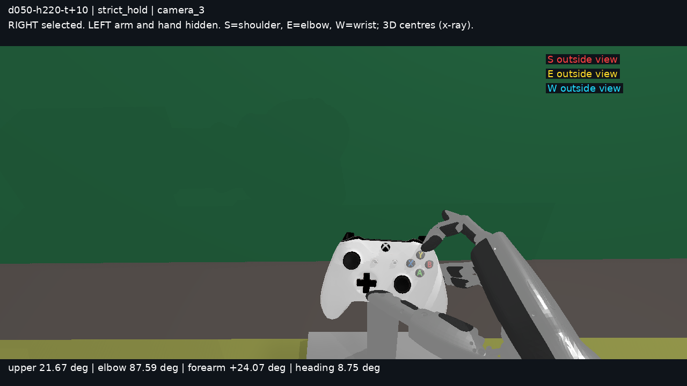
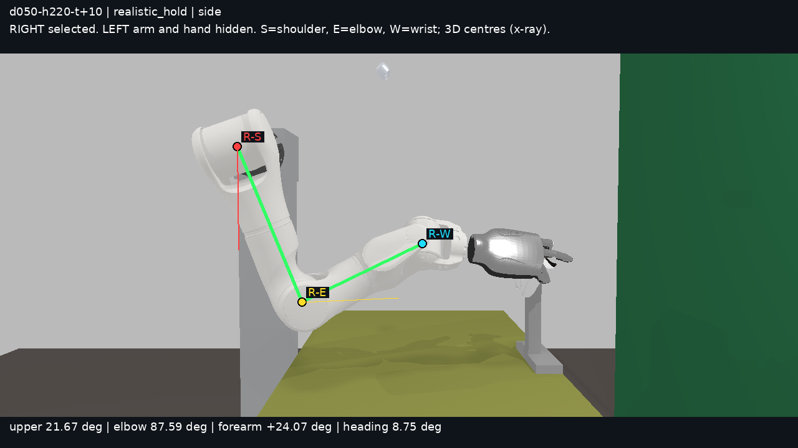
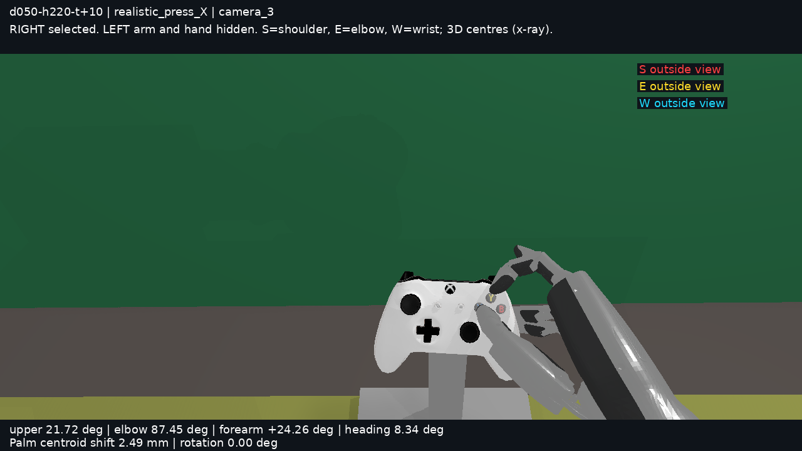
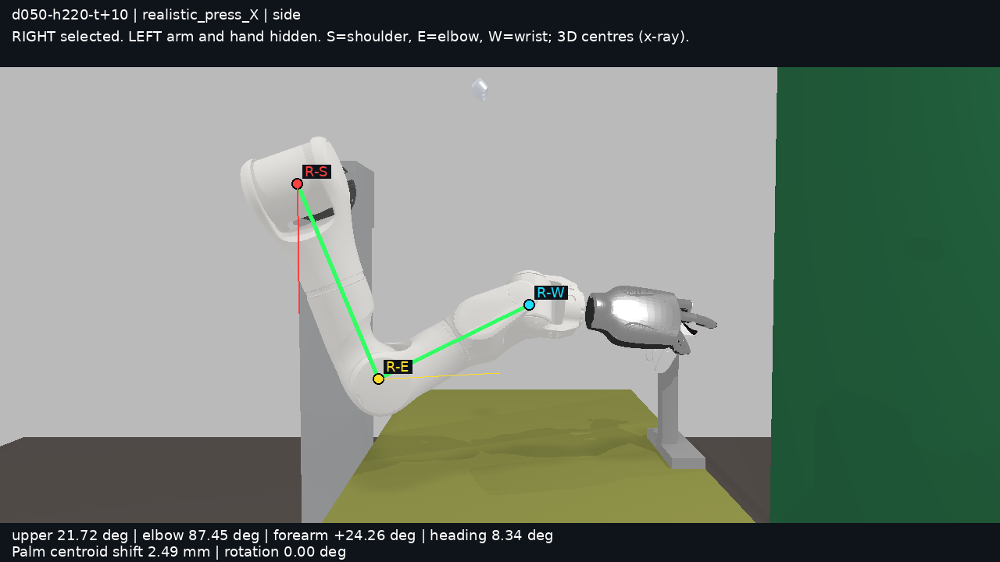

# 任务 Z：自然姿态范围内的控件覆盖

本次移除理想上臂、肘角和水平前臂目标，以自然姿态区间作为硬门，按**实际通过原生验收的完整控件数**选共同握姿。结果是有界搜索中的最大已发现覆盖，不是全局最优或不可行性证明。

| 点位 | 严格左 | 严格右 | 现实左 | 现实右 |
|---|---|---|---|---|
| `d050-h220-t+10` | 6/8 | 4/8 | 6/8 | 6/8 |
| `d075-h190-t+10` | 5/8 | 3/8 | 8/8 | 5/8 |
| `d025-h250-t+10` | 5/8 | 1/8 | 6/8 | 3/8 |
| `d050-h190-t+10` | 6/8 | 3/8 | 7/8 | 4/8 |

按两手分别求解后的覆盖数相加排序：

- 严格：`d050-h220-t+10`（10/16） > `d050-h190-t+10`（9/16） > `d075-h190-t+10`（8/16） > `d025-h250-t+10`（6/16）。
- 现实：`d075-h190-t+10`（13/16） > `d050-h220-t+10`（12/16） > `d050-h190-t+10`（11/16） > `d025-h250-t+10`（9/16）。

X 的顺序是推荐点、备选 1 `d075-h190-t+10`、备选 2 `d025-h250-t+10`、备选 3 `d050-h190-t+10`。上面的覆盖排序是 Z 的排序依据；并列表示当前找到的总数相同，不用旧的理想臂姿分数拆开并列。它不代表两手同时操作已经验证。

## 控件清单及与 X 的比较

X 所选姿态四点均为左右各 0/8；每点另一个左掌位最多 4/8，右手最多 0/8。下表增量对比 **X 同点观察到的最大值**（左 4、右 0），避免只用所选 0/8 夸大改进。

| 点位 | 手 | 严格通过控件 | 严格增量 | 现实通过控件 | 现实增量 |
|---|---|---|---|---|---|
| `d050-h220-t+10` | 左 | 6/8：`Dpad_up`、`Dpad_down`、`Dpad_left`、`Dpad_right`、`LS`、`L3` | +2 | 6/8：`Dpad_up`、`Dpad_down`、`Dpad_left`、`Dpad_right`、`LS`、`L3` | +2 |
| `d050-h220-t+10` | 右 | 4/8：`A`、`B`、`Y`、`RB` | +4 | 6/8：`A`、`B`、`Y`、`R3`、`RB`、`X` | +6 |
| `d075-h190-t+10` | 左 | 5/8：`Dpad_up`、`Dpad_right`、`L3`、`LB`、`LT` | +1 | 8/8：`Dpad_up`、`Dpad_down`、`Dpad_left`、`Dpad_right`、`L3`、`LB`、`LT`、`LS` | +4 |
| `d075-h190-t+10` | 右 | 3/8：`A`、`B`、`R3` | +3 | 5/8：`A`、`B`、`X`、`Y`、`R3` | +5 |
| `d025-h250-t+10` | 左 | 5/8：`Dpad_up`、`Dpad_left`、`Dpad_right`、`LS`、`L3` | +1 | 6/8：`Dpad_up`、`Dpad_left`、`Dpad_right`、`LS`、`L3`、`Dpad_down` | +2 |
| `d025-h250-t+10` | 右 | 1/8：`Y` | +1 | 3/8：`A`、`X`、`Y` | +3 |
| `d050-h190-t+10` | 左 | 6/8：`Dpad_up`、`Dpad_down`、`Dpad_left`、`Dpad_right`、`LS`、`L3` | +2 | 7/8：`Dpad_up`、`Dpad_right`、`L3`、`LB`、`Dpad_down`、`Dpad_left`、`LS` | +3 |
| `d050-h190-t+10` | 右 | 3/8：`B`、`X`、`Y` | +3 | 4/8：`A`、`B`、`X`、`Y` | +4 |

## 共同握姿的臂姿指标

角度均为三维世界坐标指标，单位 °；肘前移为肘心相对肩心的 world +x，单位 mm。肘内角只记录，不再用 95° 作目标，也没有 90–100° 硬门。两种口径独立选择共同握姿，可能选择同一解，也可能不同。现实按压状态仍逐状态通过自然范围硬门，范围值另见 [operations.csv](operations.csv) 和 [summary.json](summary.json)。

| 点位 | 手/口径 | 上臂前倾 | 肘内角 | 前臂俯仰 | 朝向偏差 | 腕偏差 | 肘前移 mm | 背壳原生接触 |
|---|---|---|---|---|---|---|---|---|
| `d050-h220-t+10` | 左/严格 | 23.55 | 94.60 | 10.12 | 3.32 | 31.27 | 126.00 | 无名＋小指 |
| `d050-h220-t+10` | 左/现实 | 23.55 | 94.60 | 10.12 | 3.32 | 31.27 | 126.00 | 无名＋小指 |
| `d050-h220-t+10` | 右/严格 | 21.67 | 87.59 | 24.07 | 8.75 | 31.56 | 117.63 | 无名＋小指 |
| `d050-h220-t+10` | 右/现实 | 21.67 | 87.59 | 24.07 | 8.75 | 31.56 | 117.63 | 无名＋小指 |
| `d075-h190-t+10` | 左/严格 | 32.93 | 87.99 | 11.30 | 4.59 | 34.26 | 150.54 | 无名＋小指 |
| `d075-h190-t+10` | 左/现实 | 32.93 | 87.99 | 11.30 | 4.59 | 34.26 | 150.54 | 无名＋小指 |
| `d075-h190-t+10` | 右/严格 | 14.82 | 95.09 | 9.25 | 14.49 | 9.24 | 77.63 | 无名指 |
| `d075-h190-t+10` | 右/现实 | 14.04 | 97.46 | 4.15 | 6.71 | 10.05 | 53.80 | 无名＋小指 |
| `d025-h250-t+10` | 左/严格 | 24.99 | 97.74 | 12.05 | 1.87 | 28.32 | 138.85 | 无名＋小指 |
| `d025-h250-t+10` | 左/现实 | 24.99 | 97.74 | 12.05 | 1.87 | 28.32 | 138.85 | 无名＋小指 |
| `d025-h250-t+10` | 右/严格 | 29.39 | 101.34 | 7.04 | 8.38 | 8.08 | 90.38 | 无名＋小指 |
| `d025-h250-t+10` | 右/现实 | 29.18 | 100.94 | 7.09 | 8.28 | 8.10 | 88.28 | 无名＋小指 |
| `d050-h190-t+10` | 左/严格 | 22.13 | 100.40 | 3.95 | 1.99 | 27.24 | 119.29 | 无名＋小指 |
| `d050-h190-t+10` | 左/现实 | 28.83 | 93.18 | 13.11 | 1.20 | 29.43 | 147.70 | 无名＋小指 |
| `d050-h190-t+10` | 右/严格 | 22.38 | 94.44 | 12.50 | 10.08 | 18.75 | 82.88 | 无名指 |
| `d050-h190-t+10` | 右/现实 | 18.61 | 101.25 | 4.32 | 3.69 | 16.49 | 70.82 | 无名＋小指 |

无名指、小指背壳点位误差均留在 `summary.json`，只报告，不影响通过。表中背壳接触指共同握姿；按压时可能松开，逐控件的最少背壳接触手指数量和是否所有状态保留双指接触见 operations 数据。背壳接触不是力闭合、整掌包握或抗扰动证据。

## 现实口径逐控件的实际调整

掌心定义为 G20 `hand_base_link` 原始碰撞网格的表面积质心，与 S/Y 的掌质心定义一致；约束是它相对本口径共同握姿的欧氏位移 ≤20 mm，以及 SO(3) 转角 ≤15°。**掌根位移只记录，不设额外上限**。初轮保守地也限制了掌根，后续补查已移除此额外限制。严格口径的所有成功状态臂掌固定，位移和转角均为 0。

下表对已通过控件取其所有必需状态的最大值；摇杆必须 8/8 个 80% 端点通过。现实口径允许不同端点各有范围内的调整，所有端点均相对同一个共同握姿计量；不把它写成“某个固定调整掌位覆盖全部八方向”。扳机取通过的一个 80% 行程承力面。`—` 表示未找到完整通过结果，不拿失败尝试的位移作为实际用量。CSV 同时提供每个成功控件的全部臂姿指标范围和最大点位误差。

### `d050-h220-t+10`

| 手 | 控件 | 掌心位移 mm | 掌根位移 mm（记录） | 转角 ° | 最大点误差 mm |
|---|---|---|---|---|---|
| 左 | Dpad_up | 0.000 | 0.000 | 0.000 | 0.0000 |
| 左 | Dpad_down | 0.000 | 0.000 | 0.000 | 0.2000 |
| 左 | Dpad_left | 0.000 | 0.000 | 0.000 | 0.0000 |
| 左 | Dpad_right | 0.000 | 0.000 | 0.000 | 0.0500 |
| 左 | LS | 0.000 | 0.000 | 0.000 | 0.1000 |
| 左 | L3 | 0.000 | 0.000 | 0.000 | 0.0000 |
| 左 | LB | — | — | — | — |
| 左 | LT | — | — | — | — |
| 右 | A | 0.000 | 0.000 | 0.000 | 0.1125 |
| 右 | B | 0.000 | 0.000 | 0.000 | 0.2400 |
| 右 | X | 2.493 | 2.493 | 0.000 | 0.1525 |
| 右 | Y | 0.000 | 0.000 | 0.000 | 0.1361 |
| 右 | RS | — | — | — | — |
| 右 | R3 | 1.778 | 1.465 | 0.278 | 0.1076 |
| 右 | RB | 0.000 | 0.000 | 0.000 | 0.2000 |
| 右 | RT | — | — | — | — |

### `d075-h190-t+10`

| 手 | 控件 | 掌心位移 mm | 掌根位移 mm（记录） | 转角 ° | 最大点误差 mm |
|---|---|---|---|---|---|
| 左 | Dpad_up | 0.000 | 0.000 | 0.000 | 0.1000 |
| 左 | Dpad_down | 8.460 | 7.214 | 3.742 | 0.0450 |
| 左 | Dpad_left | 16.975 | 15.087 | 3.520 | 0.0463 |
| 左 | Dpad_right | 0.000 | 0.000 | 0.000 | 0.0000 |
| 左 | LS | 1.213 | 14.941 | 10.000 | 0.2476 |
| 左 | L3 | 0.000 | 0.000 | 0.000 | 0.1500 |
| 左 | LB | 0.000 | 0.000 | 0.000 | 0.1417 |
| 左 | LT | 0.000 | 0.000 | 0.000 | 0.2382 |
| 右 | A | 1.545 | 1.388 | 0.253 | 0.1520 |
| 右 | B | 1.697 | 1.697 | 0.000 | 0.0687 |
| 右 | X | 4.382 | 4.382 | 0.000 | 0.1791 |
| 右 | Y | 8.307 | 8.307 | 0.000 | 0.0890 |
| 右 | RS | — | — | — | — |
| 右 | R3 | 5.021 | 5.047 | 10.000 | 0.0450 |
| 右 | RB | — | — | — | — |
| 右 | RT | — | — | — | — |

### `d025-h250-t+10`

| 手 | 控件 | 掌心位移 mm | 掌根位移 mm（记录） | 转角 ° | 最大点误差 mm |
|---|---|---|---|---|---|
| 左 | Dpad_up | 0.000 | 0.000 | 0.000 | 0.0000 |
| 左 | Dpad_down | 3.173 | 3.233 | 10.000 | 0.2000 |
| 左 | Dpad_left | 0.000 | 0.000 | 0.000 | 0.0000 |
| 左 | Dpad_right | 0.000 | 0.000 | 0.000 | 0.0500 |
| 左 | LS | 0.000 | 0.000 | 0.000 | 0.1551 |
| 左 | L3 | 0.000 | 0.000 | 0.000 | 0.0000 |
| 左 | LB | — | — | — | — |
| 左 | LT | — | — | — | — |
| 右 | A | 0.000 | 0.000 | 0.000 | 0.2005 |
| 右 | B | — | — | — | — |
| 右 | X | 8.287 | 7.545 | 1.646 | 0.0251 |
| 右 | Y | 2.215 | 2.202 | 0.260 | 0.1075 |
| 右 | RS | — | — | — | — |
| 右 | R3 | — | — | — | — |
| 右 | RB | — | — | — | — |
| 右 | RT | — | — | — | — |

### `d050-h190-t+10`

| 手 | 控件 | 掌心位移 mm | 掌根位移 mm（记录） | 转角 ° | 最大点误差 mm |
|---|---|---|---|---|---|
| 左 | Dpad_up | 0.000 | 0.000 | 0.000 | 0.1000 |
| 左 | Dpad_down | 4.256 | 4.256 | 0.000 | 0.1000 |
| 左 | Dpad_left | 4.815 | 4.815 | 0.000 | 0.0683 |
| 左 | Dpad_right | 0.000 | 0.000 | 0.000 | 0.0000 |
| 左 | LS | 1.125 | 1.081 | 0.101 | 0.1674 |
| 左 | L3 | 0.000 | 0.000 | 0.000 | 0.0500 |
| 左 | LB | 0.000 | 0.000 | 0.000 | 0.0797 |
| 左 | LT | — | — | — | — |
| 右 | A | 0.000 | 0.000 | 0.000 | 0.0874 |
| 右 | B | 1.068 | 1.070 | 0.400 | 0.0363 |
| 右 | X | 2.475 | 2.243 | 0.564 | 0.2107 |
| 右 | Y | 4.406 | 4.421 | 0.193 | 0.1420 |
| 右 | RS | — | — | — | — |
| 右 | R3 | — | — | — | — |
| 右 | RB | — | — | — | — |
| 右 | RT | — | — | — | — |

## 两种口径均未计入的控件：链长上界及原因

沿用 S 的 URDF 平移长度三角不等式：从首个主动关节的基点起，`R = 后续连杆平移长度之和 + 所有 K0 接触模式点到末端原点的最大长度`。旋转、mimic 限位和法线约束被忽略，因而得到的是扩大后的可达球。点位误差下界为 `max(0, |目标−指基|−R)`；摇杆取八状态最大值，扳机取三个备选承力面的最小值。**下界 >0.25 mm 才能证实该掌位链长不足**，采样云距离不作不可达证明。

现实区域球界再扣掉 `20 mm + 2|指基−掌质心| sin(15°/2)`，覆盖所有允许的掌心平移和旋转；忽略自然边界、关节限位及碰撞只会扩大区域。表中“现实区域下界”为 0 不表示可达；它表示这条链长证明排除不了。这里的证明仍针对所选共同握姿及其调整区域，不覆盖所有可能握姿。

| 点位 | 手/控件/指 | 链长上界 R mm | 严格固定掌位下界 mm | 现实基准掌位下界 mm | 现实区域下界 mm | 同点其它握姿已通过 |
|---|---|---|---|---|---|---|
| `d050-h220-t+10` | 左/LB/食指 | 106.702 | 0.000 | 0.000 | 0.000 | 未找到 |
| `d050-h220-t+10` | 左/LT/中指 | 106.702 | 1.485 | 1.485 | 0.000 | 是 |
| `d050-h220-t+10` | 右/RS/拇指 | 176.271 | 0.000 | 0.000 | 0.000 | 未找到 |
| `d050-h220-t+10` | 右/RT/中指 | 106.711 | 0.000 | 0.000 | 0.000 | 未找到 |
| `d075-h190-t+10` | 右/RB/食指 | 106.711 | 0.000 | 0.000 | 0.000 | 未找到 |
| `d075-h190-t+10` | 右/RS/拇指 | 176.271 | 0.000 | 0.000 | 0.000 | 未找到 |
| `d075-h190-t+10` | 右/RT/中指 | 106.711 | 0.000 | 0.000 | 0.000 | 未找到 |
| `d025-h250-t+10` | 左/LB/食指 | 106.702 | 0.000 | 0.000 | 0.000 | 未找到 |
| `d025-h250-t+10` | 左/LT/中指 | 106.702 | 2.808 | 2.808 | 0.000 | 未找到 |
| `d025-h250-t+10` | 右/B/拇指 | 176.271 | 0.000 | 0.000 | 0.000 | 未找到 |
| `d025-h250-t+10` | 右/R3/拇指 | 176.271 | 0.000 | 0.000 | 0.000 | 未找到 |
| `d025-h250-t+10` | 右/RB/食指 | 106.711 | 0.000 | 0.000 | 0.000 | 未找到 |
| `d025-h250-t+10` | 右/RS/拇指 | 176.271 | 0.000 | 0.000 | 0.000 | 未找到 |
| `d025-h250-t+10` | 右/RT/中指 | 106.711 | 0.000 | 0.000 | 0.000 | 未找到 |
| `d050-h190-t+10` | 左/LT/中指 | 106.702 | 0.196 | 0.000 | 0.000 | 未找到 |
| `d050-h190-t+10` | 右/R3/拇指 | 176.271 | 0.000 | 0.000 | 0.000 | 未找到 |
| `d050-h190-t+10` | 右/RB/食指 | 106.711 | 0.000 | 0.000 | 0.000 | 是 |
| `d050-h190-t+10` | 右/RS/拇指 | 176.271 | 0.000 | 0.000 | 0.000 | 未找到 |
| `d050-h190-t+10` | 右/RT/中指 | 106.711 | 0.000 | 0.000 | 0.000 | 未找到 |

相同 G20 几何下，已在其它原生有效握姿通过的项属于握姿覆盖取舍，不能称为 G20 绝对够不到。区域球界仍为正且超过 0.25 mm 的项，则已证实所选握姿附近的有效链长不够：R 来自 G20，目标到指基的距离来自握姿，两者共同导致。其余项只能报告有限求解中出现的点位/法线、原生碰撞或缺少有效接触拒绝，不能据此判定是 G20 全局几何限制。逐项拒绝类型、可通过的替代握姿标签见 [unreached.json](unreached.json)。

具体到最终结果：19 个“两口径均未计入”的控件，其现实调整区域球界下界全部为 0。推荐点左 LT 的严格掌位差 **1.485 mm**，但 `joint-cloud-2` 在另一原生有效握姿已通过 LT，因此它是握姿取舍；`d025-h250-t+10` 左 LT 的严格掌位差 **2.808 mm**，放宽到现实区域后也无法再由球界排除。推荐点右 RS、RT 的严格和现实基准球界均为 0，拒绝记录是点位/法线、原生碰撞或有效接触未通过，不能再沿用 X 掌位下的“链长不够”解释它们。`d050-h190-t+10` 右 RB 也在另一共同握姿 `explicit-shared-all` 已通过，是另一个握姿取舍的直接反例。

本次已执行的对照是：同场景、同 G20/控件合同的 X 握姿与重新优化握姿，以及固定掌位与范围内调整。覆盖的改善支持“原握姿限制了可达性”；自然目标移除、背壳接触降为软项及搜索方式同时改变，因此不把总改进单独归因于某一个因素。对未得到替代握姿反例且球界无法排除的项，G20 关节/接触几何与局部搜索不足仍未区分；没有进行额外无界搜索。

## 推荐点右手渲染

同 `operator_view` → SAPIEN 3.0.3 → 公开 `robotwin.create_scene` 的场景、灯光和 appearance 管线；CPU lavapipe。左臂和左手全部隐藏，图上明示。S 红、E 黄、W 青，绿线为实际三维关节中心的透视标注；不表示被遮挡的关节表面可见。侧视的竖直/水平参考线与 Y 一致；camera_3 看不到的肩/肘明确标为视口外。

| 口径 | camera_3 | 侧视 |
|---|---|---|
| 严格共同握姿 |  |  |
| 现实共同握姿 |  |  |

推荐点图像中的肩肘腕由 SAPIEN 实际 link 轴线重建，与对应求解输出的最大位置差为 **0.000205 mm**。图像输入不是另一条臂的 home，也不是二维投影角替代三维角。

另给一个完整已通过控件 `X` 的现实按压状态（图上标实际位移/转角）：

| camera_3 | 侧视 |
|---|---|
|  |  |

## 方法、预算与复现范围

1. 复用四个 X rank 的只读 `spec.json`、立柱/底座和 S/X 候选；v4.5 安装值不变，不重复施加 J1 negation/offset。范围硬门为上臂 10–35°、肘在肩前、前臂俯仰 −10–25°、朝向偏差 ≤30°。范围内没有理想角残差；保留的 `deviation` 仅为旧指标诊断，不参与选姿态。

2. 腕偏差软残差约为 `2.8e−7 × 腕偏差(°)`：S 的 `0.0005 × 腕偏差/180` 降为约 `0.00005 × 腕偏差/180`。S 的背壳点吸引残差从 90 降为 0.18/m，只用于提案；原生背壳接触和背壳点误差均不是硬门。实际覆盖数相同时，偏好背壳原生接触数较多、腕偏差较小的候选。

3. 先用 S 的 FK 云引导共同臂掌与手指提案，再显式联合优化一个共同臂掌和多个控件的独立手指状态；逐控件允许全臂、全手联合求状态。最后用掌心限幅内的平移、±10° 转动起点补查，并把已通过现实姿态回收为共同握姿候选。数值提案沿用 [SciPy 1.15.3 TRF least_squares](https://docs.scipy.org/doc/scipy-1.15.3/reference/generated/scipy.optimize.least_squares.html)；仅出界近解使用 [SLSQP](https://docs.scipy.org/doc/scipy-1.15.3/reference/optimize.minimize-slsqp.html) 投回自然硬范围。优化收敛不算通过，离散计数来自原生复核。

4. 数字键保留 0.25 mm、30° 法线锥及原生有效接触；摇杆保留 8 个 80% 端点；扳机保留 80% 行程、原有承力面采样。沿用 S 的机器人原生凸近似和手柄 SDF、全部夹具显式距离检查，以及其原始数值容差：一般穿透 ≤1 µm，操作接触允许 0–100 µm 深度，背壳无名/小指原有 1 mm 接触容差不加宽。自身碰撞范围和分侧检查口径与 S 相同。30 mm 桌面净空仅记录；桌面/桌架/站柱/安装座/支柱/底座的实际无穿透门保留。

5. 对计入覆盖的 **127 个状态条目**检查了原生验收记录，并从 q 重算现实掌心位移、掌根位移和 SO(3) 转角；严格状态断言臂 q 完全一致。重新比对 40 个资源文件，均与 X 留档及 0.4.1 资源一致。CPU 环境发行元数据仍显示 xbox-gamepad-physics 0.4.0，但实际隔离接口源自既有 0.4.1 包；SAPIEN 渲染环境实测 3.0.3 / 0.4.1，没有安装包或覆盖共享环境。

计算墙钟 **47.43 分钟**，截至报告定稿的任务窗口 **52.65 分钟**；按并行墙钟计，不把 worker 时长相加。计算从首次 CPU 冒烟开始，涵盖求解、复核及 CPU 出图，低于 60 分钟；任务窗口低于 90 分钟。每轮每点/手有独立上限：首轮 2100 s，显式联合轮 1400 s，掌心补查 1000 s，姿态回收 1100 s；外层 timeout 分别为 2250/1500/1100/1200 s。后两轮受首次计算起 3000 s 的全局求解截止约束，给渲染和导出留余量。后轮时间包含等待前轮完成，不能相加为墙钟。

| 点位 | 手 | 首轮 | 联合轮 | 掌心补查 | 姿态回收 |
|---|---|---|---|---|---|
| `d050-h220-t+10` | 左 | 完成 | 完成 | 达到上限，保留已过结果 | 完成 |
| `d050-h220-t+10` | 右 | 完成 | 完成 | 达到上限，保留已过结果 | 完成 |
| `d075-h190-t+10` | 左 | 完成 | 完成 | 达到上限，保留已过结果 | 完成 |
| `d075-h190-t+10` | 右 | 完成 | 完成 | 达到上限，保留已过结果 | 完成 |
| `d025-h250-t+10` | 左 | 完成 | 完成 | 达到上限，保留已过结果 | 完成 |
| `d025-h250-t+10` | 右 | 完成 | 完成 | 达到上限，保留已过结果 | 完成 |
| `d050-h190-t+10` | 左 | 完成 | 完成 | 达到上限，保留已过结果 | 完成 |
| `d050-h190-t+10` | 右 | 完成 | 完成 | 达到上限，保留已过结果 | 完成 |

运行目录：`$GAMEPAD_VLA_WORKSPACE/runs/reach-coverage-z-20261104`；只读来源：`$GAMEPAD_VLA_WORKSPACE/runs/gamepad-placement-x-20261103`。全部模型、原始状态、每轮快照、原生诊断、有界日志和 mmap 留在计算节点。报告提供 [summary.json](summary.json)、[candidates.json](candidates.json)、[operations.csv](operations.csv)、[provenance.json](provenance.json) 和 [verification.json](verification.json)。`solve.py`、`refine.py`、`adjust.py`、`rebase.py` 是一次性实验工具；节点保留 `solve-stage1.py` / `solve-stage2.py` 以区分初轮约束，最终 `solve.py` 按掌心质心口径。

导出和一致性复核可在节点 X 的 `code` 目录、既有 fixed-gamepad Python 3.11 环境下调用本报告 `finalize.py --run ... --source ...`。它核对并导出原生状态记录及重算位移；原生几何验收已在每个候选/状态生成时实际执行。出图脚本 `render.py` 使用既有 SAPIEN Python 3.10 环境，设置空 `CUDA_VISIBLE_DEVICES`、空 `GAMEPAD_VLA_RENDER_DEVICE` 和 `VK_ICD_FILENAMES=/usr/share/vulkan/icd.d/lvp_icd.x86_64.json`。重新出图应换一个新的运行输出目录，避免旧 mmap/stop 文件。

基线 HEAD `37f44ef`。按用户指定使用 2026-11-04 报告目录，实际执行于 2026-11-03 UTC。本任务仅新增本报告目录，没有改采集场景 JSON、CAD、S/X/Y 基线工具或共享环境，没有 commit；工作期间另见仓库约定与项目文档的并发改动，均保留未动。没有连接采集台、启动硬件 SDK/ROS 节点、发送物理命令或打断采集服务。结束时本任务进程残留为 0。

本次证据是静态原生几何可行的按压状态，不是动态轨迹、力闭合或真机操作成功。v4.5 右臂安装 +15° 仍为待实物验证的推断。实体检验需另获硬件授权：在同一导出 q 下测肩肘腕位置并逐控件测触发/行程；若仿真坐标一致而实测偏移或无法触发，则反驳其当前实物外推，应检验安装、标定及接触模型。本次未执行该实体实验。
