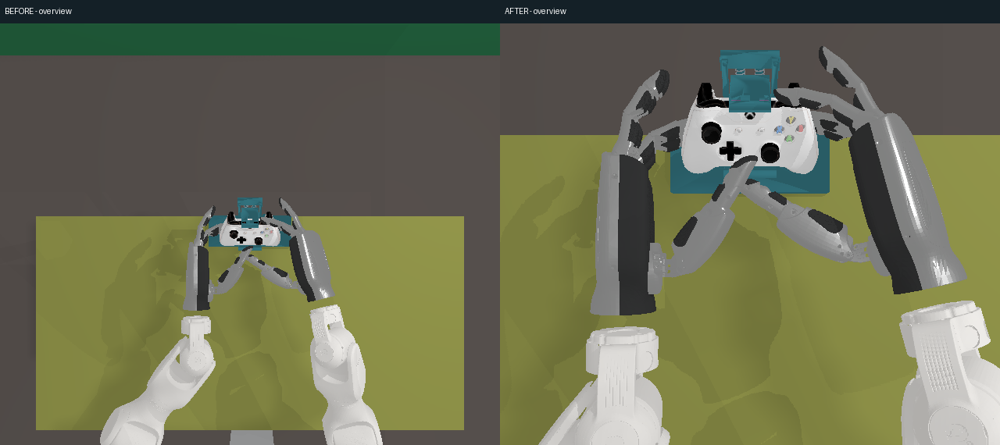

# AG：辅助视角默认全开、视口布局与近景取景

基线 `22d1038`。camera_3 与六个辅助窗格默认同时显示，版式已按裁决 3 改为等大 16:9 格网（camera_3 占 2×2，辅助各占一格），窗口变化自动重排，选择保存在浏览器 `localStorage` 的 `collection.auxiliaryViews`。Camera / Simulation session、已保存快照及事件 / episode 列表收进抽屉；录制、备注、倒计时快照、状态和视角开关保留在紧凑工具栏。没有安装依赖、提交或部署；8780 与硬件控制没有改动。

## 页面截图与实际 Firefox 验收

按审阅者裁决，最终验收使用 **linkerhand 的 Linux headless Firefox 158.0.1**。使用开发版本的实际 HTML/CSS/JS，独立回环临时服务提供假 API 状态，七个 canvas 填入本轮在计算节点渲染的同一 RB 姿态原图。截图中的 “Video reconnecting” 与 59.5 fps 等状态来自离线夹具的假数据，用于检查关键状态格显示及同步；它们不是本轮性能测量。这些截图验证页面与图像显示，不代表 Firefox 已解码实时 H.264。此前阶段的真实后端帧率另见下述测量。

| 浏览器内容视口 | 页面截图 | document 滚动宽×高 | 视频区起点 / 高度 | 格网 / 单元格 | camera_3 显示尺寸 | 相邻边界最大误差 |
|---|---|---|---|---|---|---:|
| 1920×1080 | [截图](page-1920x1080.png) | 1920×1080 | y=129 / 917 px | **4×3 / 480×270 px** | 960×540 px | **0 px** |
| 1536×864 | [截图](page-1536x864.png) | 1536×864 | y=129 / 701 px | **4×3 / 384×216 px** | 768×432 px | **0 px** |
| 864×1536（额外重排检查） | [截图](page-864x1536.png) | 864×1536 | y=129 / 1341 px | 2×5 / 432×243 px | 864×486 px | 0 px |

两种指定视口均无页面滚动条，七个相机窗格和常用控件在视口内，辅助格不再缩成右侧窄列。全部单元格统一 16:9，主图固定占 2×2。视频区、辅助容器、窗格、信息格与 canvas 的 margin / gap / padding / border 均为 0；相邻边界按 `getBoundingClientRect()` 测量。已逐张检查新截图。

辅助源图仍是原生 640×540，canvas 通过 `object-fit:contain` 在 16:9 单元格内完整等比显示，因此**辅助图左右有黑边**；不裁切、不拉伸。窗格边界直接相接。camera_3 保持标定画面与 16:9 比例。

新算法遍历 **2–6 列**，根据“主图 4 格 + 当前开启的辅助格数”计算所需行数，选单元格最大的排法；同尺寸时选末尾剩余格较少的方案。主图占左上 2×2，其余相机跳过这四格后按行顺序填入。默认横屏 4×3 的最后两格显示现有手柄信号 SVG 和关键状态（录制、episode / 时长 / 行数、帧率与快照状态），数据沿用原有信号适配器和 SSE。没有多余格时隐藏信息格，关键状态仍在顶部可见。

关闭任意辅助视角立即重新计算格网，后续视角向前补位，信息格排在所有相机之后，仍有空格时仅留在格网末尾。1536×864 实测逐个关闭后：5 / 4 / 3 个辅助格使用 3×3，2 / 1 个辅助格使用 3×2，全部关闭使用 2×2。点击相机窗格在整个视频区放大，再点或按 Esc 恢复，录制等控件继续可用。

Firefox Marionette 通过的实际 DOM 断言包括：两种指定视口的 4×3 / 精确单元格尺寸、主图 2×2、所有相机和常用控件可见、零边距 / 边界误差、`contain`、两个信息格及状态同步；七格逐一放大 / 恢复、Esc、逐个关闭到全关的补位、刷新保留开关选择均通过。[完整数值](browser-validation.json)。Marionette 通过 Python 标准库 socket 顺序发送命令，没有安装 Selenium、geckodriver 或 marionette_driver。

浏览器启动形态：

```sh
nice -n 10 firefox --headless --no-remote \
  --profile "$TASK_TMP/firefox-profile" --window-size=1920,1080 \
  --marionette about:blank
```

测试使用 `WebDriver:SetWindowRect` 校正浏览器外框与内容视口差值，随后以 `WebDriver:TakeScreenshot(full=false)` 保存原生视口 PNG。临时服务为 18188，Marionette 为 2837；文件位于站点 `~/gamepad_vla/tmp/` 内本任务子目录。验证前只读确认采集会话已停止。取回截图后确认本次 server / Firefox PID 和进程组均不存在、两个临时端口均关闭，并删除任务目录；没有结束桌面用户的浏览器。本机先前启动的两个任务 Chrome 端点已关闭，任务 Chrome profile 临时目录也已删除。最终交付截图全部来自采集台 Firefox。

## 相机修改与同姿态对照

在 scalelab01 的隔离代码副本，使用 SAPIEN **3.0.3**、xbox-gamepad-physics **0.4.1**、CPU PhysX / lavapipe 与现有 `SapienBackend → robotwin.create_scene/load_into_scene`。冻结 AE 从任务 Z 握持 / 控件姿态保存的三个状态：`left_strict_hold_-1`、`left_realistic_Dpad_right_0`、`right_realistic_RB_0`，逐相机原生渲染 640×540。前后使用相同状态、v3 场景及外观，只改变辅助相机；未混入 AF 的 v3.1 夹具。相机渲染过程没有步进物理，也没有发送硬件命令。

相机统一保留 **50° 垂直 FOV**。前五个相机的位置 / 目标 / up 在手柄坐标系；俯视在世界坐标系中保持竖直。`O` 为手柄世界位置，单位 m：

| 相机 | 原位置 → 新位置 | 目标点 | 同姿态前后对比（左旧 / 右新） |
|---|---|---|---|
| 正面 face | `(0,.005,.38)` → `(0,.005,.34)` | `(0,.005,0)` | [对比图](images/compare-face.png) |
| 前方 front | `(0,-.18,.32)` → `(0,-.15,.28)` | `(0,0,.015)` | [对比图](images/compare-front.png) |
| 背面 back | `(0,.22,-.24)` → `(0,.205,-.23)` | `(0,.015,-.005)` | [对比图](images/compare-back.png) |
| 左斜 left | `(-.34,.24,.20)` → `(-.24,.19,.28)` | `(0,.01,0)` | [对比图](images/compare-left.png) |
| 右斜 right | `(.34,.24,.20)` → `(.24,.19,.28)` | `(0,.01,0)` | [对比图](images/compare-right.png) |
| 俯视 overview | `O+(0,0,1.10)` → `O+(-.10,0,.48)` | `O` → `O+(-.10,0,0)` | [对比图](images/compare-overview.png) |

俯视手柄轮廓从约 78 px 增到约 178 px（格宽 640，约 12% → 28%，约 **2.3 倍**），同时保留双手、腕部和部分前臂工作区。为保留工作区，其取景略宽于其余近景。正面 / 前方 / 背面手柄外轮廓约占格宽 40% / 45% / 48%；斜侧约三分之一，近侧手掌遮挡会使可见壳体轮廓更小。这些是阅图估计，不是无遮挡分割测量。

初轮仅沿原斜侧方向拉近时，近侧手背仍遮挡按键面；最终增加机位高度后，可看到更多按键面与指尖接近区。俯视同时向双臂方向偏移，减少画面上方无关桌面。保留手和夹具的真实遮挡，没有隐藏几何体。

逐张查看了三姿态前后全部 **36 张辅助原图**，以及六张对比图：

| 视角 | 握持 / 十字键 / RB 的观察 |
|---|---|
| face | 握持时两杆与 ABXY 可辨；十字键姿态能看见拇指接近区域；RB 姿态右食指在肩部。中心部分仍会被拇指遮挡。 |
| front | 双侧手指与手柄前缘放大；十字键与 RB 姿态的部分按键被手指挡住，保留了接近方向信息。 |
| back | 两侧握把、肩部与手指位置可辨；背部中央仍有夹具背托遮挡。 |
| left | 两杆、按键面与双手关系比旧机位清楚；十字键拇指落点容易辨认，RB 肩部接近可见。 |
| right | 抬高后能看到 ABXY 和摇杆，减少旧机位手背盖住中心的情况；近侧手掌仍遮挡壳体一部分。 |
| overview | 三姿态均包含手柄、双手、腕部接近范围；去掉远处大片桌面，保留前臂进入方向。 |

原图位于 `images/{before,after}/{pose}/{face,front,back,left,right,overview}.png`；[相机参数记录](images/parameters.json)保留世界位置与目标。对比图仅将两张原始 640×540 并排放置并加顶部文字，没有缩放、裁剪或修饰原始像素。同姿态 camera_3 的前后 PNG 完全相同。



## 性能与原始 mmap 检查

下述为裁决 3 之前同一辅助相机 / 编码配置的计算节点测量。本次只修改网页显示、补位及信息格，没有改变渲染 / 编码参数，也没有重新测量浏览器或后端性能；截图中的假状态不用于帧率结论。

最终预热后 **30.15 s** 窗口测得主流 **58.87 fps**、辅助流 **18.72 fps**；主 / 辅各收到 1775 / 565 帧。辅助接近目标 20 fps，但本次没有达到精确 20 fps。[完整测量](fps-summary.json)。保持主图 **1280×720 / 60 fps**、辅助源流 **1920×1080 / 20 fps**，六格全开，沿用 `operator_view → SAPIEN → teleop Latest mmap → NVENC → WebSocket`。每次启动前查询 GPU 利用率、显存和计算进程，使用当时空闲的 GPU 0。输入为在 AE RB 姿态上以 60 Hz 发布的合成完成状态，带轻微手指变化，不包含真实 ROS 输入 / 物理控制循环 / episode 录制。

首次启动期间发生了 I/O 等待及首帧超时；未更改生产超时。首个成功的 20 s 窗口只有 **52.84 / 19.60 fps**（主 / 辅），该窗口后段服务指标已稳定在 59.5–59.8 / 19.4–19.6 fps，见 [该次完整窗口](fps-cold-window.json)。随后在相同代码和配置下延长实验预热至 10 s，测量 30 s；不把早期较低结果隐藏，也不把 AE 的历史结果当成此次测量。预热长度与主机 I/O 状态没有分别控制，不能将窗口差异单独归因于其中一个因素。

按审阅者提供的格式直接读取本轮 `aux-frame.mmap`：16 字节 `<QQ` 的 generation / length，载荷头 `!I` JSON 长度，再取元数据与 RGB 字节，按 height×width×3 重建图像。[解码帧](aux-frame.png)、[元数据与各格非黑像素数](mmap-check.json)。六格均包含画面，已直接阅图；没有用该解码过程改写采集文件格式。

## 测试、范围与配置入口

- 本地最小环境：辅助相机 / operator collection 定向测试 **8 passed**；原生快照测试因缺 PIL 跳过，没有安装依赖。
- 计算节点现有环境：同组加七相机原生快照格式 / 外参 / 生命周期测试 **10 passed**。
- `node --test tests/test_auxiliary_layout.mjs`：**28 种几何组合**，覆盖 0–6 个辅助格、横 / 竖视口；检查统一 16:9、主图 2×2、单元格最大化、边界、无重叠与相机先于信息格连续补位。
- Firefox 数值与截图验收通过，范围如上。未执行实际操纵或采集台录制性能验收。计算节点本任务三次管线的父进程与 render / auxiliary / gateway 均已退出，临时端口关闭；结束时 GPU 0 为 0% / 16 MiB。

默认值变化：辅助开关从 `face + overview` 改为全六格；页面从原生像素溢出布局改为统一 16:9 格网，主图 2×2，辅助各一格，剩余格显示信号 / 状态；五个近景位置与俯视位置 / 目标按上表修改。camera_3 标定、视频源尺寸和目标帧率、快照数据格式与 episode schema 保持原值。

入口：[辅助相机](../../../src/gamepad_vla/workstation/auxiliary_views.py)、[网页布局与浏览器选择](../../../src/gamepad_vla/workstation/collection_web/auxiliary-panel.mjs)、[样式](../../../src/gamepad_vla/workstation/collection_web/overlay/collection.css)、[流尺寸 / 帧率配置](../../../configs/render/operator_view.yaml)。`operator_web/video.mjs` 不需要修改，继续接收完整原生图像；CSS 负责显示缩放。

依据为 W3C [ResizeObserver](https://www.w3.org/TR/resize-observer/) 和 [CSS object-fit](https://www.w3.org/TR/css-images-3/#the-object-fit)，以及 Mozilla 的 [Marionette 协议](https://firefox-source-docs.mozilla.org/remote/marionette/Protocol.html)。这些资料支持布局 / 验收方法；性能和取景结论来自本报告的实际测量与原图。
