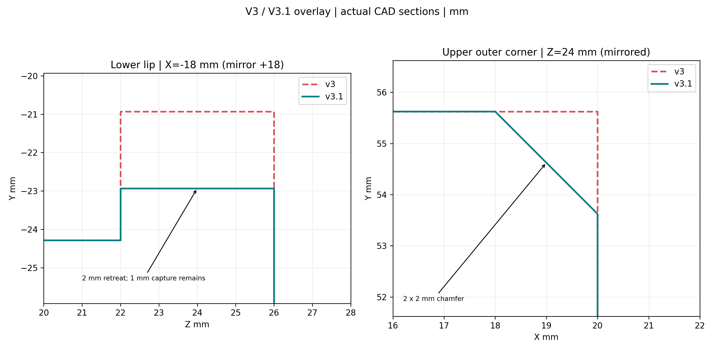

# AF：夹具 v3.1 与 Fusion STEP 编辑入口

基线 `22d1038`。本轮不提交、不部署；未修改 src、兄弟仓库、采集默认场景、8780 或采集台。使用现有 `.local/cad-env`，未安装依赖。计算节点重放使用现有 SAPIEN 3.0.3 环境、资产 0.4.1、CPU/lavapipe；不发送硬件/CAN 命令。

交付目标：Windows `Downloads/gamepad_fixture_v3_1/`。`assembly.step` 为桌面朝上版本，原点位于远端桌边中点，X 沿桌边、Y 向桌外、Z 向上；与之前 table-up 交付约定一致。打印件在 `print/`，用户编辑源在 `edit_table_up/`，两种坐标不可混用。

## 采用的几何

- 下爪前唇局部区域 |X|=10…28 mm，Z=22…26 mm，上沿从下承压基准以上 3 mm 降到 **1 mm**；左右镜像各退让 **2 mm**。默认 `installation.lower_lip_retreat_mm=2`。
- 上爪左右外角作 **2×2 mm 倒角**，仅限前端 Z=22…26 mm。默认 `installation.upper_outer_chamfer_mm=2`。
- 初版沿整条深度作倒角时，打印器在 Pair 孔旁检出 146 个薄壁点，拒绝。最终将倒角限在前端非承压角，没有增加任何豁免。右 RB 的最近点不在该前端角，因此其间隙没有明显改善；不扩大切除来追求数字。
- 承压垫完整形状、宽度、背托、导轨、M8 双剪叉耳和 Hirth 保留。实际分件网格的变化见 [几何对比](geometry_comparison.json)；体积变化仅在两爪。



参数化、装配 STEP、分件装配坐标 STEP、独立 table-up 编辑 STEP、打印 STEP/STL、GLB 和参考手柄都由 `fixture.py` 同一批实体导出。v3 的 `out/` 与 `gamepad_fixture_v3.json` 保留；默认生成器及检查/绘图入口改用 `out_v3_1/`，试验场景为 `configs/workcell/placement_trials/gamepad_fixture_v3_1.json`。

## 硬门与证据边界

实际导出 STL 通过 build volume、实体/网格有效性、装配干涉、所有控件扫掠、壳体间隙、接口开口、左右握把背面空间、三处接触链、切除审计、结构对称/肋板、桌边夹持带、抗扭与锁紧、Hirth 实际齿截面、滑块行程、装配姿态及仿真单位检查。

| 检查 | 最终测量 |
|---|---|
| 抗扭 | 0.46269315 N·m，0.4 N·m 工况安全系数 **1.15673288**，与 v3 同值；没有降低。B 节约 1.122 是更保守表面估计，承压片完整形状保留，该项也不因本次切角下降 |
| 齿盘锁紧 | M8 预紧约750 N，分离安全系数7.79423；估算剪切容量12.9116 N·m |
| 防脱剩高 | 四条实际 STL 射线 X=±16/±24，前唇高1.00000055 mm；中央 |X|<10 保留3 mm |
| 防脱前向对照 | 锁爪、固定朝向，手柄视觉壳沿自身 +Z 扫0…12 mm，步长0.5 mm；初始无交叉，4.5 mm 首遇上爪，7 mm 起同时遇下爪。故不能沿该前向路径直接脱出；不宣称任意六维拔出路径或实物强度已认证 |
| 打印 | 11件 PETG，60k 随机表面点加所有三角形中心；**未豁免标记0**。原 Hirth 边缘/背托凹角豁免和支撑计划保留，没有新增豁免；尚未切片或实打 |
| camera_3 | 所有控制关节极限/中间网格、全视觉顶点投影，444组配置、150304个顶点投影，最小边距111.105 px，四边要求≥20 px；详见 [projection.json](projection.json)。这是投影边界检查，不替代遮挡认证 |

SAPIEN 实际加载 **14 个 cooked 静态网格**。34个已接受控件状态加4个握姿均无夹具接触候选，均有正间隙。原生方法复用 AE 的顶点/面、边/边、边/三角交叉距离，20 mm 截断上限；[输入状态](hand_states.json)保留原覆盖口径，不重新搜索或升级覆盖。

| 状态 | v3 mm | v3.1 mm | 变化 mm |
|---|---:|---:|---:|
| 左 realistic Dpad_right 拇指—下爪 | 4.5652545 | 6.3857449 | +1.8204904 |
| 右 realistic RB 食指—上爪 | 3.2695453 | 3.2695547 | +0.0000094，视为相同 |
| 旧拒绝 Dpad_down 见证 | 0.2135755 | 1.9111662 | +1.6975907，仅诊断，不计入34状态 |

已接受状态全局最小仍约3.26955 mm。新旧末态间隙支持局部退让改善左拇指通道，不证明到达路径顺畅或新动作成功。新证据见 [硬门](checks.json)、[凸块精度](convex_accuracy.json)、[原生间隙](hand_clearance.json)和[汇总](validation_summary.json)，均在本目录保留，完整生成产物位于 `hardware/gamepad_fixture/out_v3_1/`。

## 用户 STEP 覆盖

中文操作见 [USER_EDITING.md](../../../hardware/gamepad_fixture/USER_EDITING.md)。用户从 Downloads 的 `edit_table_up/<part>.step` 编辑，保留 mm、装配原点与坐标，每次导出一个实体。审阅者可执行：

```bash
.local/cad-env/bin/python hardware/gamepad_fixture/user_steps.py /mnt/c/Users/<you>/Downloads/slider_upper_jaw.step --part slider_upper_jaw
.local/cad-env/bin/python hardware/gamepad_fixture/pipeline.py
```

导入复制到 `hardware/gamepad_fixture/user_overrides/`；导入与生成均检查单实体、单位/位置/旋转的明显偏差，不自动对齐。中心偏差>3 mm、尺寸偏差>4 mm 或保留体积<85%拒绝；对称轴转动无法从等价几何辨认。承压垫覆盖须保持完整形状。通过初检后实际替换同名实体，再执行原检查、实际网格导出、凸分解与误差/保护空间检查、新场景与原生手部重放。覆盖件不能使用旧参数化 CSG 或旧背托碰撞残差代替；非覆盖件仅在实际 STL 完全相同时复用基线凸块，且仍重新检查。

流水线用站点 compute profile，在其配置 workspace 下建立独立 run，复制当前源码/config/新资产，调用现有 SAPIEN 环境，明确禁用 CUDA 并用 nice+3000s 超时；不会覆盖共享代码或环境。`manifest.user_overrides` 与 runtime provenance 均记录零件、来源文件名、SHA256和坐标检查指标；正式 v3.1 无用户覆盖。

端到端测试：底板两个后角各作1 mm小倒角，导出 table-up STEP，再经 import→替换→硬门→打印/仿真网格→凸块→场景→原生手部重放。测试文件 SHA256：`ec69ebe7065ac3963e0fa199a05ea9f5ec8eed8815490128a733d7b9a0e8e904`。中心偏差约1.42e−11 mm，保留体积0.999953548。测试覆盖完成后删除；测试记录保留而不带入正式交付。

负例已执行：[坐标错误拒绝测试](coordinate_tests.json)包含平移10 mm、Z旋转90°、缩小1000倍，全部被拒绝。

## 原始依据与复现

采用现有夹具/AE 流程的设计与采样口径，没有引入新机械原理。STEP 交换使用 build123d 官方的 [import_step/Compound/export_step 装配接口](https://build123d.readthedocs.io/en/latest/assemblies.html)，CAD尺寸单位为mm，运行网格转为m。文档支持接口用法，不代表经过 Fusion GUI 实测；本轮 STEP 往返测试由 OpenCascade/build123d 生成和读取，用户实际 Fusion 导出仍须同样通过坐标与几何硬门。

```bash
# 本机 CAD 环境已存在；本轮没有安装依赖。
OPENBLAS_NUM_THREADS=1 OMP_NUM_THREADS=1 .local/cad-env/bin/python hardware/gamepad_fixture/pipeline.py
# 仅重放已生成场景，自动使用配置的计算节点，不调用采集台：
.local/cad-env/bin/python hardware/gamepad_fixture/replay_hands.py --out hardware/gamepad_fixture/out_v3_1 --spec configs/workcell/placement_trials/gamepad_fixture_v3_1.json
```

工作区期间还出现了采集视角、网页、配置与测试的独立并行修改；本任务未写入或回退这些文件，未将其计入 AF 验证。

MuJoCo 多凸块几何硬门：**386块**，最大外扩采样误差1.251921 mm（门≤1.5），最大内缩采样误差0.040937 mm；三处接触面最大误差0.00005871 mm（门≤0.1），保护空间交叠0，所有凸块顶点≤255。这里是面积采样+全部顶点/面中心的误差测量，不冒称连续Hausdorff证明或全局最少分解。

用户覆盖凸块生成首先比较名义 STEP 与替换 STEP 的实际差体。若差体由凸实体组成（本测试为两个三角棱柱），按差体精确切分名义 CSG 凸块，添加体则逐块加入；不丢弃原有孔道。仅当差体不是凸实体时使用 CoACD 0.01 分解，并照常受1.5 mm等硬门约束。微小布尔数值残片沿用现有 CSG 的0.001 mm³过滤阈值；精度门独立检查实际输出。

MuJoCo 原生导入已执行：计算节点现有 `fixed-gamepad-mujoco-py311` 环境实际编译386个夹具mesh geom，数量与凸块一致，见 [编译结果](mujoco_smoke.json)。SAPIEN环境未安装MuJoCo，因此使用已有独立环境，没有新增依赖；仅证明导入/编译，不作动态操作声明。

STEP 端到端测试按生成/硬门与后续导出/重放分阶段执行，复用同一份已通过的替换实体，没有用另一份名义实体代替。节点后续启动曾在Trimesh共享pyc读取上等待；单次绕开缓存后等待移到requests/Trimesh源码，且/proc/pressure/io测得full约65%、some约69%，支持宿主I/O等待而非CAD错误。未修改共享环境或停止其他用户进程；诊断缓存设置不保留为流水线默认。

最终人工STEP端到端测试 **PASS**，详见 [override_test.json](override_test.json)。底板两个后角1 mm倒角经实际差体切分得到15个底板凸块，最大外扩0.935765 mm；整个测试装配387块全部通过误差/接触/保护空间硬门，39条原生重放记录保留原口径，38条已接受状态全部通过；MuJoCo实际编译387个mesh geom，预览与总图生成完毕。中途两次300 s编译因节点I/O读取超时；在I/O压力回落至约5%后，以同一场景、常规缓存和单次600 s上限重试成功，没有放宽任何几何硬门。诊断用缓存绕行不进入默认流水线。

人工覆盖文件已经删除，临时试验spec移入 `out_override_test/test_scene.json` 后从configs删除；正式v3.1 manifest 的user_overrides为空。Downloads包最终77个文件哈希全部一致。未新增依赖、未提交、未部署。软件筛查与名义材料估算不替代用户Fusion确认、切片及实物载荷验证。
