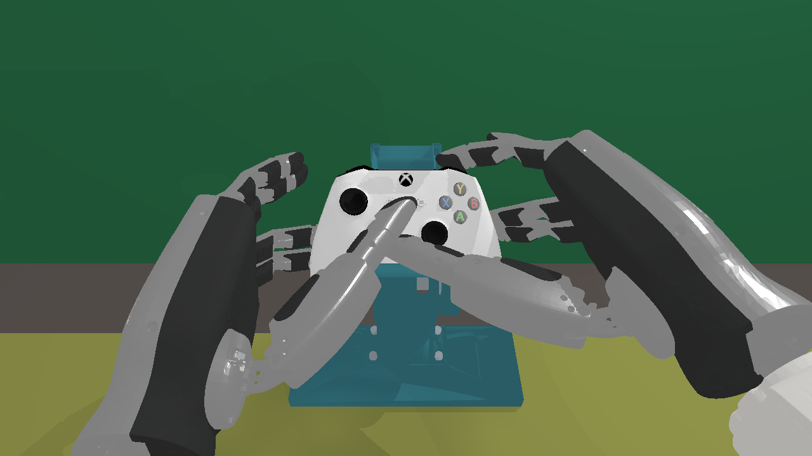
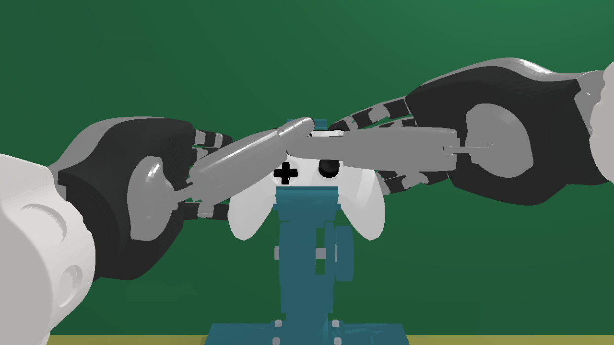
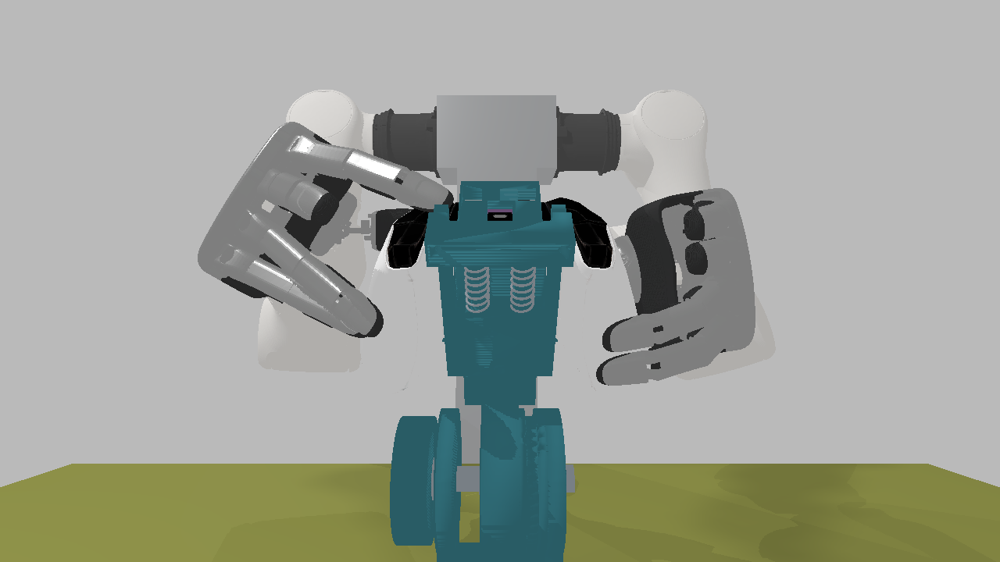
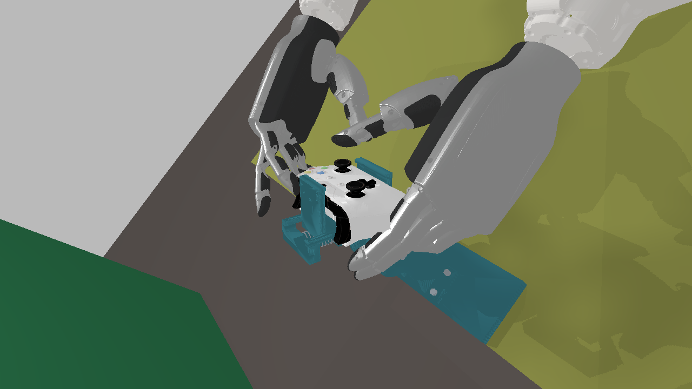
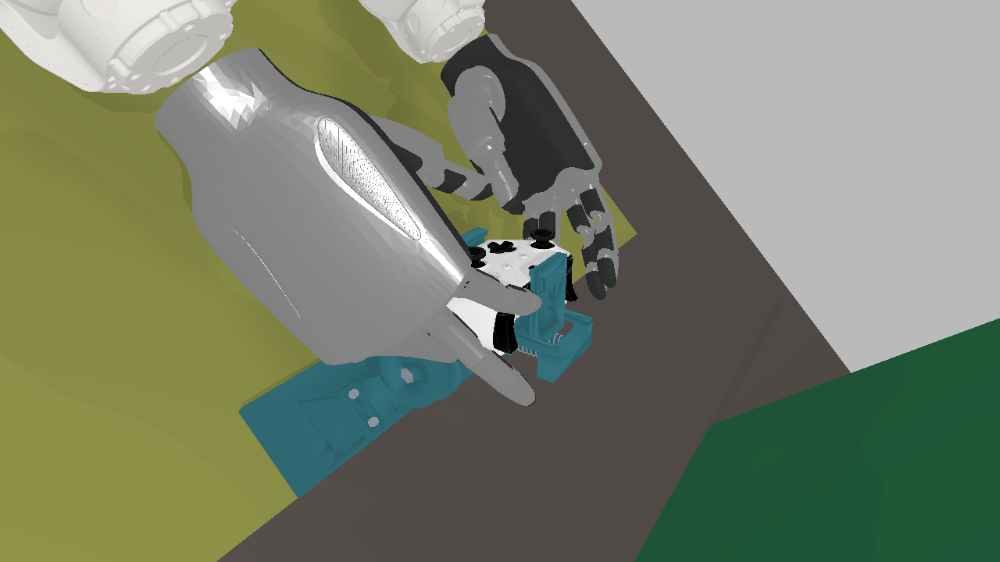
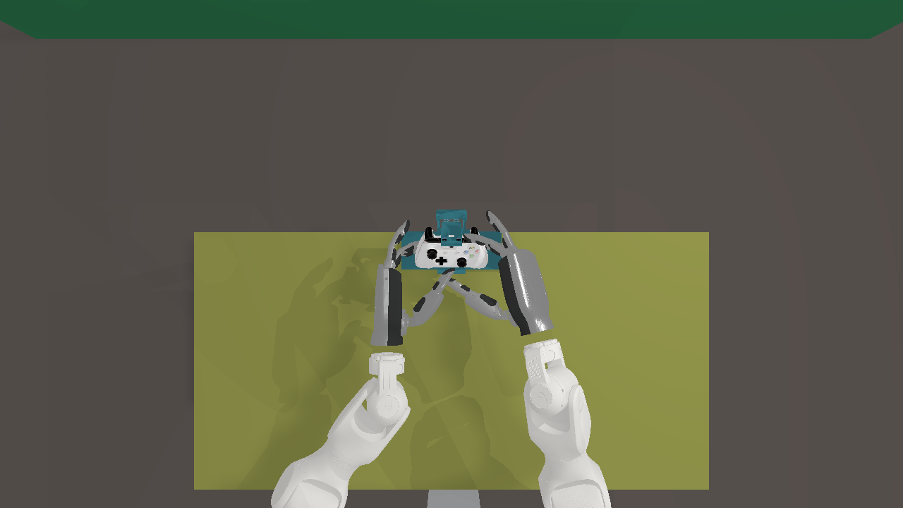

# AE：遥操作辅助视角、场景快照与首次 v3 反馈

> 2026-11-05 AG 更新：[布局与取景修正](../2026-11-05-aux-layout-fix/README.md)将辅助视角改为默认六格全开、浏览器记忆开关并按视口等比缩放。下文的“默认两格 / 原生像素溢出允许滚动”仅记录 AE 当时版本，已被 AG 取代。

A 已实现；B/C 完成离线测量与建议。基线为 `c6165ef`，未 commit、未部署采集台，未改 CAD、兄弟仓库或生产手部增益。手柄与支架位置保持不变。

推荐默认值：**主图 1280×720 / 60 fps，辅助流 1920×1080 / 20 fps**；默认打开 Button face 和 Overview。计算节点实测默认两格为 **59.55 / 20.01 fps**，六格全开为 **58.80 / 19.59 fps**（主/辅）。1920 主图和 2560 辅助流的更高成本组合未满足主图约 60 fps，因此不作为默认值。

## A：使用方法与实现

在原采集网页的 Positioning view controls 工具栏勾选各相机。camera_3 独立显示，主图没有 overview 或其他画中画；实际信号示意图移到单独的折叠区域。辅助图分别是按键正面、前方接近、背面、左右斜侧和俯视。取消勾选关闭该窗格；多个页面的需求取并集，最后一个页面关闭某相机后才停止该相机拍照。全部关闭时辅助渲染暂停。点击任意窗格放大，再点或按 Esc 恢复。

主/辅窗格间 margin、gap、padding、border 均为 0，无圆角或阴影。小号半透明相机名叠在角落，控制按钮在视频区外。网页按原生像素显示，窄窗口允许横向滚动，不将多个原生窗格缩成小图。

配置入口：[operator_view.yaml](../../../configs/render/operator_view.yaml)，修改后重启仿真：

```yaml
collection_main:
  width: 1280
  height: 720
auxiliary:
  width: 1920
  height: 1080
  fps: 20
```

辅助流为无间隙 3×2 格：1920×1080 使用六个原生 640×540 相机；2560×1440 的三列宽度为 853、853、854，每格高 720。各相机直接按格子尺寸和宽高比渲染，没有先缩小再放大、黑边或居中填充。主相机升至 1920×1080 时同比缩放原标定 K。

前五个相机以 spec 的手柄坐标系计算位置、目标和 up；Overview 随手柄平移，保持世界竖直俯视。前方相机在 v3 中位于手柄中心之上约 10 cm。左右侧相机经过实际双手握姿的三组对照，选用局部 `[±.34,.24,.20] m`，避开原来几乎覆盖整个画面的手背；对照图及观察见 [B/C 报告](BC.md#侧相机确实经过实际画面修改)。

实现继续使用 `operator_view → SapienBackend → robotwin.create_scene/load_into_scene → teleop Latest mmap → NVENC → WebCodecs`。主流和辅助流使用独立渲染进程，共用已有场景/外观加载与状态应用逻辑；六个辅助相机拼成一路流，网页分格显示。辅助视角不进入 episode，schema 不变。新增 mmap 大小按实际分辨率分配，生产默认不保存逐帧日志或推流。

### fps 与编码延迟矩阵

以下为计算节点空闲 GPU 0（RTX 4090）上的实际 SAPIEN 3.0.3、资产 0.4.1、NVENC 和 WebSocket 测量；每例预热后约 20 s。输入为 60 Hz 的合成完成状态，含小幅手指运动，**不是实际 ROS/物理控制循环或采集台性能验收**。完整汇总见 [fps-summary.json](fps-summary.json)。

“编码延迟”从读取 raw mmap、准备送入编码器起，到完整 H.264 访问单元可发送止，包含排队、管道传输和上游 AU 解析器等待边界的时间；不是纯 NVENC 内核耗时，也不是传感器端到端延迟。帧率按编码帧的单调时钟计算。

| 主图原生尺寸 | 辅助流尺寸 / 目标 fps | 开启相机 | 主 fps | 辅 fps | 主编码 P50/P95 ms | 辅编码 P50/P95 ms |
|---|---|---|---:|---:|---:|---:|
| 1280×720 | 1920×1080 / 20 | 全关 | **60.04** | 0.00 | 24.89/31.42 | —/— |
| 1280×720 | 1920×1080 / 20 | 六格全开 | **58.80** | 19.59 | 32.87/46.12 | 81.12/99.61 |
| 1280×720 | 1920×1080 / 30 | 六格全开 | **58.58** | 19.15 | 32.31/46.15 | 79.57/101.31 |
| 1280×720 | 2560×1440 / 20 | 六格全开 | **56.03** | 16.23 | 35.67/53.41 | 113.55/139.29 |
| 1280×720 | 2560×1440 / 30 | 六格全开 | **56.32** | 16.36 | 34.51/52.98 | 108.81/137.46 |
| 1920×1080 | 1920×1080 / 20 | 全关 | **51.06** | 0.00 | 39.29/56.13 | —/— |
| 1920×1080 | 1920×1080 / 20 | 六格全开 | **23.55** | 16.04 | 90.81/125.21 | 106.52/136.43 |
| 1920×1080 | 1920×1080 / 30 | 六格全开 | **24.11** | 16.32 | 85.28/135.83 | 100.20/136.10 |
| 1920×1080 | 2560×1440 / 20 | 六格全开 | **23.79** | 13.39 | 90.18/128.89 | 137.88/177.99 |
| 1920×1080 | 2560×1440 / 30 | 六格全开 | **26.47** | 14.13 | 80.94/113.71 | 125.60/155.87 |
| 1280×720 | 1920×1080 / 20 | overview | **58.79** | 19.95 | 31.51/44.82 | 79.11/95.52 |
| 1280×720 | 1920×1080 / 20 | face+overview | **59.55** | 20.01 | 28.08/40.75 | 74.83/91.04 |
| 1280×720 | 1920×1080 / 20 | face+front+back | **59.62** | 20.04 | 29.31/41.61 | 74.34/90.64 |

辅助目标从 20 提到 30，并没有使六格达到 30 fps；提高目标频率不等于实际获得更快反馈。主图 1920 的所有测量均低于 60 fps。默认 1280 主图和 1920/20 辅助流保留图像清晰度并满足本次“约 60 fps”目标；采集台恢复后仍需在其 GPU、实际 ROS 输入和录制同时运行时复测。

最初的 float32 Color 回传短测只有约 41 fps 主流、14 fps 辅流；限制 OpenCV 线程的对照没有改善。将同一个 raster 显示目标改为 RGBA8 后恢复接近目标帧率，减少了浮点回传和 CPU 量化。没有更换场景或渲染器。CPU lavapipe 下对同一冻结场景比较 float32→RGB8 与原生 RGBA8，逐像素差为 **0**，见 [颜色对照摘要](color-check-summary.json)。这个对照支持组合优化有效，没有单独量化传输与量化各自贡献。

### 30 秒倒计时场景快照

网页点击 **Snapshot in 30 s**，可填 Label 和 Delay；默认 30 s，可在倒计时阶段取消。所有页面通过 SSE 显示同一待拍任务；同时只允许一个任务，重复申请返回 409。录制状态不限制拍照，快照不写入 episode，也不发送机器人控制命令。

期限到达时，服务只读取一次最新完成状态，冻结双臂、双手 G20、手柄关节/信号及最近输入。独立辅助进程按这份状态逐相机渲染，不再步进物理。**camera_3 和全部六个辅助相机都分别生成 PNG，关闭的窗格也拍。** 不取网页截图、NVENC 帧或拼图裁剪。默认每张 1280×720；实际尺寸取快照配置与主图尺寸的较大值。临时原生相机逐张释放，避免持续保留七组全分辨率目标；挂载相机只卸载相机组件，不移除机器人实体。

保存到 `station.data_root` 下的 `snapshots/<date>/<time>_<label>/`。配置键为 `snapshots.delay_s/width/height/max_bytes`，默认单份 **64 MiB**；出图失败或超限不发布残缺快照。

| 文件 | 内容 |
|---|---|
| `state.json` | 同一完成帧的双臂、双手、手柄关节/信号、实际执行目标和输入序号 |
| `inputs.json` | 最近四路手电机/主臂原始消息、转换值、消息头、接收时钟与年龄；不伪造缺失消息 |
| `camera_3.png`、六个 `aux_*.png` | 七个相机独立原生拍照 |
| `scene-spec.json` | 原始场景 spec，摘要位于 meta |
| `meta.json`、`render-result.json` | 时间、标签、映射版本、代码版本/源文件摘要、手柄/夹具世界矩阵、每相机尺寸、K、双向光学外参及出图时钟 |

当前采集源没有订阅手套 `raw_nodes/ergonomics`，在 meta 中明确标记 unavailable。四路最近消息并非同步传感器采样，其各自时间戳/年龄与实际执行目标分别保留。七张图片的实际出图时钟不同，但使用同一冻结几何状态。

在采集台本机、现场开启远程控制后可用：

```bash
python scripts/collection_ctl.py status --json
python scripts/collection_ctl.py snapshot --label "left_stick"
python scripts/collection_ctl.py snapshot-cancel
python scripts/collection_ctl.py snapshots --json
python scripts/collection_ctl.py snapshot-get "$SNAPSHOT_NAME" --output /tmp/reference-pose
```

API 为 `POST /api/v1/snapshot`、`POST /api/v1/snapshot/cancel`、`GET /api/v1/snapshots` 和 `GET /api/v1/snapshots/{name}`；追加文件名即可下载原图或 JSON。写权限、同源检查、远程开关与审计沿用现有规则；成功只读请求不写审计。审阅者也可按 API 返回的 path 复制整目录。完整使用与字段说明见[采集 API](../../usage/collection-api.md#场景倒计时快照)。

重启前实际 Chrome/原生管线验证已完成 30 s 倒计时、取消、全窗格关闭后七图拍照与 CLI 下载。该份真实 SAPIEN 快照共 **966643 B**，读取的状态年龄约 **4.95 ms**；七图出图跨度约 **669 ms**，期间几何状态冻结。它使用假输入源，不是现场参考位姿。示例：[主图原始 PNG](images/snapshot-example/camera_3.png)、[前方原始 PNG](images/snapshot-example/aux_front.png)、[快照摘要和七相机参数](snapshot-summary.json)。其余原文件在完整归档中。

## B：实际阅图与夹具瘦身建议

[逐图观察表、对照图及尺寸建议](BC.md#b逐图观察)保留了所有 19 组、133 张原图的观察结果；公开目录只精选必要原图，完整原图已归档。本轮没有新的姿态搜索或动态操作成功声明。

- SAPIEN 实际 14 个 cooked 静态网格，重放 34 个控件状态、4 个握姿，另加一个旧拒绝 Dpad_down 见证，共 39 条。
- 已接受状态没有夹具接触候选；最近为右 RB 食指—上爪 **3.2695 mm**、左 Dpad_right 拇指—下爪前唇 **4.5653 mm**。背托、导杆、叉耳、齿盘等在这些状态中均至少 20 mm；这里是截断下界。
- 旧 Dpad_down 见证在新网格下为 **0.2136 mm 正隙**，PhysX 候选 separation 也是正值；不能沿用旧盒子近似的 0.11 mm 穿透结论，也不能据此升级原覆盖结果。

建议 v3.1 先做两个局部候选：**下爪前唇在左拇指通道退让 2 mm，上爪非承压外角做 2 mm 倒角**。保留完整承压垫足迹/宽度、背托、导轨、M8 双剪叉耳和 Hirth 锁紧结构。原抗扭估算只有约 1.122 裕量，不能整体缩窄承压垫来换空间。所有建议都须在用户确认改 CAD 后重新通过原抗扭、锁紧、防脱和打印硬门；当前没有新 CAD 或实物承载认证。末态有间隙不证明到达末态的路径畅通。

以下均为计算节点 CPU/lavapipe 的独立原图，展示 RB 姿态；每格可打开原始 1280×720 PNG：

| 正面 | 前方 | 背面 |
|---|---|---|
|  |  |  |
| 左斜侧 | 右斜侧 | 俯视 |
|  |  |  |

## C：L3/R3 原因与修复选项

完整条件、48 例参数对照、实际杆角与分层结论见 [B/C 报告](BC.md#c摇杆按下条件与轴向分力)及 [bc-summary.json](bc-summary.json)。

L3/R3 是沿倾斜摇杆自身轴向的 0…0.4 mm 直线关节；返回刚度 18500 N/m，目标预压 −6 µm。资产输出连续行程比例，没有统一数字闭合阈值。网页默认 **20%** 亮灯只对应 **0.080 mm**，准静态弹簧反力约 **1.591 N**；80%/95% 则分别约 6.031/7.141 N。显示亮灯不能直接当成实物触点闭合。

在左摇杆第 6 向的诊断插值中，生产增益 240/60 产生轴向接触峰值 **21.632 N**、稳态中位 **10.807 N**，L3 满行程。`gamepad-contact` 与 full 对照逐点相同，且没有夹具/桌面接触，因此这个复现不依赖夹具碰撞。`force_limit=60` 是每个转动关节的 **N·m** 上限，不是指尖 60 N。该轨迹没有准确跟踪目标杆角，不是八向操控成功证明。

按成本排序的建议：

1. 单独校准显示用 L3/R3 阈值，保留原始连续量；可减少浅压亮灯，不能消除已满按的例子。
2. 离线单变量调拇指增益/力矩上限，同时验收杆角、接触保持及故意点击；本轮降低参数能降压力，但最软组合出现杆角反向，不能直接采用。
3. 改变指腹接近方向与杆帽接触点，减少轴向分力，保持资产机械参数再做对照。
4. 需要数字采集标签时显式定义阈值/迟滞；给资产的进一步建议应基于目标实物的力—位移及触点测量，不直接增加刚度掩盖问题。

[ALPS 原厂参考元件](https://tech.alpsalpine.com/e/products/detail/RKJXV122400R/)为 **7.4±3 N**、**0.4(+0.5,−0.3) mm**，也是资产参数来源。未找到能核对到用户这只 Xbox One S / Model 1708 整机的公开力曲线；组件料号匹配也未确认，不能冒称实物已测。没有首次遥操轨迹，尚不能量化网页阈值、姿态及 PD 各自造成的误触比例。

## 验证与证据范围

- WSL 重启后的本地定向测试：**84 passed，4 skipped**，跳过原因是本地最小环境缺 PIL/aiohttp/cv2；未安装依赖。
- 同一组测试在计算节点现有 SAPIEN 环境重跑：**91 passed**，包括 API/SSE 权限、倒计时/取消、并发、大小上限、录制状态兼容、1280/1920 原生七相机独立出图与临时组件释放、辅助 1920/2560 像素覆盖、关闭不拍照和 CLI 下载。
- 重启后真实 Chrome 对当前完整 HTML/CSS/JS、空闲 API 测试夹具重测布局：8 处相邻边界 **0 px**；原生像素尺寸、零 margin/gap/padding/border、按钮在窗格外、放大恢复、关闭隐藏均通过。该复测不包含 H.264；真实双流/原生快照验证在重启前完成。
- 全部公开图片保留原始 PNG 像素，未缩放重压；尺寸/散列/保留相机参数见 [image-summary.json](image-summary.json)。
- 本轮任务进程已核对退出，GPU 0 无计算进程、0% 利用率、16 MiB；没有停止其他用户进程。公开内容检查结果及复测记录见 [validation-summary.json](validation-summary.json)。

## 归档与复核

公开目录仅保留 README、B/C 观察、必要原图及汇总 JSON，不留 `bc-data/`、`data/`、逐步轨迹、原始状态、脚本或 pycache。完整资料已移到忽略目录 **`.local/teleop-feedback-ae-20261105/full-report/`**；真实七图快照原文件在 **`.local/teleop-feedback-ae-20261105/snapshot-example/`**。

计算节点工作区还保留 `runs/teleop-feedback-ae-a-20261105/` 和 `runs/teleop-feedback-ae-bc-20261105/`，包括隔离代码、矩阵样本、原始轨迹及实验脚本。本地归档脚本需恢复到隔离代码副本原报告相对位置后执行，避免改变原仓库或采集台。

采集台恢复后，由审阅者按现有 `sync_tree.py` 整树同步并核对哈希，再复测真实输入+录制时的帧率、窗格关闭与七相机快照，确认录制持续增长及四路消息完整性。本任务没有部署，也没有执行任何硬件或 CAN 命令。

## 设计依据

复用 [SAPIEN 相机接口](https://sapien-sim.github.io/docs/api/sapien.sensor.html)与 [WebCodecs VideoFrame](https://www.w3.org/TR/webcodecs/)；原生 RGBA8 显示目标适配参考 [ManiSkill 的 SAPIEN 3.0 shader 配置](https://github.com/mani-skill/ManiSkill/blob/main/mani_skill/render/shaders.py)。这些资料支持接口与格式选择；实际性能、像素一致性、碰撞和力的结论分别来自本报告测量，不由文档或单元测试推断操作成功。
