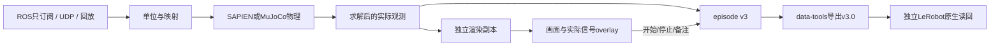

# 双手双臂参考轨迹采集

本入口采集手套和 LinkerTA 主臂驱动的仿真参考轨迹，不接游戏策略。SAPIEN CPU PhysX 与 MuJoCo 输出同一 episode v4（继续读取 v2/v3）。当前验收状态以[任务 L 报告](../reports/2026-10-22-collection-platform/README.md)为准；代码存在和短测通过不代表 L1/L2 通过。采集台安装及不连接硬件的验收见 [M1 报告](../reports/2026-10-22-station-install/README.md)。



## 环境与资源

场景使用 `configs/workcell/station_g20_v4_4.json`，保持手柄固定方式和装置不变。右手使用与 L25/right 一致的资产；安装采用对称假设，episode meta 标记 `assumed`。右手不是从左手网格临时镜像生成。

安装本项目及来源资产的方法见[复现说明](../reproduce.md)；网格和转换资产在配置的工作区，不在公开仓库。机器地址、设备、站点路径放在忽略的私有站点配置，或以 `GAMEPAD_VLA_SITE_CONFIG` 指向 `.local/` 内配置。不要把运行目录复制进 Git。

现有环境分工：

| 环境 | 用途 |
|---|---|
| `envs/sapien-3.0.3-py310` | SAPIEN 物理和可选 GPU 渲染；不装 pyarrow/LeRobot |
| `envs/fixed-gamepad-mujoco-py311` | 修补 MuJoCo 物理、CPU/GPU 渲染；推流需要 aiohttp 3.14.5；不装 pyarrow/LeRobot |
| `envs/data-tools-py310` | PyArrow 数据转换和直接写出 LeRobot |
| `envs/lerobot-check-py310` | 仅 LeRobot 原生读回，lerobot 0.4.0、CPU PyTorch |

新建 MuJoCo 环境仍用 `scripts/setup_fixed_gamepad_env.sh`，锁定依赖包含 aiohttp。已有 MuJoCo 环境仅补这一包的授权版本。不要用普通 MuJoCo 替换 `3.16.0+concon.sdf3689.2`。

专用读回环境：

```bash
source scripts/site_settings.sh
bash scripts/setup_lerobot_check_env.sh
```

该脚本仅向专用环境安装 `lerobot==0.4.0` 及其传递依赖。固定版本[源码](https://github.com/huggingface/lerobot/blob/v0.4.0/src/lerobot/datasets/lerobot_dataset.py)声明 `CODEBASE_VERSION="v3.0"`，与采集快照一致；0.4.0 是包版本，v3.0 是数据格式。先用上交镜像直连；脚本失败即保留日志，只有确认直连失败后才显式传 `--proxy URL` 重试，不静默切换路由。

## 采集台仅仿真联调

**本节是 M2 现场手册，M1 没有执行以下硬件输入启动步骤。** M1-c 的真实 rclpy 无损和延迟重测已通过，数值及剩余验收状态以 M1 报告为准。 由用户在场并另行授权后执行。命令依据采集台 `~/workstation/README.md` 第 5–7 节、`~/workstation/START.md` 的 Manus/LinkerTA 终端说明，以及安装中的 `linkerta/launch/run.launch.py`、`config/lta.yaml`。站点私有入口为 `~/gamepad_vla/code/.local/`。M1 的域 87 及测试话题仅用于合成输入验收，真实手套/主臂联调按现场批准的域执行，不直接复用 M1 测试发布器。

不启动 `linker_hand_ros2_sdk`、`linker_hand_double`、任何 `rokae_*`、相机、策略 bridge 或 command mux。所谓“只读”臂状态节点也会给臂上电。不要运行整套 GUI/launch、CAN 扫描、`twin_calib_record.sh` 或 neutral 服务；本模式不需要从臂状态或手 SDK。软件停止无法给电机下电。

### 现场预检和环境

确认没有手 SDK、珞石节点、旧遥操或策略进程；若存在，先由现场人员按其流程处理。保留启动前的 `nvidia-smi`：没有其他 CUDA 计算任务、显存 <4 GiB 且利用率 <30% 时可用。常驻 Xorg、gnome-shell、Firefox、RobotAssist 图形进程允许共存，不关闭或干扰它们；退出后显存应回到测试前水平。LinkerTA 的安装配置 `~/workstation/ros2_ws/install/linkerta/share/linkerta/config/lta.yaml` 必须是 `calibration: 0`；源配置在 `~/workstation/linkerhand-tele-arm-main/src/linkerta/config/lta.yaml`。M1 已只读核对安装配置为 0，现场仍须复核，不修改或重新标定。

每个 ROS 终端先加载私有站点配置和已存在的工作空间（不使用 conda base）：

```bash
cd ~/gamepad_vla/code
export GAMEPAD_VLA_SITE_CONFIG="$PWD/.local/station.json"
source scripts/site_settings.sh
source "$STATION_ROS_SETUP"
source ~/workstation/ros2_ws/install/setup.bash
export ROS_DOMAIN_ID="${M2_ROS_DOMAIN_ID:?填写现场批准的ROS域}"
export ROS_LOG_DIR="$GAMEPAD_VLA_WORKSPACE/logs/m2-ros"
export ROS_HOME="$GAMEPAD_VLA_WORKSPACE/cache/ros"
```

Humble 使用系统 Python 3.10；M1 venv 未启用 system-site-packages，通过 ROS setup 加入 Humble 的 Python 路径。不要用 Python 3.11 加载 Humble 的 rclpy。所有日志和临时文件应指向安装根目录。

### 只启动输入链

终端 1，Manus 手套发布器：

```bash
ros2 run manus_ros2 manus_data_publisher
```

终端 2，左右手重定向：

```bash
ros2 run linkerhand_retarget handretarget --ros-args \
  -p motion_type:=manus_dex -p enabled_hands:=left,right -p calibration:=false
```

`enabled_hands` 参数已从站上源码核对，显式启用两侧，避免配置默认只启用右手。保持站上现有 G20 双手重定向配置，不调用串口扫描或校准模式。

终端 3，LinkerTA 主臂输入：

```bash
ros2 launch linkerta run.launch.py
```

该 launch 仅启动 `linkerta_node`，读取安装配置，默认约 100 Hz。**标定开关始终为 0**。该输入节点会访问主臂 CAN，属于 M2 硬件输入授权范围，M1 没有运行。

### 话题核对

| 话题 | 现场核对 |
|---|---|
| `/manus_glove_0` 及现场实际第二路手套话题 | 手套左右归属正确；不把 0/1 编号当作固定左右 |
| `/cb_left_hand_control_cmd`、`/cb_right_hand_control_cmd` | `sensor_msgs/msg/JointState`；position 恰好 20 路、0–255 电机值；两侧持续更新，约 100 Hz |
| `/left_arm_joint_control`、`/right_arm_joint_control` | JointState；position 恰好 7 路、单位度；约 100 Hz；小幅动作方向正确 |
| `/cb_*_hand_state`、`/rokae/*`、相机话题 | 本模式不要求这些话题；确认没有为了补齐它们而启动硬件节点 |

使用 `ros2 topic info --verbose <话题>`、`ros2 topic echo <话题> --once`、`ros2 topic hz <话题>` 逐项核对；这些检查也必须使用现场批准的域。数采平台对四路指令只建立 subscription，不创建指令 publisher。输入消息的完整性门槛仍以 M1 报告为准，不能仅凭话题存在认定无丢失。

### 启动仿真与本机浏览器

终端 4，加载前述环境后：

```bash
cd ~/gamepad_vla/code
export PYTHONPATH="$PWD/src${PYTHONPATH:+:$PYTHONPATH}"
export XDG_CACHE_HOME="$GAMEPAD_VLA_WORKSPACE/cache"
export TMPDIR="$GAMEPAD_VLA_WORKSPACE/tmp"
export CUDA_VISIBLE_DEVICES="${M2_CUDA_VISIBLE_DEVICES:?先确认符合GPU共享规则再指定}"
"$GAMEPAD_VLA_WORKSPACE/envs/sapien-3.0.3-py310/bin/python" scripts/run_collection.py \
  --backend sapien --source ros2 --duration 600 --rate-hz 60 --realtime \
  --view --record --host 127.0.0.1 --port 8780 \
  --output "$GAMEPAD_VLA_WORKSPACE/runs/m2-session-$(date +%Y%m%d-%H%M%S)"
```

在采集台本机浏览器打开 `http://127.0.0.1:8780/`；检查画面、左右手臂指令/实际值、实际信号 overlay、开始/停止和备注。上例预览端口只监听回环。`--rate-hz 60` 是控制与观测采样率；约 100 Hz 的原始输入另由独立 FIFO 完整录制，不能把控制帧数当作消息数。画面速度和链路完整性以独立验收为准。输出目录每次唯一。

### 停止和急停

1. 浏览器“停止录制”，确认 episode 已完成；采集终端 Ctrl+C，等待仿真和渲染子进程退出。
2. 重定向 Ctrl+C，再停止 Manus 发布器和 LinkerTA；对 `ros2 launch` 所在终端 Ctrl+C 并等待子节点退出。
3. 用 `pgrep -a -f 'run_collection\.py|manus_data_publisher|handretarget|linkerta_node'` 检查；只结束本次启动的 PID，复查 GPU 回到基线。

需要软件停止时，仓库入口为 `bash scripts/station/stop_collection_sim.sh`；若 launch 子节点仍在，回到其终端 Ctrl+C 并检查 `linkerta_node`。现有站点急停脚本是 `bash ~/gamepad_vla_estop/estop.sh`，M1 仅核对其存在，未执行。它只能停止进程，**不能下电**；若发现真实手臂上电或运动，由现场人员使用 RobotHMI 或控制柜电源处理。不要通过启动珞石节点来“查询是否上电”。

同台运行 MuJoCo 时，ROS Humble 的 Python 3.10 与现有 MuJoCo wheel 的 Python 3.11 必须分开：可让 ROS 3.10 的 `forward_collection.py --host 127.0.0.1` 向本机 UDP 转发，MuJoCo 3.11 用 `--source udp --udp-host 127.0.0.1` 接收，端口取同一私有配置；仍不启动 SDK/从臂。若选择 MuJoCo 3.10 直接 `--source ros2`，需先准备同源修补的 CPython 3.10 wheel 并单独验证，本轮未构建或测试该部署组合。

主臂转换先加左右 90°偏置，再做源节点的绝对限位与启动姿态附近限幅，最后换成 rad。当前启动参考明确采用场景的左右 `home_q`，默认 margin=3°、max_delta=60°、启动姿态限幅开启；这不是读取真实从臂启动姿态。原始度数与最终目标分别记录。若未来使用其他 startup reference，需明确配置并保存到 meta，不能暗中替换。状态和 LeRobot 最终动作目标不走此变换。

## 远程仿真

采集台以后仅启动上述三个输入链，并运行订阅转发器：

```bash
python scripts/station/forward_collection.py
```

它只订阅、发送 UDP，不发布 ROS，不启动 SDK 或从臂。目标地址读私有 `udp.peer_host/port`；主臂报文携带 `representation="master-deg"`，由仿真端按其显式 startup reference 转换一次。无此标志的历史 `arm_command` 保持从臂 rad 语义。

计算节点另用独立代码副本运行：

```bash
source scripts/site_settings.sh
export PYTHONPATH="$PWD/src${PYTHONPATH:+:$PYTHONPATH}"
export CUDA_VISIBLE_DEVICES=""
"$GAMEPAD_VLA_WORKSPACE/envs/sapien-3.0.3-py310/bin/python" scripts/run_collection.py \
  --backend sapien --source udp --duration 600 --realtime --record \
  --output "$GAMEPAD_VLA_WORKSPACE/runs/collection-remote"
```

监听地址、源地址 allowlist 与 NAT 后的源地址配置在私有 `udp` 字段中；远程输入需要监听相应接口，不能保持仅回环配置。默认 0.25 s 没有新包则不再提交该路旧指令，仿真保持上一个执行器目标。源时间戳与 Unix/单调时钟不是同一时域，不能相减声称端到端延时。

## ROS 指令日志与真实回归测试

ROS 接收使用独立 SingleThreadedExecutor 线程持续 spin，每路 reliable/keep-last 深度为 128，能够缓存约 1.28 s 的 100 Hz 消息。回调把每一条原始 JointState 放入线程安全 FIFO，控制环不再负责 spin。录制期间主线程持续排空 FIFO，结束时先停止接收线程，再排空并关闭日志。控制仍以最新值零阶保持，过期路保留此前执行器目标。

新 episode schema 为 **v3**，旧 v2 可读；v2 本身没有原始接收事件，不能补称无损：

| 文件/字段 | 含义 |
|---|---|
| `commands.jsonl` / `raw` | 每条收到的原始 name、position、velocity、effort；保留 float64，不取整 |
| `commands.jsonl` / `header` | 原始 sec/nanosec 整数与 frame_id，不依赖浮点秒辨别消息 |
| `received_monotonic_ns`、`received_wall_time_ns` | 接收时的两种时钟；单调时钟适用于同机延迟 |
| `converted_command` | 该消息按协议取整/限幅、映射后的候选目标；并非每条都被控制环选中 |
| `steps.jsonl` / `commands`、`input_sequences` | 该拍实际执行器目标及其接收事件序号；两拍之间被更新值覆盖的消息依然在原始日志里 |
| `applied_monotonic_ns` | 设置完目标的单调时钟；渲染 `frames.jsonl` 另存编码完成时间与应用→编码延迟 |

真实 ROS 回归测试在已加载 Humble、兼容 Python 3.10 的环境中运行：

```bash
export ROS_DOMAIN_ID=87 ROS_LOCALHOST_ONLY=1 GAMEPAD_VLA_TEST_ROS2=1
python -m pytest -q tests/test_ros2_collection_integration.py
```

测试仅在 `/gamepad_vla_test/` 前缀发布 JointState；需要显式的非默认域。没有 rclpy 或未显式启用时会跳过，不能把跳过当作链路通过。采集台验收使用同一测试逻辑，加 SAPIEN 和 8 月数据：

```bash
source ~/gamepad_vla/code/.local/runtime.sh
"$P" scripts/check_ros2_collection.py --backend sapien --duration 60 \
  --replay "$W/data/august/states.npz" --output "$W/runs/ros-check-$(date +%Y%m%d-%H%M%S)"
```

8 月记录没有原始主臂度数：该传输测试只把最终从臂 rad 换成度数测试向量，再走现有映射，不能声称恢复原始主臂轨迹。无损按原始消息日志计数；发布→应用只对实际选中的最新指令计算，明确列出分母，不要求控制环执行全部 100 Hz 历史目标。

## 画面与开始、停止、备注

加 `--view` 启动独立渲染进程，浏览器地址由私有 operator 配置的 host/port 决定，默认使用回环。SAPIEN 渲染需要空闲且获授权的 GPU；CPU 物理保持 `CUDA_VISIBLE_DEVICES=""`，需要渲染时再显式选择可用卡。MuJoCo CPU 画面可设置：

实时画面建议加 `--rate-hz 60 --realtime`；渲染目标上限 60 fps，只处理新的实际状态，不重复旧状态凑帧。源物理记录只有 30 Hz 时，不能据此声称画面有 ≥30 fps 的稳定余量；SAPIEN 的实际 ≥30 fps 仍必须测量。

```bash
export CUDA_VISIBLE_DEVICES="" MUJOCO_GL=egl PYOPENGL_PLATFORM=egl LIBGL_ALWAYS_SOFTWARE=1
```

MuJoCo 使用其 Python 3.11 运行同一入口，将 `--backend` 改为 `mujoco`。原生 640×480 CPU 渲染较慢，见报告实测速率；物理、记录不等待渲染。网页使用 MJPEG，避免 CPU 模式依赖 NVENC；保留现有推流的独立物理/渲染结构与 latest-state 策略。

画面上的虚拟手柄复用用户手柄仓库的 overlay：摇杆、扳机、按钮行程来自**已完成的物理求解**。网页 overlay 与该渲染帧引用同一份实际状态；`overlay`、32 维 `gamepad_signal` 和 available mask 同时保存在 episode。非实体通道不因向量有 32 维而变成可用控件。按钮保持资产连续行程显示，未另外引入未测闭合阈值。

`--record` 立即开始一个 episode；省略时先预览。浏览器点击“开始录制”“停止录制”“添加备注”。终端支持逐行输入 `start`、`stop`，其他文本作为备注，按 Enter 提交。每次 start→stop 产生一个独立目录，重启不能覆盖已有输出。

可选勾选“显示指令与实际值”查看双手、双臂对比。录制按物理采样保存，不受浏览器帧率影响。浏览器控制已排入队列与实际 recording 状态是两回事，以状态栏和 episode 元数据为准。

## 回放与导出

先在数据工具环境将已存在的站点快照转换为原始 54 维 NPZ；该步骤不会访问采集台：

```bash
"$GAMEPAD_VLA_WORKSPACE/envs/data-tools-py310/bin/python" scripts/export_station_episode.py \
  /path/to/local-station-dataset --output "$GAMEPAD_VLA_WORKSPACE/runs/august-export"

"$GAMEPAD_VLA_WORKSPACE/envs/sapien-3.0.3-py310/bin/python" scripts/run_collection.py \
  --backend sapien --source replay --replay "$GAMEPAD_VLA_WORKSPACE/runs/august-export/states.npz" \
  --loop-replay --duration 300 --record --output "$GAMEPAD_VLA_WORKSPACE/runs/collection-replay"
```

回放也可传自己的 v2/v3 episode 目录，按其 meta.fps 控制网格调度指令；引擎量化后的观测时间不当作指令事件时间。NPZ 校验双臂 rad、双手 motor_0_255 及单一源 episode，并保留原时间戳。8 月 action 为从臂最终目标，不能反推主臂原始度数：对应字段保存 null。`--loop-replay` 明确允许重复短样本，以原速度和零阶保持循环；循环总时长不等于新的独立数据覆盖量，结果记录循环计数。

```bash
"$GAMEPAD_VLA_WORKSPACE/envs/data-tools-py310/bin/python" scripts/export_lerobot.py \
  "$GAMEPAD_VLA_WORKSPACE/runs/collection-replay/episode-000000" \
  --output "$GAMEPAD_VLA_WORKSPACE/runs/collection-lerobot"

"$GAMEPAD_VLA_WORKSPACE/envs/lerobot-check-py310/bin/python" scripts/check_lerobot_export.py \
  "$GAMEPAD_VLA_WORKSPACE/runs/collection-lerobot"
```

导出默认包含状态 56 维（臂 14、模型手关节 42，均 rad）、动作 54 维（从臂目标 14 rad、实际应用的手电机协议值 40）、手柄实际信号及 mask 各 32、世界位姿 84。和源站点 54 维电机状态不同，状态明确标为模型关节角。关节顺序、单位和源 episode meta 一起保存。

LeRobot 的 `timestamp` 使用均匀采样网格；实际引擎时间和 Unix 纳秒另外保存为特征，不用网格时间掩盖两引擎离散步长差。导出要求每行都有已知双臂最终目标和手电机协议指令，缺失时明确报错，不把模型实测反算成原始电机。ROS 原始浮点精度保存在源 episode 的 `commands.jsonl`，LeRobot 的均匀采样 action 是实际应用的协议值，不把事件日志合并伪装成逐消息动作。

图像可选：用 `--video /path/to/aligned.mp4` 加入与每条物理记录逐帧对齐、帧数和 fps 完全一致的视频。异步预览可能掉帧，不能直接拿预览录像冒充逐物理帧相机流；没有对齐视频时导出数值数据即可。

## 停止与故障排查

正常停止录制用网页或终端 `stop`；退出采集程序用 Ctrl+C。软件急停：在运行输入/仿真的机器本地执行 `bash scripts/station/stop_collection_sim.sh`，发送中断并停止输入进程。它不联网、不启动 SDK、不切断电源，不等于硬件急停。既有站点物理急停脚本不是本轮执行项；若真实节点意外运行，须由现场人员使用已批准的硬件急停流程。

| 现象 | 核查 |
|---|---|
| 找不到 rclpy | 用 Humble 系统 Python ABI，source ROS 和输入工作空间，再检查 venv 对系统包的可见性 |
| UDP 无输入 | 核对私有监听接口、端口、路由、NAT 后源地址 allowlist；检查 decode_errors，不猜测为映射问题 |
| 臂突然偏 90° | 核对 master-deg 与 slave-target-rad 标签；最终目标和状态不能再加主臂偏置 |
| 两后端位姿不同 | 先比较实际关节，再核对相同 v4.4、左右安装、指尖参考点、实际仿真时钟；保留接触分类 |
| MuJoCo EGL 失败 | 同时设 MUJOCO_GL=egl、PYOPENGL_PLATFORM=egl；CPU 模式设 LIBGL_ALWAYS_SOFTWARE=1，日志应显示 Mesa llvmpipe |
| 浏览器慢但录制正常 | 独立渲染允许丢弃旧预览状态；查看 view/frames.jsonl，不用浏览器帧数推断物理采样数 |
| 导出报缺指令 | 先确认该 episode 的两臂两手都收到有效输入，不能填零或用实测补成动作 |
| 中断 episode 无法读回 | 保留 steps.jsonl 和 meta.json；当前严格读取器会拒绝行数不一致，不自动把残缺记录当完整采集 |

L1/L2 使用 `scripts/check_collection.py`。按审阅者裁决 2，门槛回放命令必须加 `--scene-variant free-space`：由代码关闭台面、手柄、立柱及固定物的环境碰撞，机器人、安装、驱动和原有自碰撞设置不变，v4.4 JSON 不改。完整场景用默认 `--scene-variant full`，接触及误差只报告，不用于门槛。两个后端都调用 `workstation/contact.py` 的同一距离≤0判据，记录区间所有子步的 OR。门槛失败即停止，不自动调参重跑；自由空间样本不加“稳态”筛选。报告必须列明自由空间/接触分母、P95、循环次数及未执行项。8 月数据与当前场景的几何不匹配，因此不能从完整场景接触误差推断无接触运动学一致性。

完整场景接触回放较慢时，可显式加 `--mujoco-workers 8` 使用引擎原生 CPU 线程池；默认 1，不改变物理步长或求解器参数。线程数记入 episode meta。只增加线程不保证实时，具体速度仍应实际测量。

## 本机采集网页与程序控制（任务 N）

**N1 与采集台 N2 已通过。** 本轮以 replay 和隔离的 ROS 合成输入验收；数值、分母与限制见[任务 N 报告](../reports/2026-10-22-collection-web/README.md)。验收服务已退出，需要使用时由现场人员启动。

由旁边助手操作网页；戴手套、握主臂的操作者不碰网页。加载本站私有运行环境后，用现有 SAPIEN Python 启动 `scripts/collection_server.py`，本机打开 `http://127.0.0.1:8780/`。服务拒绝非回环绑定。参数、错误与 Codex 语音操作流程见 [collection-api.md](collection-api.md)。原 `run_collection.py` 的参数与终端方式继续保留。

网页从 `collection` 站点配置读取后端、场景、输入源、回放文件、时长（null 为不限）、采样率和回放循环设置。`replay_files` 是可选文件列表；`output_root` 指定数据盘目录；`export_python` 指向独立 data-tools 环境。私有路径留在 `.local/`，不要写入公开配置。既有会话结束后才能启动下一个；回看也占用唯一仿真会话。

大号录制状态显示未录制、红色录制中与计时、保存中、检查中、带编号的检查通过或失败。快捷键 R 开始、S 停止、N 聚焦自由备注；在输入框中不拦截字母。页面不提供动作提示。常驻 ego 画面叠加**实际**信号 overlay，显示实测帧率及应用→编码延迟；低于 30 fps 或 P95 超过 50 ms 变色。

左右手、左右臂分别显示实测频率、消息年龄、累计条数和解码错误；从未收到或年龄超过 0.25 s 告警。ROS 录制开始会拒绝不健康的通道，用户明确 force 才能绕过，并将 forced 和当时健康写入 meta。臂限幅显示侧和关节；v4 新增每侧 absolute/startup 七位布尔标志，未知为 null，不从最终目标反推限幅。旧 v2/v3 仍可回放。

每个完整性结果包含所属的完整 episode_id 和 pending/running/passed/failed 状态；新段开始清除旧段当前结果。停止后显示保存中→检查中→带编号的检查通过/失败；网页驱动和 CLI 均按停止返回的编号等待，None 或非终态继续等，超时失败。停止录制后严格读回，检查独立接收计数与日志数量、连续序号、行数与物理时长及时间边界。检查结果保存为 `integrity.json`，CLI `record-stop --wait` 等待它。旧数据缺少独立计数时不冒称通过。episode 列表提供回看、旁路作废标记与现有 LeRobot 导出；作废只写 `discarded.json`，不删除或修改原始数据。数据盘剩余不足 10 GiB 告警。导出解释器缺失或导出失败会显示原因，不安装依赖。

安全横幅每 1 s 按程序身份只读检查进程；仅匹配路径组成部分或 ROS 包名前缀，shell 和搜索工具参数里的检查文本不算硬件节点。检测到手 SDK 或珞石匹配进程时变红并显示进程。它不终止任何进程，不阻止仿真操作。页面只提示 `~/gamepad_vla_estop/estop.sh` 的位置及其不能下电，不调用它。“停止采集与仿真”只结束服务自己创建的进程，不按名称结束桌面或外部输入节点。

远程控制每次服务启动默认关闭，助手在网页明确开启后，Codex/CLI 才可执行写操作。SSE 同步各客户端状态和最近 10 条控制事件；断线自动重连并先拉完整状态。GET 始终允许，所有 API 操作追加审计。现场硬件输入启动步骤仍按上面的 M2 手册执行，网页与 API 不提供硬件启动、急停或下电。

任务 P 将采集画面统一回 `operator_view` 的 teleop mmap/独立孪生渲染/NVENC 管线，移除 MJPEG 自建场景。主画面可在标定 camera_3 与原操作者虚拟视角之间切换，手柄资产固定 v0.4.1；现场域 88、临时抬高场景及 gamepad-contact 的确切服务命令见 [API 现场启动说明](collection-api.md#采集画面与现场启动)。输入节点仍由现场人员的 `~/gamepad_vla/m2/start.sh` 启动。
